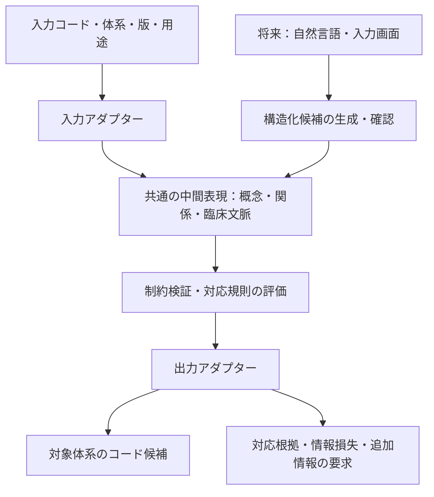

# MedDSL（仮称）

医療コード体系間の翻訳・対応付けを入口に、臨床概念を共通の中間表現で扱うための実験プロジェクト。

**現在は非公開での立ち上げ段階です。** この README は暫定版で、実装・対応表・外部マスターはまだありません。名称、言語仕様、技術スタックは今後の調査と試作で見直します。

## 何を目指すか

最初は、対象を絞ったコード変換で「何が対応し、何が失われ、何の追加情報が必要か」を確認できる道具を作ります。その経験をもとに、解剖部位・病態・原因・修飾・臨床文脈を組み合わせられる内部モデルを育てます。

長期的には、傷病名に加えて所見、検査、処置、薬剤なども扱える基盤を探ります。「全ケースへの対応」は研究目標であり、現時点での保証ではありません。

## 基本構想



内部の中間表現を中心に置き、外部の分類・用語体系との接続をアダプターとして分ける方針です。人間による DSL の手入力を必須にせず、まずコード入力からの変換を検討します。

## 設計の出発点

- **原情報を保つ。** 入力コード、体系、版、用途、出典を保持し、変換で得られた情報と区別します。
- **対応の限界を返す。** 完全一致、出力先の方が広い／狭い、一部重複、候補複数、対応なしを区別します。不明な属性を推測して埋めません。
- **臨床文脈を独立させる。** 疑い、否定、既往、家族歴、時間、対象者を扱い、同じ病名でも異なる意味を保持します。
- **構文と意味を分ける。** 型検査や構文検査だけで医学的妥当性を保証せず、用語体系の制約、対応根拠、人による評価を組み合わせます。
- **外部用語を分離する。** 外部マスターは利用者が取得したものを取り込む構想です。取り込み・対応表・配布の条件は体系ごとに確認します。
- **網羅性と実用性を測る。** 表現できる症例の幅に加えて、変換の正確性、情報損失、確認負担、再現性を評価します。

## 最初の試作候補

候補は ICD-10 と ICD-11 の限定領域での**一方向の変換**です。対象国・版・用途・データ入手条件を調べたうえで、領域と方向を確定します。両方向の変換や完全な可逆性は前提にしません。

最初の試作では、コード入力に対して候補と根拠を返し、不足情報や未対応を明示できることを重視します。独自 DSL のパーサー、自然言語処理、画面は後続の検討項目です。

将来の接続候補には SNOMED CT、MEDIS、LOINC、国内レセプト電算体系があります。FHIR はデータ交換や対応表の表現の候補として別途検討します。いずれも未対応です。

## リポジトリ構成

```text
.
├── AGENTS.md             # 開発時の方針
├── docs/
│   ├── architecture.md   # 中間表現と変換結果の設計メモ
│   ├── research.md       # 先行仕様・研究の調査入口
│   └── roadmap.md        # 調査項目・決定事項・各段階の完了条件
├── packages/README.md    # 将来の実装分割案
└── examples/README.md    # 架空例と評価ケースの方針
```

実行環境や依存パッケージはまだ設定していません。`package.json` は名前と `private: true` のみを管理する初期メタデータです。次の作業は [調査フェーズのロードマップ](docs/roadmap.md) を参照してください。

## 調査と検証

会話で挙がった先行プロジェクトと設計仮説は [調査メモ](docs/research.md) に整理しています。既存の仕組みとの差、複合概念の扱い、変換の限界、利用条件を一次資料で確かめてから仕様を固めます。

調査は、利用場面の定義、既存方式の比較、データ入手条件、対象と評価方法、最小の内部モデル、試作仕様の順で進めます。各段階で調べること・決めること・完了条件を残し、具体例で必要性を確認してから実装に進みます。

## 非公開運用・権利

本リポジトリは private で運用します。`package.json` の `private: true` は npm への誤公開を防ぐ設定で、GitHub の公開範囲は別に管理します。

ソースコードの公開・再配布ライセンスは未決定です。MIT などの公開ライセンスは現段階では採用しません。外部コード、名称、定義、対応表の利用条件はそれぞれ確認し、許諾を確認するまでは同梱しません。患者情報や業務上の非公開マスターをコミットせず、例には架空データを使います。

研究・設計段階の成果物であり、診断・治療・保険請求に利用できる実装や検証結果はありません。
