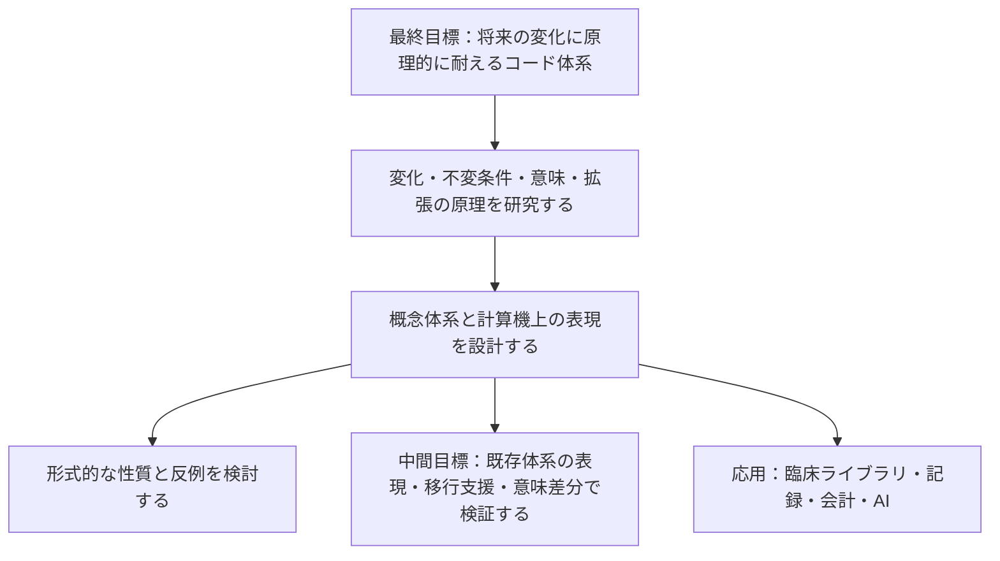

# MedDSL（仮称）

**未来永劫、原理的に変化に耐えうる医療コード体系を確立するための研究プロジェクト。** 医学・制度・システム・AI の変化を受け止める、意味の表現と拡張の原理を探ります。

**現在は非公開での調査・試作段階です。** P1-d まで進め、有限予測、役割付き事象、モデル被覆の反例、限定した合成の認定を実装しました。[共通台帳による総合評価](docs/research/15-p1-d-results.md) で P1 全20条件・80 JSON・417必須パスと、別枠の P0 全22条件を照合済みです。開発テスト231件が通過しています。[独立レビュー計画書](docs/research/16-review-plan.md)、12の証明義務と追加監査8テストを整備しました。続いて AI による単独の内部レビュー（裁定者・指摘者・レビュアーが同一）を最後まで実施し、契約版 `p0-draft-2` として指摘 RV-01〜RV-08 を処理しました（[内部実施の完了記録](docs/research/17-internal-run-ai-001.md)）。独立レビューは未実施で、外部の協力が得られた時点で G0 から再開します。未確認だった経路の追加検査（[18](docs/research/18-additional-checks-ai-001.md)）を行い、次の段階 P2「意味能力の拡張契約」の研究設計（[19](docs/research/19-p2-design.md)）を作成しました。P2-a として、既存の handler 10件に拡張契約の宣言を後付けし、登録・非干渉・再検証範囲の検査を実装しました（[実行契約](docs/research/20-p2-a-contract.md)、[結果](docs/research/21-p2-a-results.md)。独立確認前。防護例のない義務が24件残り、新しい意味能力の追加（P2-b）は未着手です）。認定は既知の十分条件に限り、一般の保存判定、体系全体・変換器・実対応表は未完成です。取得済みの外部資料は Git 管理外です。名称、言語仕様、技術スタックは調査と試作で見直します。

## 何を目指すか

最終目標は、将来の変化を原理的に受け止められる**コード体系そのもの**の確立です。新しい概念や関係、知識の修正、記録の目的、実装が変わっても、表現を拡張し、既存の意味を追跡できる仕組みを研究します。

| 位置付け | 目指すこと |
| --- | --- |
| 最終目標 | 将来の変化に耐えうるコード体系の原理と仕様を確立する |
| 基礎研究・設計 | 変化の種類、保つ性質、意味の表現、拡張と互換性の仕組みを定義する |
| 中間目標 | 既存体系の表現、移行支援、意味の保持・喪失・追加の監査を通じて設計を検証する |
| 応用・普及 | 臨床ライブラリの整備・標準化、医療者の操作と接続先の分離、AI と共有できる情報整理を実現する |

移行支援・意味差分の監査は中間目標です。対象を絞った例で「何が対応し、何が失われ、何が追加され、その根拠は何か」を調べ、体系の表現能力を検証します。移行ツールが動くことだけでは、最終目標を達成したとは判定しません。

特定の既存体系の粒度に固定しない概念体系を設計し、その計算機上の表現として中間表現を検討します。何を不変とし、どの変化をどの仕組みで受け止めるかを先に研究します。コアを固定する範囲と、コア自体の改訂を扱う方法も研究対象です。

傷病名に加えて所見、検査、処置、薬剤などの領域、将来の医療者・システム・AI の利用を初期設計から考慮します。「全ケースへの対応」と永続性は研究目標であり、現時点での実現・証明を意味しません。目標と検証範囲の関係は [最終目標と設計原則](docs/vision.md) に定めます。

素のコードや DSL を医療者が直接操作する運用は前提にしません。開発・保守で扱う内部表現と、臨床ライブラリ・画面で提供する操作を分け、初期設計から拡張性・普遍性を要件に置きます。操作を変えずに接続できる範囲は、入力情報と接続先の要求を比較して検証します。

この応用目標は、**医療者の入力・操作をフロントエンド、会計コードや各種分類コードなどの出力先への接続処理をバックエンドとして、共通の意味表現を介して分離する**構想とも説明できます。入力や根拠付きの補助情報で出力先の要求を満たせる範囲で、接続先の変更を医療者の操作変更から切り離すことを目指します。[入力と出力先の分離](docs/vision.md#応用目標入力と出力先の分離) に、このアナロジーの位置付けと条件を記します。

## 基本構想



体系そのものの原理と、外部の分類・用語体系への接続を分けて研究します。医療者による DSL の手入力を必須にせず、臨床ライブラリや AI から利用できる表現を目指します。基礎モデルは研究用に選定し、具体的な形式仕様・実装はこれから定めます。

## 設計の出発点

- **原情報を保つ。** 入力コード、体系、版、用途、出典を保持し、変換で得られた情報と区別します。
- **人と AI が根拠を共有する。** 観察・記録、臨床判断、機械的な導出、AI の生成候補と、人による確認状態を区別します。特定の AI モデルやベンダーに共通の意味を依存させません。
- **追加の根拠を追う。** 既存情報の明示化、補助情報による追加、根拠を確認できない追加を区別します。意味を解釈できない部分は比較不能として残します。
- **対応の限界を返す。** 完全一致、出力先の方が広い／狭い、一部重複、候補複数、対応なしを区別します。不明な属性を推測して埋めません。
- **臨床文脈を独立させる。** 疑い、否定、既往、家族歴、時間、対象者を扱い、同じ病名でも異なる意味を保持します。
- **構文と意味を分ける。** 型検査や構文検査だけで医学的妥当性を保証せず、用語体系の制約、対応根拠、人による評価を組み合わせます。
- **外部用語を分離する。** 外部マスターは利用者が取得したものを取り込む構想です。取り込み・対応表・配布の条件は体系ごとに確認します。
- **網羅性と実用性を測る。** 表現できる症例の幅に加えて、変換の正確性、情報損失、確認負担、再現性を評価します。

## 中間目標としての検証候補

初期の検証材料には、RxNorm CPC の二つの月次版と FHIR Procedure の二版の定義を [R3](docs/research/03-data-access.md) で選定しました。[R4](docs/research/04-evaluation.md) で、最初の中間実験を CPC 2026-09-08 → 2026-10-05 の薬剤概念の版更新監査に定めました。FHIR は構造・文脈の変化を扱う補助材料です。これを基盤全体の仕様や成功条件にはしません。

ICD-10 → ICD-11 も候補に残していますが、独自体系開発という目的に対する利用条件と、版を固定した対応資料の確認が必要です。WHO・LOINC 等の内容の取り込みを保留する範囲は [R3 の条件整理](docs/research/03-data-access.md) に記録しました。

移行実験では、コードと変換候補に対して意味の差分と根拠を返し、不足情報や比較不能を明示できることを重視します。対象コードだけで伝わる情報と、原情報を別に保持しているから復元できる情報を区別します。独自 DSL のパーサー、自然言語処理、画面は後続の検討項目です。

将来の接続候補には SNOMED CT、MEDIS、LOINC、国内レセプト電算体系があります。FHIR はデータ交換や対応表の表現の候補として別途検討します。いずれも未対応です。

## リポジトリ構成

```text
.
├── AGENTS.md             # 開発時の方針
├── docs/
│   ├── vision.md         # 最終目標、目的の階層、変化に耐えるための研究方針
│   ├── architecture.md   # 体系の原理・拡張・中間用途の設計メモ
│   ├── research.md       # 先行仕様・研究の調査入口
│   ├── research/
│   │   ├── 01-use-case.md # R1：最終目標と中間用途、意味差分の例
│   │   ├── 02-landscape.md # R2：既存方式・研究・実装の一次比較
│   │   ├── 02-sources.md  # R2：出典、参照版、確認範囲
│   │   ├── 02b-change-model.md # R2b：変化・不変条件・拡張原理
│   │   ├── 02b-cases.md   # R2b：14 件の机上例・反例
│   │   ├── 02b-sources.md # R2b：一次資料と実際の確認範囲
│   │   ├── 03-data-access.md # R3：資料選定・版・利用条件
│   │   ├── 03-sources.md  # R3：一次資料と確認範囲
│   │   ├── 03-materials.json # R3：資料の版・実測ハッシュ・取得状態
│   │   ├── 03-acquisition.md # R3：実ファイルの取得・初期照合の結果
│   │   ├── 04-evaluation.md # R4：原理・中間用途の評価設計、D04・D05
│   │   ├── 04-cases.md     # R4：14 原理ケースと架空 40 ケースの期待結果草案
│   │   ├── 04-material-probes.md # R4：実資料の部分追跡と再現方法
│   │   ├── 04-sources.md   # R4：一次資料と確認範囲
│   │   ├── 05-model-study.md # R5：三案の比較と基礎モデルの研究用選定
│   │   ├── 05-principles.md # R5：保存の十分条件・意味引き継ぎの導出
│   │   ├── 05-sources.md   # R5：一次資料の追加確認と限界
│   │   ├── 06-prototype-brief.md # R6：試作範囲・構成・着手判断
│   │   ├── 06-p0-contract.md # R6：P0 の意味・入出力・22 受入条件
│   │   ├── 07-p0-a-results.md # P0-a：初期実装の実行記録
│   │   ├── 08-p0-b-results.md # P0-b：定義認定・推論・反例の検証
│   │   ├── 09-p0-c-results.md # P0-c：確認・訂正・未知能力の検証
│   │   ├── 10-p0-d-results.md # P0-d：比較・全22ケースの草案評価
│   │   ├── 11-p1-design.md # P1：意味能力・コア改訂の研究設計
│   │   ├── 11-p1-contract.md # P1：意味・回答・履歴の引き継ぎ契約
│   │   ├── 11-p1-cases.md # P1：20受入条件の草案
│   │   ├── 11-p1-sources.md # P1：一次資料と実際の確認範囲
│   │   ├── 12-p1-a-contract.md # P1-a：有限予測の実行形式・能力・上限
│   │   ├── 12-p1-a-results.md # P1-a：7条件の照合と制限
│   │   ├── 13-p1-b-contract.md # P1-b：事象化・読み戻し・役割表の問い合わせ
│   │   ├── 13-p1-b-results.md # P1-b：6条件の照合と有限検査の制限
│   │   ├── 14-p1-c-contract.md # P1-c：モデル反例・合成・可用性の契約
│   │   ├── 14-p1-c-results.md # P1-c：7条件の照合と限定した認定
│   │   ├── 15-p1-d-contract.md # P1-d：共通台帳・実体固定・評価契約
│   │   ├── 15-p1-d-results.md # P1-d：全20条件の総合照合・認定範囲
│   │   ├── 16-*.md        # 独立レビューの計画・証明義務・様式、AI-001 の記録
│   │   ├── 17-internal-run-ai-001.md # AI による内部レビューの完了記録と再開点
│   │   ├── 18-additional-checks-ai-001.md # compare・split_roles・Python 3.11 の追加検査
│   │   ├── 19-p2-design.md # P2：意味能力の拡張契約の研究設計
│   │   ├── 20-p2-a-contract.md # P2-a：宣言の書式・登録・再検証範囲の実行契約
│   │   └── 21-p2-a-results.md # P2-a：10件の後付け・非干渉・限界
│   └── roadmap.md        # 調査項目・決定事項・各段階の完了条件
├── scripts/research/     # ローカル資料の初期検査・R4 の部分追跡・P0/P1 評価
├── src/med_dsl/          # P0/P1 のライブラリ・固定仕様・JSON CLI
├── extensions/          # P2-a：拡張契約の宣言10件と索引（作成者草案）
├── tests/               # 架空資料の情報保持・棄権・境界の検証（review/ はレビュー系列、p2/ は拡張契約）
├── packages/README.md    # 将来の実装分割案
└── examples/            # 架空例と評価ケースの方針
    ├── README.md
    ├── p0/              # P0 の 37 JSON 例と草案のハッシュ台帳
    ├── p1/              # P1 の8設計例。設計用形式は実行不可
    ├── p1-a/            # 有限予測の31実行例・草案ハッシュ台帳
    ├── p1-b/            # 事象への引き継ぎの22実行例・草案ハッシュ台帳
    ├── p1-c/            # 反例・合成・可用性の27実行例・草案ハッシュ台帳
    ├── p1-evaluation/   # 全20条件とP0回帰の共通台帳・固定実体
    ├── audits/          # 追加監査の例
    └── review/          # レビュー負例系列（別の分母）
```

P0/P1 は Python 3.11 以降・標準ライブラリ・JSON を使い、Python 3.14.4 と 3.11.17（conda-forge のビルド）で全テスト系列と評価を実行しました（[18](docs/research/18-additional-checks-ai-001.md)）。他のパッチ版・ビルド・OS は未確認です。外部パッケージのインストールは不要です。リポジトリのルートで実行します。

```bash
PYTHONPATH=src python3 -m med_dsl --fixture examples/p0/definition-extension.json
PYTHONPATH=src python3 -m med_dsl --fixture examples/p0/definition-entailment.json
PYTHONPATH=src python3 -m med_dsl --fixture examples/p0/linked-observations.json
PYTHONPATH=src python3 -m med_dsl --fixture examples/p0/assertion-revision.json
PYTHONPATH=src python3 -m med_dsl --fixture examples/p0/projection-compare.json
PYTHONPATH=src python3 -m med_dsl --fixture examples/p1-a/finite-forecast.json
PYTHONPATH=src python3 -m med_dsl --fixture examples/p1-a/correlated-forecast.json
PYTHONPATH=src python3 -m med_dsl --fixture examples/p1-b/reify-events.json
PYTHONPATH=src python3 -m med_dsl --fixture examples/p1-b/linked-observations.json
PYTHONPATH=src python3 -m med_dsl --fixture examples/p1-b/split-witness.json
PYTHONPATH=src python3 -m med_dsl --fixture examples/p1-c/coverage-countermodel.json
PYTHONPATH=src python3 -m med_dsl --fixture examples/p1-c/event-renaming-chain.json
PYTHONPATH=src python3 -m med_dsl --fixture examples/p1-c/lossy-composition.json
python3 -m unittest discover -s tests
python3 -m unittest discover -s tests/review
python3 -m unittest discover -s tests/p2
python3 scripts/research/check-extensions.py
python3 scripts/research/evaluate-p0.py --cli
python3 scripts/research/evaluate-p1-a.py --cli
python3 scripts/research/evaluate-p1-b.py --cli
python3 scripts/research/evaluate-p1-c.py --cli
python3 scripts/research/evaluate-p1-d.py --cli
```

`--fixture` は草案例の request だけを処理し、expected を推論へ渡しません。`package.json` は名称と非公開設定等の初期メタデータです。次の作業は [ロードマップ](docs/roadmap.md) を参照してください。

## 調査と検証

会話で挙がった先行プロジェクトと設計仮説は [調査メモ](docs/research.md) に整理しています。既存の仕組みとの差、複合概念の扱い、変換の限界、利用条件を一次資料で確かめてから仕様を固めます。

調査は、目標の定義、既存方式の比較、変化に耐える原理の調査、検証資料の確認、評価方法、内部モデル、試作仕様の順で進めます。原理上保つ性質と、具体例で検証できた範囲を区別します。

[R1：目的と中間用途の定義](docs/research/01-use-case.md)、[R2：既存方式の一次比較](docs/research/02-landscape.md)、[R2b：変化・不変条件・拡張原理の基礎調査](docs/research/02b-change-model.md) を整理済みです。R2b では変化を 8 種類に分け、不変条件の候補 8 項目、設計案 3 案、14 件の例・反例をまとめました。既存の意味を保つ拡張と、意図して知識・定義を改訂する操作を分けて比較します。

[R3](docs/research/03-data-access.md) で初期材料を選定し、[4 ファイルの取得・初期照合](docs/research/03-acquisition.md) を完了しました。[R4](docs/research/04-evaluation.md) では、原理の評価契約、架空ケース 24+16 件、比較方式・指標・工学的最低条件を策定し、[実資料も部分追跡](docs/research/04-material-probes.md) しました。期待結果は独立確認前の草案で、公開済みの例による回帰評価と未見版の追加評価を区別します。

[R5](docs/research/05-model-study.md) で三案を比較し、不変な定義参照、役割付き事象・文脈付き主張を基礎とする構成を研究用に選定しました。通常の定義追加、意味能力の追加、コアの改訂を別の契約で扱います。[保存原理](docs/research/05-principles.md) に、条件内の定義追加、有限回の合成、役割付き表現への意味引き継ぎの小さな導出を記録しました。

[R6 の試作仕様](docs/research/06-prototype-brief.md) と [P0 契約](docs/research/06-p0-contract.md) を定め、[P0-a](docs/research/07-p0-a-results.md) に続き [P0-b](docs/research/08-p0-b-results.md) を実装しました。S1/S2 の保存認定、単項包含・連言定義による推論、根拠追跡、確認・時点・訂正の選択が動作します。[P0-c](docs/research/09-p0-c-results.md) では未知能力の停止元・衝突の両根拠を具体化し、18 ケースの草案を整えました。続いて [P0-d](docs/research/10-p0-d-results.md) で compare を実装し、全22ケースを37 JSON で具体化しました。116 件の開発テストが通過し、作成者草案の22/22ケース・指定チェック221/221と、API/CLI の一致・再実行を確認しました。独立確認と R4 の実行評価は未完了です。

[P1 の研究設計](docs/research/11-p1-design.md) と [引き継ぎ契約](docs/research/11-p1-contract.md) で、20受入条件・8設計JSONを用意しました。[P1-a](docs/research/12-p1-a-results.md) は型付き有限予測、[P1-b](docs/research/13-p1-b-results.md) は事象化・原履歴・有限回答を実装しました。[P1-c の実行契約](docs/research/14-p1-c-contract.md) と [7条件・27 JSON・126必須パスの照合結果](docs/research/14-p1-c-results.md) では、モデル被覆の反例、既知条件による合成の認定、射影の喪失、原保存と再実行の可用性を区別します。有限一致だけで認定せず、保証範囲を明記します。次は P1-d の全20条件の共通台帳・固定・総合評価です。独立レビュー、完全な形式仕様、永続性全体の証明、臨床変換の実証は未完了です。HAPI FHIR と ROBOT は後続の中間用途で再評価します。

## 非公開運用・権利

本リポジトリは private で運用します。`package.json` の `private: true` は npm への誤公開を防ぐ設定で、GitHub の公開範囲は別に管理します。

ソースコードの公開・再配布ライセンスは未決定です。MIT などの公開ライセンスは現段階では採用しません。外部コード、名称、定義、対応表の利用条件はそれぞれ確認し、許諾を確認するまでは同梱しません。患者情報や業務上の非公開マスターをコミットせず、例には架空データを使います。

研究・設計段階の成果物であり、診断・治療・保険請求に利用できる実装や検証結果はありません。
