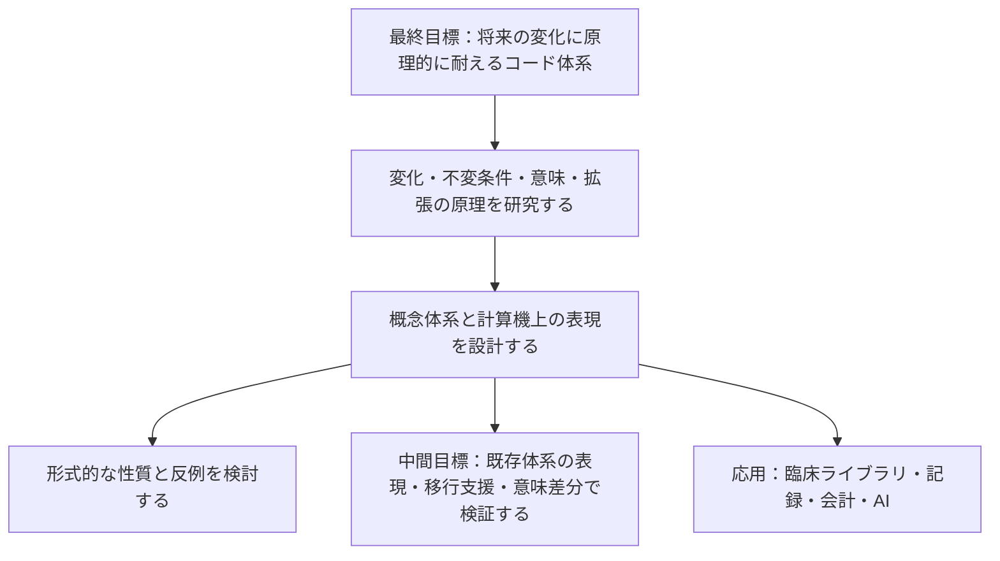

# MedDSL（仮称）

**未来永劫、原理的に変化に耐えうる医療コード体系を確立するための研究プロジェクト。** 医学・制度・システム・AI の変化を受け止める、意味の表現と拡張の原理を探ります。

**現在は非公開での立ち上げ段階です。** この README は暫定版で、実装・対応表・外部マスターはまだありません。名称、言語仕様、技術スタックは今後の調査と試作で見直します。

## 何を目指すか

最終目標は、将来の変化を原理的に受け止められる**コード体系そのもの**の確立です。新しい概念や関係、知識の修正、記録の目的、実装が変わっても、表現を拡張し、既存の意味を追跡できる仕組みを研究します。

| 位置付け | 目指すこと |
| --- | --- |
| 最終目標 | 将来の変化に耐えうるコード体系の原理と仕様を確立する |
| 基礎研究・設計 | 変化の種類、保つ性質、意味の表現、拡張と互換性の仕組みを定義する |
| 中間目標 | 既存体系の表現、移行支援、意味の保持・喪失・追加の監査を通じて設計を検証する |
| 応用・普及 | 臨床ライブラリの整備・標準化、医療者の操作と接続先の分離、AI と共有できる情報整理を実現する |

移行支援・意味差分の監査は中間目標です。対象を絞った例で「何が対応し、何が失われ、何が追加され、その根拠は何か」を調べ、体系の表現能力を検証します。移行ツールが動くことだけでは、最終目標を達成したとは判定しません。

特定の既存体系の粒度に固定しない概念体系を設計し、その計算機上の表現として中間表現を検討します。何を不変とし、どの変化をどの仕組みで受け止めるかを先に研究します。コアを固定する範囲と、コア自体の改訂を扱う方法も研究対象です。

傷病名に加えて所見、検査、処置、薬剤などの領域、将来の医療者・システム・AI の利用を初期設計から考慮します。「全ケースへの対応」と永続性は研究目標であり、現時点での実現・証明を意味しません。目標と検証範囲の関係は [最終目標と設計原則](docs/vision.md) に定めます。

素のコードや DSL を医療者が直接操作する運用は前提にしません。開発・保守で扱う内部表現と、臨床ライブラリ・画面で提供する操作を分け、初期設計から拡張性・普遍性を要件に置きます。操作を変えずに接続できる範囲は、入力情報と接続先の要求を比較して検証します。

## 基本構想



体系そのものの原理と、外部の分類・用語体系への接続を分けて研究します。医療者による DSL の手入力を必須にせず、臨床ライブラリや AI から利用できる表現を目指します。具体的な仕様・実装は未決定です。

## 設計の出発点

- **原情報を保つ。** 入力コード、体系、版、用途、出典を保持し、変換で得られた情報と区別します。
- **人と AI が根拠を共有する。** 観察・記録、臨床判断、機械的な導出、AI の生成候補と、人による確認状態を区別します。特定の AI モデルやベンダーに共通の意味を依存させません。
- **追加の根拠を追う。** 既存情報の明示化、補助情報による追加、根拠を確認できない追加を区別します。意味を解釈できない部分は比較不能として残します。
- **対応の限界を返す。** 完全一致、出力先の方が広い／狭い、一部重複、候補複数、対応なしを区別します。不明な属性を推測して埋めません。
- **臨床文脈を独立させる。** 疑い、否定、既往、家族歴、時間、対象者を扱い、同じ病名でも異なる意味を保持します。
- **構文と意味を分ける。** 型検査や構文検査だけで医学的妥当性を保証せず、用語体系の制約、対応根拠、人による評価を組み合わせます。
- **外部用語を分離する。** 外部マスターは利用者が取得したものを取り込む構想です。取り込み・対応表・配布の条件は体系ごとに確認します。
- **網羅性と実用性を測る。** 表現できる症例の幅に加えて、変換の正確性、情報損失、確認負担、再現性を評価します。

## 中間目標としての検証候補

移行実験の候補は ICD-10 と ICD-11 の限定領域での**一方向の変換**です。原理の調査後、対象国・版・用途・データ入手条件を調べて領域と方向を確定します。これを基盤全体の仕様や成功条件にはしません。

移行実験では、コードと変換候補に対して意味の差分と根拠を返し、不足情報や比較不能を明示できることを重視します。対象コードだけで伝わる情報と、原情報を別に保持しているから復元できる情報を区別します。独自 DSL のパーサー、自然言語処理、画面は後続の検討項目です。

将来の接続候補には SNOMED CT、MEDIS、LOINC、国内レセプト電算体系があります。FHIR はデータ交換や対応表の表現の候補として別途検討します。いずれも未対応です。

## リポジトリ構成

```text
.
├── AGENTS.md             # 開発時の方針
├── docs/
│   ├── vision.md         # 最終目標、目的の階層、変化に耐えるための研究方針
│   ├── architecture.md   # 体系の原理・拡張・中間用途の設計メモ
│   ├── research.md       # 先行仕様・研究の調査入口
│   ├── research/
│   │   ├── 01-use-case.md # R1：最終目標と中間用途、意味差分の例
│   │   ├── 02-landscape.md # R2：既存方式・研究・実装の一次比較
│   │   ├── 02-sources.md  # R2：出典、参照版、確認範囲
│   │   ├── 02b-change-model.md # R2b：変化・不変条件・拡張原理
│   │   ├── 02b-cases.md   # R2b：14 件の机上例・反例
│   │   └── 02b-sources.md # R2b：一次資料と実際の確認範囲
│   └── roadmap.md        # 調査項目・決定事項・各段階の完了条件
├── packages/README.md    # 将来の実装分割案
└── examples/README.md    # 架空例と評価ケースの方針
```

実行環境や依存パッケージはまだ設定していません。`package.json` は名前と `private: true` のみを管理する初期メタデータです。次の作業は [調査フェーズのロードマップ](docs/roadmap.md) を参照してください。

## 調査と検証

会話で挙がった先行プロジェクトと設計仮説は [調査メモ](docs/research.md) に整理しています。既存の仕組みとの差、複合概念の扱い、変換の限界、利用条件を一次資料で確かめてから仕様を固めます。

調査は、目標の定義、既存方式の比較、変化に耐える原理の調査、検証資料の確認、評価方法、内部モデル、試作仕様の順で進めます。原理上保つ性質と、具体例で検証できた範囲を区別します。

[R1：目的と中間用途の定義](docs/research/01-use-case.md)、[R2：既存方式の一次比較](docs/research/02-landscape.md)、[R2b：変化・不変条件・拡張原理の基礎調査](docs/research/02b-change-model.md) を整理済みです。R2b では変化を 8 種類に分け、不変条件の候補 8 項目、設計案 3 案、14 件の例・反例をまとめました。既存の意味を保つ拡張と、意図して知識・定義を改訂する操作を分けて比較します。

体系の採用仕様、普遍性・永続性の証明、実行検証は未完了です。HAPI FHIR と ROBOT は中間用途の実験候補のままです。次は R3 で、原理を検証する定義・版差の資料と利用条件を確認します。

## 非公開運用・権利

本リポジトリは private で運用します。`package.json` の `private: true` は npm への誤公開を防ぐ設定で、GitHub の公開範囲は別に管理します。

ソースコードの公開・再配布ライセンスは未決定です。MIT などの公開ライセンスは現段階では採用しません。外部コード、名称、定義、対応表の利用条件はそれぞれ確認し、許諾を確認するまでは同梱しません。患者情報や業務上の非公開マスターをコミットせず、例には架空データを使います。

研究・設計段階の成果物であり、診断・治療・保険請求に利用できる実装や検証結果はありません。
