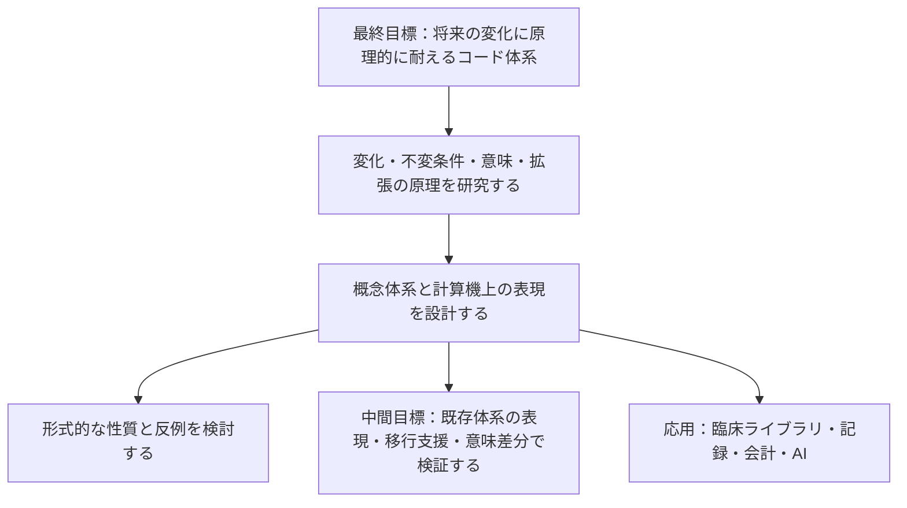

# MedDSL（仮称）

**未来永劫、原理的に変化に耐えうる医療コード体系を確立するための研究プロジェクト。** 医学・制度・システム・AI の変化を受け止める、意味の表現と拡張の原理を探ります。

**現在は非公開での調査・試作段階です。** P1-d まで進め、有限予測、役割付き事象、モデル被覆の反例、限定した合成の認定を実装しました。[共通台帳による総合評価](docs/research/15-p1-d-results.md) で P1 全20条件・80 JSON・417必須パスと、別枠の P0 全22条件を照合済みです。開発テスト231件が通過しています。[独立レビュー計画書](docs/research/16-review-plan.md)、12の証明義務と追加監査8テストを整備しました。続いて AI による単独の内部レビュー（裁定者・指摘者・レビュアーが同一）を最後まで実施し、契約版 `p0-draft-2` として指摘 RV-01〜RV-08 を処理しました（[内部実施の完了記録](docs/research/17-internal-run-ai-001.md)）。独立レビューは未実施です。今後の運用は、下記の2026-10-20の方針に従います。未確認だった経路の追加検査（[18](docs/research/18-additional-checks-ai-001.md)）を行い、次の段階 P2「意味能力の拡張契約」の研究設計（[19](docs/research/19-p2-design.md)）を作成しました。P2-a として、既存の handler 10件に拡張契約の宣言を後付けし、登録・非干渉・再検証範囲の検査を実装しました（[実行契約](docs/research/20-p2-a-contract.md)、[結果](docs/research/21-p2-a-results.md)）。続いて、引き継ぎの族のホストと操作の分離、防護例の追加、宣言の固定対象への追加を行いました（[追加作業](docs/research/22-p2-a-hardening.md)）。独立確認前で、防護例のない義務が3件残ります。さらに P2-b として、新しい意味能力「概念の分割」（旧い概念が部分に分かれたとき、候補集合と情報要求を返す。基底の状態へ変換しない）を拡張契約に沿って設計・実装しました（[設計](docs/research/23-p2-b-design.md)、[結果](docs/research/24-p2-b-results.md)）。この過程で、契約に新しいクラス R6（公理つき読み取りモジュール）が要ることが分かりました。続いて P2-c として、併用の検査（独立な拡張の機械的な判定、記号を共有する分割の併用の保存性を全数で判定して K04 型を反例つきで示す、入れ子の鎖）を実装しました（[設計](docs/research/25-p2-c-design.md)、[結果](docs/research/26-p2-c-results.md)）。契約には新しいクラス JOINT（併用）を加えました。最後に P2-d として、拡張契約の統合評価（固定した分母との照合）、全要求に共通の予算の不変条件、版の手順の実演（draft-1 → draft-2 を git の履歴から再現）、独立確認の資料（証明義務 PO13〜PO18、覆り得る内部判断、再開点）を整えました（[設計](docs/research/27-p2-d-design.md)、[結果](docs/research/28-p2-d-results.md)）。独立確認と評価の凍結は未実施で、独立確認前です。認定は既知の十分条件に限り、一般の保存判定、体系全体・変換器・実対応表は未完成です。取得済みの外部資料は Git 管理外です。名称、言語仕様、技術スタックは調査と試作で見直します。

**独立確認の運用方針（2026-10-20 利用者決定）**：このリポジトリは確認者を置かず、作成者側の研究・実装・内部検証として進めます。将来、独立の確認者を入れる場合は、英語で記述する別リポジトリを立て、確認が必要な時点の資料を引き継いでG0から進めます。内部検証と独立確認済みの評価は引き続き区別します。[決定記録](docs/research/29-review-repository-policy.md) を参照してください。

**P2-e「有効期間つきの主張」の最小実装を追加しました**（[設計](docs/research/31-p2-e-design.md)、[実装前の正例・反例](docs/research/32-p2-e-cases.md)、[実装・内部評価](docs/research/33-p2-e-results.md)）。参照時点と対象期間を分け、期間を限定した訂正を旧P0とは別の方針・回答型で点検します。単一原子・有限半開区間のR5診断に限定し、旧基底の状態への変換・保存認定は行いません。[実行例](examples/p2-temporal/README.md) は意味20件・入力境界10件・資源4件を61 JSON・462必須パスへ展開しています。その後の内部評価から応用へ進む順序は [今後の作業計画](docs/research/30-next-pilot-and-plan.md) に記録しています。

続いて **P2-f「単位つき数量」の最小実装** を追加しました（[設計](docs/research/34-p2-f-design.md)、[手指定期待](docs/research/35-p2-f-cases.md)、[実装・内部評価](docs/research/36-p2-f-results.md)）。有理数の点・有限区間の厳密換算と比較を扱うR2です。量の種類と次元、数値の同値と臨床的同等性、測定の不確かさを分け、原入力とAI由来を保持します。[架空の79例・609必須パス](examples/p2-quantity/README.md) を用意し、数量の計算を臨床の採用へ変換しない境界を検査します。その接続は下記のP2-gで限定して実装しています。

**P2-g「数量と測定主張の接続」の最小実装** を追加しました（[設計](docs/research/37-p2-g-design.md)、[手指定期待](docs/research/38-p2-g-cases.md)、[一次資料](docs/research/37-sources.md)）。測定の記録版・対象・検体・方法・時点・数量の内容を人の確認に結び、訂正と過去の再現を分けます。同じリテラルを使う別測定を自己比較へ潰さないことも契約に含めます。意味36・入力境界12・資源4条件を [137 JSON・1425必須パス](examples/p2-measurement/README.md) と専用テストへ展開し、内容hash・確認の可視性・文脈・共有予算を点検します。[実装・内部評価](docs/research/39-p2-g-results.md) に範囲と結果を記録します。人の確認は構造上の照合で、医学的妥当性の認定や臨床主張の生成は行いません。


**P2-h「厳密な数量と表示の射影」の最小実装** を追加しました（[設計](docs/research/40-p2-h-design.md)、[P36/N12/B4の手指定期待](docs/research/41-p2-h-cases.md)、[資料確認](docs/research/40-sources.md)）。丸めた型付き表示、出所の根拠、原情報の別添えを分け、表示だけで答えられる問いを限定します。同じ表示へ写る二原値の反例と、予算の最終確定前に認定を返さない条件も設計しました。[145 JSON・2128必須パス](examples/p2-display/README.md) と専用モジュールを追加しました。[実装・内部評価](docs/research/42-p2-h-results.md) に、別計算・予算・原情報の保持と認定範囲を記録します。表示の問いへの認定を、原値一般や医学的妥当性の認定にはしません。

**P2-i「時間と測定の併用契約」の最小実装** を追加しました（[設計43](docs/research/43-p2-i-design.md)、[C32/N12/B4の手指定期待44](docs/research/44-p2-i-cases.md)）。瞬間の測定を期間へ広げず、期間について明示された数量主張を、内容を指定した確認・部分訂正・厳密換算へ結ぶ専用R5を設計し、実装しました。部分訂正の外側、確認の可視性、原情報・出自を保持する条件を定めました。[151 JSON・1676必須パス](examples/p2-temporal-measurement/README.md) と専用R5を追加しました。[実装・内部評価45](docs/research/45-p2-i-results.md) に区間差引きの参照計算・確認・予算・制限を記録します。表示への接続は別契約として扱います。

**P2-j「期間つき数量と表示の接続」の最小実装** を追加しました（[設計46](docs/research/46-p2-j-design.md)、[手指定期待47](docs/research/47-p2-j-cases.md)、[内部評価48](docs/research/48-p2-j-results.md)）。170例・2670必須パスで、P2-iの計画の再検証・再実行、型付き表示、七種類の問い、原情報からの回答、共有予算を点検します。表示だけで保存する問いと、元記録・時点・期間を必要とする問いを分けます。続いて、P2-b〜P2-jの結果を [拡張の設計原理の草案49](docs/research/49-extension-principles.md) に整理しました（共通契約の対応表、導出・有限確認・仮説の区別、次の検証課題の候補）。その候補から、確認済みの期間不明記録の精密化を **P2-k** として設計・実装しました（[設計50](docs/research/50-p2-k-design.md)、[手指定期待51](docs/research/51-p2-k-cases.md)、[結果52](docs/research/52-p2-k-results.md)）。精密化は元の記録を消さない新しい種類の記録で、66例・721必須パスと、列挙・乱数・P2-eからの継承の差分で点検します。作成者側の草案・実装で、独立確認前です。続いて、拡張の版を上げる手順を **P2-l** として実演しました（[設計53](docs/research/53-p2-l-design.md)、[手指定期待54](docs/research/54-p2-l-cases.md)、[結果55](docs/research/55-p2-l-results.md)）。数量の単位表を改訂して（`u_third` の倍率を変え、`u_hundred` を追加）依存する4拡張を再固定し、旧入力を黙って再解釈せず、旧版を履歴から再現できることを点検します。独立確認前です。続いて、同じ slot の二時点の測定を比べる縦断比較を **P2-m** として設計・実装しました（[設計56](docs/research/56-p2-m-design.md)、[手指定期待57](docs/research/57-p2-m-cases.md)、[結果58](docs/research/58-p2-m-results.md)）。P2-iの計画の再実行とP2-fの比較を組み合わせ、二時点の値を独立な変数として扱う専用R5で、103例・2020必須パスと、別計算の二つの経路・P2-gとの文脈の差分・接続面の閉包で点検します。関係は算術の関係に限り、臨床的な増減・有意性の意味を持ちません。独立確認前です。続いて、利用者の指示で、拡張の宣言に継承の欄を足しました（**P2-n**。[設計59](docs/research/59-p2-n-design.md)、[手指定期待60](docs/research/60-p2-n-cases.md)、[結果61](docs/research/61-p2-n-results.md)）。宣言の書式を `p2-extension-manifest-draft-2` に上げて `inherits` を必須にし、実装を共有せず断片で観測が一致する関係を、元の拡張・結ぶ義務・登録時に評価する証人とともに宣言します。20宣言に9項目（証人30、理由つきの欠落2）を宣言し、元の拡張の変更が継承する側の再検証に及ぶこと、継承で結ばれた組を独立としないことを点検します。継承の真偽は検査できません。独立確認前です。続いて、利用者の承認した範囲選定（[文書62](docs/research/62-p2-o-selection.md)）に従い、薄い臨床ライブラリを **P2-o** として設計・実装しました（[設計63](docs/research/63-p2-o-design.md)、[手指定期待64](docs/research/64-p2-o-cases.md)、[結果65](docs/research/65-p2-o-results.md)）。医療者の三つの操作（記録・確認・訂正）から時間と測定の台帳を組み立て、出力先の要求（宣言）が満たされるか（満たされる／情報の依頼／表せない／評価不能）を診断する専用R5で、141例・2417必須パスと、別計算・要求の版の差・出力先をデータだけで足す検査・変異で点検します。AI由来の候補は要求を満たさず依頼の候補としてだけ現れ、推測で補った情報は常に空です。画面・LLM・実マスター・FHIR適合・臨床の手順は範囲外で、医療者の負担が減ることの証明ではありません。独立確認前です。続いて、D03 が選定済みの FHIR R5 のページ（Observation・Specimen・データ型・Provenance など）を取得し、ライブラリの概念との対応を構造・濃度・制約の範囲で監査し（[文書66](docs/research/66-p2-p-grounding-audit.md)）、その結果から、満たされた出力が出力先の構造で丸めず・閉じず・補わずに表せるかを診断する合成の専用R5を **P2-p** として設計・実装しました（[設計67](docs/research/67-p2-p-design.md)、[手指定期待68](docs/research/68-p2-p-cases.md)、[結果69](docs/research/69-p2-p-results.md)）。97例・1998必須パスと、別計算（Decimal）・有限格子の全数・基の行との差分・変異で点検します。表せない行は理由と失う区別を返し、足した仮定（期間の端の規約）は宣言したときだけ使って流れに残します。構造の事実は取得したページの出典のハッシュに結びます。FHIR への適合は主張せず、`status`・`code`・Provenance は範囲外です。独立確認前です。続いて、利用者の指示で、その範囲外だった Observation の `status`・`code` の写像と Provenance への出力を、P2-pの上に足す合成の専用R5として **P2-q** に設計・実装しました（[設計70](docs/research/70-p2-q-design.md)、[手指定期待71](docs/research/71-p2-q-cases.md)、[結果72](docs/research/72-p2-q-results.md)）。`status`・`code`・確認者の型の対応はライブラリが決めず、**呼び出し側の宣言**として使い、足りなければ宣言する人への依頼にします（推測で補いません）。使った宣言は仮定として流れに残し、人の確認は確認ごとに Provenance として、AI由来の記録だけが先頭に生成の Provenance（Device）を持ちます。75例・1249必須パスと、宣言の全数・別計算・変異で点検します。観察者を持たない記録は生成の Provenance を出せない、という記録モデルの穴も見つかりました。FHIR への適合は主張しません。独立確認前です。続いて、その穴を直すため、期間つき数量（P2-i）の記録に任意の観察者を足し、中核モデルの変更が下流へ及ぶ様子を **P2-r** として測りました（[設計73](docs/research/73-p2-r-design.md)、[手指定期待74](docs/research/74-p2-r-cases.md)、[結果75](docs/research/75-p2-r-results.md)）。旧版は履歴に残り、旧入力737件は黙って再解釈されず（pin による拒否678・同一59・変更0）、再生成した入力との違いは宣言した追加の25件だけでした。書き換わったファイルは813件で、操作から台帳を組み立てる系列の入力は hash を持たないので置換だけで再固定できる、という発見もありました。独立確認前です。続いて、利用者の指示で、その観察者を**必須**にする版の更新（旧入力を拒否する）を **P2-s** として測りました（[設計76](docs/research/76-p2-s-design.md)、[手指定期待77](docs/research/77-p2-s-cases.md)、[結果78](docs/research/78-p2-s-results.md)）。不明は明示の値 `{kind: unknown}` で書かせ、ライブラリは欠落を補いません。旧入力762件は黙って再解釈されず（pin による拒否703・同一59・変更0）、旧い pin に替えただけの入力18件は全て欠落した必須項目で拒否されました。版の記録の比較器は、宣言にない診断の変化（`error_path`）を見つけ、実装の側を直しました。新版の入力を旧版へ渡すと、`unknown` を含む734件は受理されませんが、拒否の理由は予測の `invalid_observer` でなく、主に `missing_field` でした。独立確認前です。続いて、P2-q の範囲外だった Provenance の `activity` の符号と `entity`（revision）を、P2-q の上に足す合成の専用R5として **P2-t** に設計・実装しました（[設計79](docs/research/79-p2-t-design.md)、[手指定期待80](docs/research/80-p2-t-cases.md)、[結果81](docs/research/81-p2-t-results.md)）。活動の符号は呼び出し側の宣言（不透明）で、宣言のない種類は別の符号で代用せず、失うものに残します。訂正の関係は、選ばれた訂正記録の生成側の項目に、訂正された記録ごと（記録の参照と独立に計算したハッシュ）に付き、向きは新しい版が target、古い版が entity です。**訂正者が不明（P2-s の明示の不明）な訂正は、確認済みでも関係を運べない**（Provenance の agent は必須）ことを、`no_agent` として区別して示しました。73例・1,533必須パスと、576要求の全数・独立なハッシュ・24変異で点検し、P2-q 以下は変更していません。FHIR への適合は主張しません。独立確認前です。続いて、利用者の指示で、取得済みの RxNorm CPC の2版（2026-09-08 → 10-05）の版更新を、旧版の参照ごとに監査する契約を **P2-u** として設計・実装し、実データに適用しました（[設計82](docs/research/82-p2-u-design.md)、[手指定期待83](docs/research/83-p2-u-cases.md)、[結果84](docs/research/84-p2-u-results.md)）。同じ (出典, id) が続くかだけで継続を決め、新版にない参照は後継を決めず候補も出さず、名称・関係・属性を別の面として比べ、属性の分類は宣言（未宣言は依頼）にします。架空の88例・1,679必須パスで契約を固定し、実データ（81,468概念）の結果は集計だけを文書に残しました：続く81,298概念の98.0%は三つの面のどれにも差がなく、差の大半は `NDC` の入れ替わりだけで、定義にあたる属性の差は77概念、新版にない参照は170、関係の差はすべて収載の出入りに結ばれていました。予測の外れ（属性の差の概念数の範囲、方針の違いの効果）も記録しています。意味の同一・廃止・置換は決めていません。独立確認前です。

## 何を目指すか

最終目標は、将来の変化を原理的に受け止められる**コード体系そのもの**の確立です。新しい概念や関係、知識の修正、記録の目的、実装が変わっても、表現を拡張し、既存の意味を追跡できる仕組みを研究します。

| 位置付け | 目指すこと |
| --- | --- |
| 最終目標 | 将来の変化に耐えうるコード体系の原理と仕様を確立する |
| 基礎研究・設計 | 変化の種類、保つ性質、意味の表現、拡張と互換性の仕組みを定義する |
| 中間目標 | 既存体系の表現、移行支援、意味の保持・喪失・追加の監査を通じて設計を検証する |
| 応用・普及 | 臨床ライブラリの整備・標準化、医療者の操作と接続先の分離、AI と共有できる情報整理を実現する |

移行支援・意味差分の監査は中間目標です。対象を絞った例で「何が対応し、何が失われ、何が追加され、その根拠は何か」を調べ、体系の表現能力を検証します。移行ツールが動くことだけでは、最終目標を達成したとは判定しません。

特定の既存体系の粒度に固定しない概念体系を設計し、その計算機上の表現として中間表現を検討します。何を不変とし、どの変化をどの仕組みで受け止めるかを先に研究します。コアを固定する範囲と、コア自体の改訂を扱う方法も研究対象です。

傷病名に加えて所見、検査、処置、薬剤などの領域、将来の医療者・システム・AI の利用を初期設計から考慮します。「全ケースへの対応」と永続性は研究目標であり、現時点での実現・証明を意味しません。目標と検証範囲の関係は [最終目標と設計原則](docs/vision.md) に定めます。

素のコードや DSL を医療者が直接操作する運用は前提にしません。開発・保守で扱う内部表現と、臨床ライブラリ・画面で提供する操作を分け、初期設計から拡張性・普遍性を要件に置きます。操作を変えずに接続できる範囲は、入力情報と接続先の要求を比較して検証します。

この応用目標は、**医療者の入力・操作をフロントエンド、会計コードや各種分類コードなどの出力先への接続処理をバックエンドとして、共通の意味表現を介して分離する**構想とも説明できます。入力や根拠付きの補助情報で出力先の要求を満たせる範囲で、接続先の変更を医療者の操作変更から切り離すことを目指します。[入力と出力先の分離](docs/vision.md#応用目標入力と出力先の分離) に、このアナロジーの位置付けと条件を記します。

## 基本構想



体系そのものの原理と、外部の分類・用語体系への接続を分けて研究します。医療者による DSL の手入力を必須にせず、臨床ライブラリや AI から利用できる表現を目指します。基礎モデルは研究用に選定し、具体的な形式仕様・実装はこれから定めます。

## 設計の出発点

- **原情報を保つ。** 入力コード、体系、版、用途、出典を保持し、変換で得られた情報と区別します。
- **人と AI が根拠を共有する。** 観察・記録、臨床判断、機械的な導出、AI の生成候補と、人による確認状態を区別します。特定の AI モデルやベンダーに共通の意味を依存させません。
- **追加の根拠を追う。** 既存情報の明示化、補助情報による追加、根拠を確認できない追加を区別します。意味を解釈できない部分は比較不能として残します。
- **対応の限界を返す。** 完全一致、出力先の方が広い／狭い、一部重複、候補複数、対応なしを区別します。不明な属性を推測して埋めません。
- **臨床文脈を独立させる。** 疑い、否定、既往、家族歴、時間、対象者を扱い、同じ病名でも異なる意味を保持します。
- **構文と意味を分ける。** 型検査や構文検査だけで医学的妥当性を保証せず、用語体系の制約、対応根拠、人による評価を組み合わせます。
- **外部用語を分離する。** 外部マスターは利用者が取得したものを取り込む構想です。取り込み・対応表・配布の条件は体系ごとに確認します。
- **網羅性と実用性を測る。** 表現できる症例の幅に加えて、変換の正確性、情報損失、確認負担、再現性を評価します。

## 中間目標としての検証候補

初期の検証材料には、RxNorm CPC の二つの月次版と FHIR Procedure の二版の定義を [R3](docs/research/03-data-access.md) で選定しました。[R4](docs/research/04-evaluation.md) で、最初の中間実験を CPC 2026-09-08 → 2026-10-05 の薬剤概念の版更新監査に定めました。FHIR は構造・文脈の変化を扱う補助材料です。これを基盤全体の仕様や成功条件にはしません。

ICD-10 → ICD-11 も候補に残していますが、独自体系開発という目的に対する利用条件と、版を固定した対応資料の確認が必要です。WHO・LOINC 等の内容の取り込みを保留する範囲は [R3 の条件整理](docs/research/03-data-access.md) に記録しました。

移行実験では、コードと変換候補に対して意味の差分と根拠を返し、不足情報や比較不能を明示できることを重視します。対象コードだけで伝わる情報と、原情報を別に保持しているから復元できる情報を区別します。独自 DSL のパーサー、自然言語処理、画面は後続の検討項目です。

将来の接続候補には SNOMED CT、MEDIS、LOINC、国内レセプト電算体系があります。FHIR はデータ交換や対応表の表現の候補として別途検討します。いずれも未対応です。

## リポジトリ構成

```text
.
├── AGENTS.md             # 開発時の方針
├── docs/
│   ├── vision.md         # 最終目標、目的の階層、変化に耐えるための研究方針
│   ├── architecture.md   # 体系の原理・拡張・中間用途の設計メモ
│   ├── research.md       # 先行仕様・研究の調査入口
│   ├── research/
│   │   ├── 01-use-case.md # R1：最終目標と中間用途、意味差分の例
│   │   ├── 02-landscape.md # R2：既存方式・研究・実装の一次比較
│   │   ├── 02-sources.md  # R2：出典、参照版、確認範囲
│   │   ├── 02b-change-model.md # R2b：変化・不変条件・拡張原理
│   │   ├── 02b-cases.md   # R2b：14 件の机上例・反例
│   │   ├── 02b-sources.md # R2b：一次資料と実際の確認範囲
│   │   ├── 03-data-access.md # R3：資料選定・版・利用条件
│   │   ├── 03-sources.md  # R3：一次資料と確認範囲
│   │   ├── 03-materials.json # R3：資料の版・実測ハッシュ・取得状態
│   │   ├── 03-acquisition.md # R3：実ファイルの取得・初期照合の結果
│   │   ├── 04-evaluation.md # R4：原理・中間用途の評価設計、D04・D05
│   │   ├── 04-cases.md     # R4：14 原理ケースと架空 40 ケースの期待結果草案
│   │   ├── 04-material-probes.md # R4：実資料の部分追跡と再現方法
│   │   ├── 04-sources.md   # R4：一次資料と確認範囲
│   │   ├── 05-model-study.md # R5：三案の比較と基礎モデルの研究用選定
│   │   ├── 05-principles.md # R5：保存の十分条件・意味引き継ぎの導出
│   │   ├── 05-sources.md   # R5：一次資料の追加確認と限界
│   │   ├── 06-prototype-brief.md # R6：試作範囲・構成・着手判断
│   │   ├── 06-p0-contract.md # R6：P0 の意味・入出力・22 受入条件
│   │   ├── 07-p0-a-results.md # P0-a：初期実装の実行記録
│   │   ├── 08-p0-b-results.md # P0-b：定義認定・推論・反例の検証
│   │   ├── 09-p0-c-results.md # P0-c：確認・訂正・未知能力の検証
│   │   ├── 10-p0-d-results.md # P0-d：比較・全22ケースの草案評価
│   │   ├── 11-p1-design.md # P1：意味能力・コア改訂の研究設計
│   │   ├── 11-p1-contract.md # P1：意味・回答・履歴の引き継ぎ契約
│   │   ├── 11-p1-cases.md # P1：20受入条件の草案
│   │   ├── 11-p1-sources.md # P1：一次資料と実際の確認範囲
│   │   ├── 12-p1-a-contract.md # P1-a：有限予測の実行形式・能力・上限
│   │   ├── 12-p1-a-results.md # P1-a：7条件の照合と制限
│   │   ├── 13-p1-b-contract.md # P1-b：事象化・読み戻し・役割表の問い合わせ
│   │   ├── 13-p1-b-results.md # P1-b：6条件の照合と有限検査の制限
│   │   ├── 14-p1-c-contract.md # P1-c：モデル反例・合成・可用性の契約
│   │   ├── 14-p1-c-results.md # P1-c：7条件の照合と限定した認定
│   │   ├── 15-p1-d-contract.md # P1-d：共通台帳・実体固定・評価契約
│   │   ├── 15-p1-d-results.md # P1-d：全20条件の総合照合・認定範囲
│   │   ├── 16-*.md        # 独立レビューの計画・証明義務・様式、AI-001 の記録
│   │   ├── 17-internal-run-ai-001.md # AI による内部レビューの完了記録と再開点
│   │   ├── 18-additional-checks-ai-001.md # compare・split_roles・Python 3.11 の追加検査
│   │   ├── 19-p2-design.md # P2：意味能力の拡張契約の研究設計
│   │   ├── 20-p2-a-contract.md # P2-a：宣言の書式・登録・再検証範囲の実行契約
│   │   ├── 21-p2-a-results.md # P2-a：10件の後付け・非干渉・限界
│   │   ├── 22-p2-a-hardening.md # P2-a の追加作業：ホスト分離・防護例・宣言の固定
│   │   ├── 23-p2-b-design.md # P2-b：概念の分割の意味・義務の導出・契約の不足（R6）
│   │   ├── 24-p2-b-results.md # P2-b：受入条件 X04・X05・X14 の結果・変異検査・発見
│   │   ├── 25-p2-c-design.md # P2-c：併用（独立・共有記号・鎖）の意味・義務の導出・契約の不足（JOINT）
│   │   ├── 26-p2-c-results.md # P2-c：受入条件 X08〜X10 の結果・変異検査・発見
│   │   ├── 27-p2-d-design.md # P2-d：評価の固定・版の手順・独立確認の計画（PO13〜PO18）
│   │   └── 28-p2-d-results.md # P2-d：受入条件 X11・X12 の結果・検査器の変異検査・発見
│   └── roadmap.md        # 調査項目・決定事項・各段階の完了条件
├── scripts/research/     # ローカル資料の初期検査・R4 の部分追跡・P0/P1/P2 評価・版の比較（p2/ は独立確認の資料）
├── src/med_dsl/          # P0/P1 のライブラリ・固定仕様・JSON CLI
├── extensions/          # 拡張契約の宣言12件と索引（作成者草案）
├── tests/               # 架空資料の情報保持・棄権・境界の検証（review/ はレビュー系列、p2/ は拡張契約）
├── packages/README.md    # 将来の実装分割案
└── examples/            # 架空例と評価ケースの方針
    ├── README.md
    ├── p0/              # P0 の 37 JSON 例と草案のハッシュ台帳
    ├── p1/              # P1 の8設計例。設計用形式は実行不可
    ├── p1-a/            # 有限予測の31実行例・草案ハッシュ台帳
    ├── p1-b/            # 事象への引き継ぎの22実行例・草案ハッシュ台帳
    ├── p1-c/            # 反例・合成・可用性の27実行例・草案ハッシュ台帳
    ├── p1-evaluation/   # 全20条件とP0回帰の共通台帳・固定実体
    ├── audits/          # 追加監査の例
    ├── review/          # レビュー負例系列（別の分母）
    ├── p2/              # 拡張契約の防護例（拒否・境界。別の分母）
    ├── p2-split/        # 概念の分割の例（P2-b。別の分母）
    ├── p2-splits/       # 概念の分割の併用の例（P2-c。別の分母）
    └── p2-versions/     # 版の記録（P2-d。draft-1 → draft-2）
```

P0/P1 は Python 3.11 以降・標準ライブラリ・JSON を使い、Python 3.14.4 と 3.11.17（conda-forge のビルド）で全テスト系列と評価を実行しました（[18](docs/research/18-additional-checks-ai-001.md)）。他のパッチ版・ビルド・OS は未確認です。外部パッケージのインストールは不要です。リポジトリのルートで実行します。

```bash
PYTHONPATH=src python3 -m med_dsl --fixture examples/p0/definition-extension.json
PYTHONPATH=src python3 -m med_dsl --fixture examples/p0/definition-entailment.json
PYTHONPATH=src python3 -m med_dsl --fixture examples/p0/linked-observations.json
PYTHONPATH=src python3 -m med_dsl --fixture examples/p0/assertion-revision.json
PYTHONPATH=src python3 -m med_dsl --fixture examples/p0/projection-compare.json
PYTHONPATH=src python3 -m med_dsl --fixture examples/p1-a/finite-forecast.json
PYTHONPATH=src python3 -m med_dsl --fixture examples/p1-a/correlated-forecast.json
PYTHONPATH=src python3 -m med_dsl --fixture examples/p1-b/reify-events.json
PYTHONPATH=src python3 -m med_dsl --fixture examples/p1-b/linked-observations.json
PYTHONPATH=src python3 -m med_dsl --fixture examples/p1-b/split-witness.json
PYTHONPATH=src python3 -m med_dsl --fixture examples/p1-c/coverage-countermodel.json
PYTHONPATH=src python3 -m med_dsl --fixture examples/p1-c/event-renaming-chain.json
PYTHONPATH=src python3 -m med_dsl --fixture examples/p1-c/lossy-composition.json
python3 -m unittest discover -s tests
python3 -m unittest discover -s tests/review
python3 -m unittest discover -s tests/p2
python3 scripts/research/check-extensions.py
python3 scripts/research/evaluate-p0.py --cli
python3 scripts/research/evaluate-p1-a.py --cli
python3 scripts/research/evaluate-p1-b.py --cli
python3 scripts/research/evaluate-p1-c.py --cli
python3 scripts/research/evaluate-p1-d.py --cli
```

`--fixture` は草案例の request だけを処理し、expected を推論へ渡しません。`package.json` は名称と非公開設定等の初期メタデータです。次の作業は [ロードマップ](docs/roadmap.md) を参照してください。

## 調査と検証

会話で挙がった先行プロジェクトと設計仮説は [調査メモ](docs/research.md) に整理しています。既存の仕組みとの差、複合概念の扱い、変換の限界、利用条件を一次資料で確かめてから仕様を固めます。

調査は、目標の定義、既存方式の比較、変化に耐える原理の調査、検証資料の確認、評価方法、内部モデル、試作仕様の順で進めます。原理上保つ性質と、具体例で検証できた範囲を区別します。

[R1：目的と中間用途の定義](docs/research/01-use-case.md)、[R2：既存方式の一次比較](docs/research/02-landscape.md)、[R2b：変化・不変条件・拡張原理の基礎調査](docs/research/02b-change-model.md) を整理済みです。R2b では変化を 8 種類に分け、不変条件の候補 8 項目、設計案 3 案、14 件の例・反例をまとめました。既存の意味を保つ拡張と、意図して知識・定義を改訂する操作を分けて比較します。

[R3](docs/research/03-data-access.md) で初期材料を選定し、[4 ファイルの取得・初期照合](docs/research/03-acquisition.md) を完了しました。[R4](docs/research/04-evaluation.md) では、原理の評価契約、架空ケース 24+16 件、比較方式・指標・工学的最低条件を策定し、[実資料も部分追跡](docs/research/04-material-probes.md) しました。期待結果は独立確認前の草案で、公開済みの例による回帰評価と未見版の追加評価を区別します。

[R5](docs/research/05-model-study.md) で三案を比較し、不変な定義参照、役割付き事象・文脈付き主張を基礎とする構成を研究用に選定しました。通常の定義追加、意味能力の追加、コアの改訂を別の契約で扱います。[保存原理](docs/research/05-principles.md) に、条件内の定義追加、有限回の合成、役割付き表現への意味引き継ぎの小さな導出を記録しました。

[R6 の試作仕様](docs/research/06-prototype-brief.md) と [P0 契約](docs/research/06-p0-contract.md) を定め、[P0-a](docs/research/07-p0-a-results.md) に続き [P0-b](docs/research/08-p0-b-results.md) を実装しました。S1/S2 の保存認定、単項包含・連言定義による推論、根拠追跡、確認・時点・訂正の選択が動作します。[P0-c](docs/research/09-p0-c-results.md) では未知能力の停止元・衝突の両根拠を具体化し、18 ケースの草案を整えました。続いて [P0-d](docs/research/10-p0-d-results.md) で compare を実装し、全22ケースを37 JSON で具体化しました。116 件の開発テストが通過し、作成者草案の22/22ケース・指定チェック221/221と、API/CLI の一致・再実行を確認しました。独立確認と R4 の実行評価は未完了です。

[P1 の研究設計](docs/research/11-p1-design.md) と [引き継ぎ契約](docs/research/11-p1-contract.md) で、20受入条件・8設計JSONを用意しました。[P1-a](docs/research/12-p1-a-results.md) は型付き有限予測、[P1-b](docs/research/13-p1-b-results.md) は事象化・原履歴・有限回答を実装しました。[P1-c の実行契約](docs/research/14-p1-c-contract.md) と [7条件・27 JSON・126必須パスの照合結果](docs/research/14-p1-c-results.md) では、モデル被覆の反例、既知条件による合成の認定、射影の喪失、原保存と再実行の可用性を区別します。有限一致だけで認定せず、保証範囲を明記します。次は P1-d の全20条件の共通台帳・固定・総合評価です。独立レビュー、完全な形式仕様、永続性全体の証明、臨床変換の実証は未完了です。HAPI FHIR と ROBOT は後続の中間用途で再評価します。

## 非公開運用・権利

本リポジトリは private で運用します。`package.json` の `private: true` は npm への誤公開を防ぐ設定で、GitHub の公開範囲は別に管理します。

ソースコードの公開・再配布ライセンスは未決定です。MIT などの公開ライセンスは現段階では採用しません。外部コード、名称、定義、対応表の利用条件はそれぞれ確認し、許諾を確認するまでは同梱しません。患者情報や業務上の非公開マスターをコミットせず、例には架空データを使います。

研究・設計段階の成果物であり、診断・治療・保険請求に利用できる実装や検証結果はありません。
