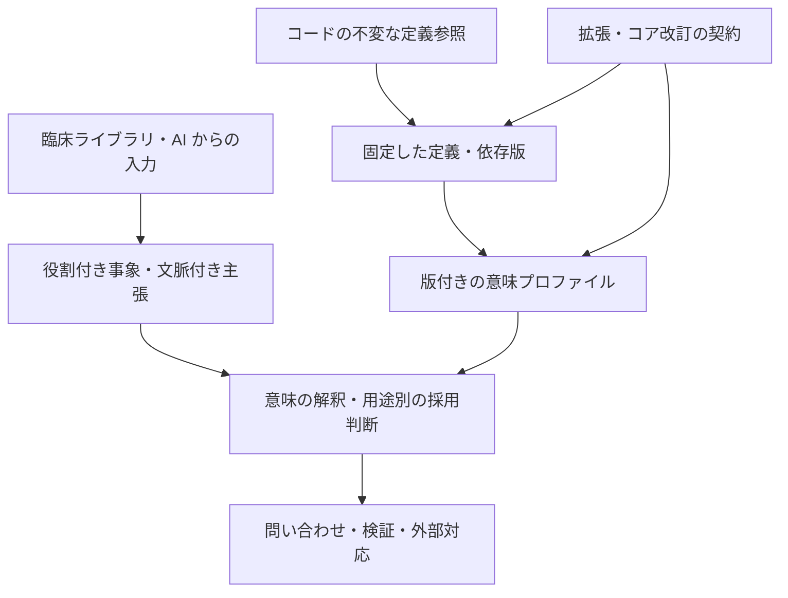
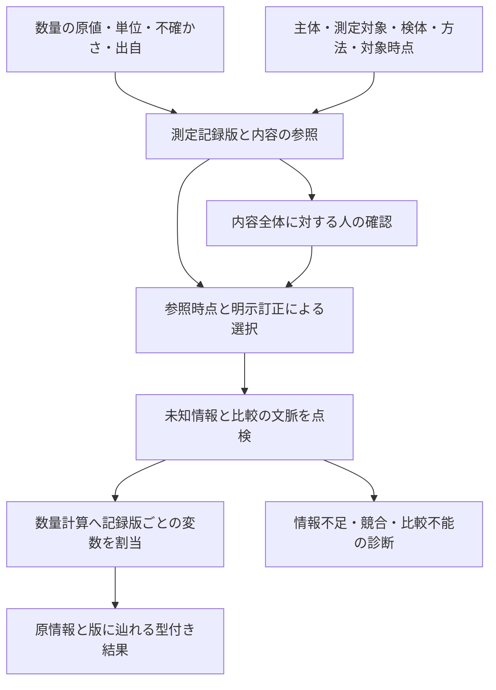
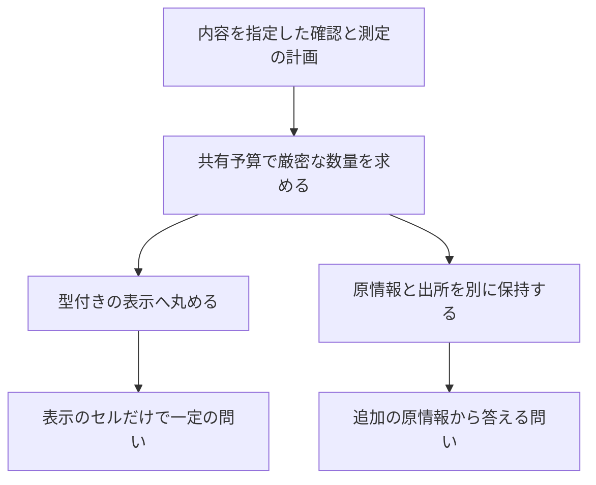

# 設計メモ

状態：P0-d と P1-a〜d まで進め、[共通台帳](research/15-p1-d-results.md) でP1全20条件と別枠のP0回帰を作成者草案として総合照合しました。独立確認・R4 の評価・外部標準への適合は未完了です。

最終目標は、未来永劫、原理的に変化に耐えうるコード体系の確立です。[最終目標と設計原則](vision.md) を基準に、変化の種類、不変条件、意味の定義、拡張原理を研究します。移行支援と意味差分の監査は、その体系を検証する中間目標です。

[R5 の比較と D06](research/05-model-study.md) で、不変な定義参照、概念と個別事象・主張の分離、役割付き関係、文脈・由来・採用方針を基礎に選びました。通常の拡張は定義追加、意味能力の追加は明示的な意味モジュール、コアの改訂は意味の引き継ぎ契約で扱います。[保存の十分条件と導出](research/05-principles.md) は条件付きで、永続性全体の証明ではありません。

[R2 の一次比較](research/02-landscape.md) は主に中間用途に関する調査です。条件付き FHIR ConceptMap による直接対応を移行実験の比較基準、HAPI FHIR と ROBOT を検証候補に選定しました。体系のコア・表現能力・拡張原理をこれらに合わせて決めたものではありません。

[R6](research/06-prototype-brief.md) の P0 は Python の単一ライブラリと JSON 入出力を使います。[P0-a](research/07-p0-a-results.md) で役割付き事実の照合、根拠、確認・時点・訂正の選択を実装しました。[P0 契約](research/06-p0-contract.md) は正の計算と否定記録の検索を分け、一般の論理含意との違いを明示します。[P0-b](research/08-p0-b-results.md) で依存閉包を含む S1/S2 の認定と正の閉包を実装しました。[P0-c](research/09-p0-c-results.md) で停止理由を該当主張・衝突 atom の両根拠まで具体化し、確認・時点・訂正と定義推論の組合せを検証しました。[P0-d](research/10-p0-d-results.md) で同じ Q の支持 binding を前後比較し、全22ケースの作成者草案を照合しました。差分と比較不能、左右の台帳の根拠を分けて返します。

## P1 の研究境界

[P1 設計](research/11-p1-design.md) では、有限予測を読む意味能力と、四項関係から同じ事象への役割付けを持つコア改訂を選びました。[引き継ぎ契約](research/11-p1-contract.md) は、モデル内の充足だけでなく旧モデルの被覆を要求し、支持・採用・原根拠も別に検査します。[P1-a](research/12-p1-a-results.md) の有限予測、[P1-b](research/13-p1-b-results.md) の事象化・原履歴・有限照合に続き、[P1-c](research/14-p1-c-results.md) で参考モデルの反例と限定した合成の認定を実装しました。恒等変換のモデル条件と、事象化・可逆な改名の原履歴/支持契約を区別し、仕様・依存・中間実体・翻訳後 Q を照合します。[P1-d](research/15-p1-d-contract.md) で実装・仕様・依存・期待条件を固定し、全20条件を総合照合しました。任意理論の保存判定や、全将来の意味を保証する認定器は未実装です。

予測は型付きの値として返し、臨床の肯定へ暗黙に変換しません。新しい意味が読み取れない消費側では停止を維持します。旧処理系で再実行できることと、新しい意味へ移して保存できることも別の経路として記録します。

保存の前提・結論・実装への対応を [12の証明義務](research/16-proof-obligations.md) に整理しました。[追加の有限監査](research/16-pre-review-results.md) は作成者側の検証で、[独立レビュー計画](research/16-review-plan.md) による確認と区別します。

## 数量と測定記録の接続（P2-gの最小実装）

[P2-f](research/36-p2-f-results.md) の数値リテラル計算と、[P2-g](research/37-p2-g-design.md) の測定主張の選択を分けます。記録版は数量の内容hashと文脈・出自を含み、確認はその内容全体を対象とします。訂正は新しい版・確認として残し、原snapshotと仕様・処理系を保持した再現を目指します。[専用のR5モジュールとして最小実装](research/39-p2-g-results.md) し、参照時点に見える内容一致の人の確認、slot単位の訂正、既知文脈の一致を点検してP2-fへ渡します。子の計算予算は親から予約し、未完了行の値・根拠を返しません。確認は構造の照合に限り、認証・医学的妥当性・臨床主張の生成は対象外です。

別の測定が同じ区間リテラルを使っても同じ変数にせず、同じ選択記録版を二度読むときだけ自己比較とします。数値関係、採用方針、医学的同等性を区別し、結果から新しい臨床主張を生成しません。確認の構造的整合と本人認証・内容の真実性も別です。外部システムや既存の医療者の操作との対応は、この設計の後に評価します。

## 数量の厳密値と表示（P2-hの最小実装）

[設計40](research/40-p2-h-design.md) では、P2-gの計画を共有予算で再実行し、単一点の厳密値を型付きの表示artifactへ写すR4を設計しました。[専用のR4モジュールとして最小実装](research/42-p2-h-results.md) しました。artifactは量の種類・単位・表示方針・桁数を含み、原値・記録ID・文脈・出自の根拠や別添えはartifactの外に置きます。応答全体に情報が残ることと、表示自身に保存される問いを区別します。

同じ表示となる1.21と1.24でも、1.22以上かという原回答は異なります。別添えから回答を得ても、表示にこの区別が保存されたとは判定しません。表示の桁数・丸めセルから測定の不確かさを推定せず、表示の認定を医学的妥当性の認定へ広げません。[手指定期待41](research/41-p2-h-cases.md) に反例・境界・予算をまとめます。

## 時間と測定の併用（P2-iの最小実装）

[設計43](research/43-p2-i-design.md) では、P2-eの部分訂正とP2-gの内容指定確認を比較し、期間について明示された数量主張を選ぶ新しいR5を設計しました。瞬間の測定から持続を推論せず、参照時点の可視性と対象時点の区間内選択を分けます。期間・文脈・数量・訂正辺を含む新しい記録全体への確認を必要とし、旧確認をadapterが発行し直す経路は作りません。

初回は選択後の数量換算だけをP2-fへ委譲します。全体訂正の後に期間で絞る方式では消えてしまう、部分訂正の外側を保持します。P2-hはP2-gの計画を読む固定契約のため、新sourceとの表示接続は後続の契約へ分けます。[手指定期待44](research/44-p2-i-cases.md) に48条件と選択式だけの有限点検を記録します。続いて [専用R5の最小実装・内部評価45](research/45-p2-i-results.md) と151実行例を追加しました。旧期間・測定・数量・表示の意味は保持し、区間差引きの別計算と共有予算を検査します。

## 原理として研究すること

| 論点 | 設計で明確にすること |
| --- | --- |
| 変化の範囲 | 新概念、新属性・関係、新領域、知識の修正、制度・用途、コア仕様の変化をどう分類するか |
| 意味の保存 | 既存の概念定義・記録の意味と、後の訂正・再解釈をどう区別するか |
| 拡張の仕組み | 何を追加でき、何を不変とし、互換性をどう確認するか |
| コアと拡張 | コアを固定する範囲と、コア自身の改訂が必要な場合の扱いをどう定めるか |
| 表現と計算 | 意味を表現できる範囲、機械的に判定できる範囲、未解決の範囲をどう分けるか |
| 根拠の提示 | どの仮定の下で性質を示し、どの反例・実証例で設計を検討するか |

これらは設計課題であり、永続性を証明した性質ではありません。新しいコードを保存できること、版を付けられること、外部接続を増やせることだけで最終目標を満たしたとはしません。

## R2b を踏まえた設計比較の前提

意味の保存、知識・記録の訂正、意味を表す言語の変更を分けます。定義、公理、個別データ、表示名、用途別の採用判断を別に扱い、どの変更がどの結論に影響するかを比較します。研究上の定義と出典は [R2b](research/02b-change-model.md)、反例は [ケース台帳](research/02b-cases.md) にあります。

| 対象 | 比較で求めること |
| --- | --- |
| 意味を保つ拡張 | 旧語彙・問い合わせ・データ条件を指定し、結論の一致を示す。単独の拡張と併用時を別に確認する |
| 知識・記録の訂正 | 過去の定義・主張と解釈を再現し、現在採用する判断を更新する。意図した差を保存の失敗と混同しない |
| 言語・コアの変更 | 旧側と新側の意味の対応、対象範囲、失われる意味、合成時の条件を明記する |
| 未知の拡張 | 保存できること、意味を解釈できること、用途に適合することを分け、理解できない範囲を黙って処理しない |
| 計算上の保証 | 構文検証、推論、拡張の保存判定を別の課題にする。十分条件の不成立は、それだけで反例とはしない |

比較した候補は、A：固定した基礎言語と領域定義、B：意味論を拡張できるメタモデル、C：コアの改訂と意味の引き継ぎ、の三案です。[R5](research/05-model-study.md) で更新の種類ごとの責務分担を選定しました。一階述語論理を最初の形式的な意味プロファイル候補とし、実行対象の断片は別に限定します。文法・保存形式・推論器は未決定です。I1〜I8 を実装済みの保証とはしません。

[R4](research/04-evaluation.md) で、各案の意味論・保存対象・変更操作・保証・合成・計算契約・能力変更・変更費用を共通の比較票にしました。[K01〜K14](research/04-cases.md) の入力と期待判断を使い、有限の正答と形式的な保証を分けます。D04 は薬剤概念の CPC 9 月→10 月の版更新監査で、これを体系全体の表現範囲にしません。期待結果は独立確認前の草案です。

## 長期構想から置く設計要件

医療者、記録・会計システム、AI が共有する意味を中心に置きます。移行監査はその最初の検証用途です。以下は設計要件であり、実装済みの機能ではありません。

| 境界 | 方針 |
| --- | --- |
| 医療者の操作と内部表現 | 臨床ライブラリ・テンプレートを介し、素のコードや DSL の直接操作を要求しない |
| 共通モデルと接続先 | 体系・制度・ベンダー固有の規則を接続層に置き、新しい接続による変更範囲を検証する |
| 共通モデルと臨床知識 | 専門領域の定義を拡張可能にし、コアと臨床ライブラリの版・互換性を管理する |
| 共通モデルと AI | 機械可読な定義、関係、文脈、根拠を提供し、意味を特定の AI モデルやプロンプトに依存させない |

AI が利用する際にも、本人と家族、現在と既往、確定と疑い、否定と未記載を区別できることを要件にします。識別子から定義・表示名・許容される属性を参照でき、原文・原コード・観察値への追跡と、取得時に失われた情報の確認を検討します。AI 向けに情報を整形・要約する場合も、原情報を参照できるようにします。

観察・記録、臨床判断、規則による導出、AI による生成候補の情報源と状態を区別します。AI の生成候補は、構造・参照・制約の検証と、用途に応じた確認の状態を伴って扱います。構造に適合していることと、内容が正しいことを別々に評価します。

拡張性・普遍性は初期要件とし、名前空間、版、拡張規則、未知の拡張の扱い、適合性の契約を R5 で整理しました。すべての接続先で操作を変えずに済むかは、入力側にある情報と出力側の要求を比較して判断します。接続先が新しい観察を必須にする場合、未観察の値を補って対応済みにはしません。

## 中間目標の移行実験における構成案

以下は中間用途に限定した案です。体系全体の構成や、最終的な基礎モデルの設計をこのパイプラインに限定しません。

| 層 | 責務 | 当初の扱い |
| --- | --- | --- |
| 入力 | 原コード、出力候補、体系、版、地域、用途を受け取る | コードと候補の入力に絞る |
| 取り込み | 外部コードの意味と原情報を保持する | 対象を限定したアダプター |
| 中間表現 | 概念、属性、関係、文脈、出典を保持する | P0 では JSON。長期的な交換形式は未決定 |
| 検証 | 構造、参照、属性制約、不足情報を確認する | 機械検証と専門的レビューを区別 |
| 変換 | 対象体系・版・用途に応じた規則を適用する | 一方向から始める |
| 監査 | 入力と出力の意味を共通の観点で比較する | 未解釈・近似・比較不能も記録する |
| 結果 | 候補、意味関係、喪失、追加、矛盾、根拠を返す | 未対応も正規の結果にする |

DSL は中間表現を記述するための将来の選択肢です。文字列構文やパーサーを先に固定せず、具体例を表せるかで判断します。

## 中間表現で検討する要素

- 概念の識別子と多言語ラベルを分ける。
- 疾患・解剖・病理・薬剤などの参照先を名前空間と版で識別する。
- 部位、左右、経過、原因、併存、因果関係を区別する。
- 否定、疑い、既往、家族歴、対象者、観察時刻と有効期間を独立して持つ。
- 未記載、未確定、不明、該当なしを混同しない。
- 原情報から直接得た事実、推定候補、人が確認した内容を区別する。
- 複数の記述が同じ事象を参照できるようにし、AST だけで十分か、グラフも必要かを評価する。
- 概念の定義変更と非推奨化、マッピング改訂を追跡できるようにする。

人体構造の妥当性を性別ラベルだけで判断する規則など、会話中の単純化した例をそのまま制約にしません。検査可能な条件と、情報不足で判断できない条件を分けます。

## 変換結果の契約案

以下は独自の作業用語で、FHIR などの列挙値とはまだ対応付けていません。

| 項目 | 保持する内容 |
| --- | --- |
| 入力 | 原コード、体系、版、地域、用途、受け取った文脈 |
| 出力候補 | 対象コードまたは複合表現、対象体系と版 |
| 意味関係 | 入力に対して同等／出力が広い／出力が狭い／一部重複／排他的／判定不能。R4 の指定制約と比較範囲に従う |
| 処理状態 | 対応あり／候補複数／追加情報が必要／対応なし／入力不正 |
| 情報損失 | 出力で表せなかった属性、文脈、精度 |
| 意味の追加 | 既存情報の明示化、補助情報による追加、根拠未確認の追加と情報源 |
| 矛盾・比較不能 | 両立しない条件、解釈や判定ができなかった範囲と理由 |
| 比較範囲 | 原コードと出力の比較、補助情報を含む比較、使用した意味定義・観点 |
| 根拠 | 対応表・規則の識別子と版、一次資料、人の確認状態 |

「出力が広い」は入力より一般的な概念を返すこと、「出力が狭い」は入力にない条件まで含む概念になることを指します。後者を追加情報なしで確定しません。意味関係と候補数は別の軸として扱います。

情報の喪失と追加は同時に起こり得るため、別々に記録します。構造の差だけで判断せず、定義と規則から導ける内容を比較します。取り込み・出力・読み戻しに近似があればその箇所を明示し、未解釈の内容を差分なしとは扱いません。原情報の別添えによる保持と、出力コード単体での保持も区別します。

R4 では、原入力だけとの比較 B0、採用可能な補助情報を加えた比較 B1、出力コード単体・記録全体・原情報からの復元を別に定めました。処理状態も、入力不正・未収載・対応なし・出力表現非対応・解釈未対応・計算打切り等を区別して評価します。具体的な契約と最低条件は [R4](research/04-evaluation.md)、架空例は [ケース仕様](research/04-cases.md) にあります。

対応付けは方向と用途に依存するものとして設計します。逆変換や往復での一致は、個別に成立を確認した範囲だけで評価します。[FHIR R5 ConceptMap](https://hl7.org/fhir/R5/conceptmap.html) も、マッピングの方向性と利用文脈を明示しています。

## 外部体系との境界

資料・用語の取得と独自体系への利用は、[R3 の D03 と資料台帳](research/03-data-access.md) を基準にします。初期材料は RxNorm CPC の二版と HL7 作成の FHIR 構造定義です。WHO・LOINC 等の内容の取り込みには目的上の条件確認が残っており、FHIR の例や別の語彙集に含まれていても利用可とは扱いません。資料の選定はコア・推論器・外部接続の採用決定とは別です。

ICD-11 を接続する際は Foundation の概念参照と、MMS などの線形化におけるコード、複合コード表現を別に扱う設計を検討します。URI とコード文字列を一つの未区別な値にせず、構文・許可される組み合わせ・版を公式仕様で確認します。

FHIR の交換形式に包めることと、変換前後の意味が一致することも別に検証します。複数のコードを同じ構造に格納するだけで、同等性を保証した扱いにはしません。

外部マスターを別途取り込む方式でも、利用・生成した対応表・配布の条件確認は必要です。コアのコードと外部データのライセンスを分けて記録する予定です。
