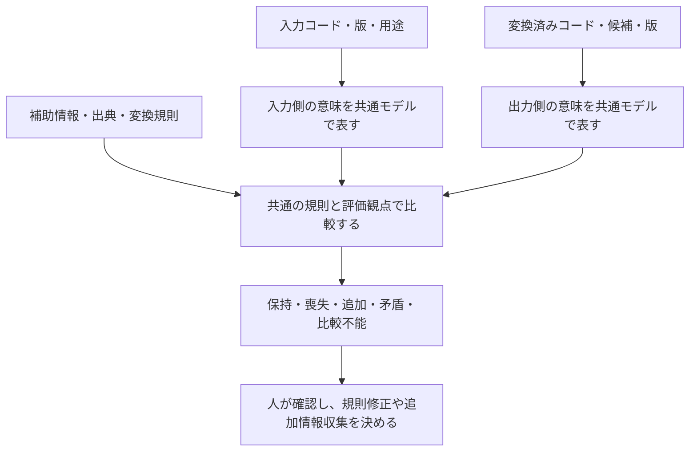

# R1：最終目標と、移行支援という中間目標

更新日：2026-10-18。状態：最終目標と中間用途の位置付けを整理済み。原理の形式化、技術的実現性、他の利用者の需要、既存方式に対する優位性は未検証。

目的の基準は [最終目標と設計原則](../vision.md) です。この文書の移行例と利用者像は、体系そのものを検証する中間目標に関するものです。

## 1. 今回の結論

**最終目標は、未来永劫、原理的に変化に耐えうる医療コード体系を確立することです。** 移行支援と意味差分の監査は、その体系を検証する中間目標です。最終目標に向けて、表現する内容の変化と、保つべき意味・互換性・拡張の仕組みを先に研究します。

中間用途の利用者を医療コード移行の設計・検証担当者、出力を変換前後で保持・喪失・追加される意味の報告とします。最初の実験者は開発者自身です。この利用者像をプロジェクト全体の対象に限定しません。

担当者が入力・出力のコード、各体系の版、用途、変換規則、利用した補助情報を与えると、変換先の候補と、保持・喪失・追加・矛盾・比較不能の内容を根拠付きで受け取ります。その結果を使って、移行規則の修正、追加情報の収集、人による確認、対象外とする範囲を決めます。

最初は、既存の変換結果や人が提示した変換候補を監査する利用も含めます。共通モデルの価値を調べるために、すべての変換機能を先に自作する必要はありません。

### 最終目標と応用との関係

利用者の構想には、将来の医療 AI を育てるために、AI が扱いやすい情報整理を用意するという設立動機があります。また、共通体系の上に医療者が使いやすい臨床ライブラリを整備・標準化し、医療者の行動をできるだけ変えずに、異なる記録・会計システムへ接続することを目指します。

素のコードや DSL は開発・保守で扱う内部表現とし、医療者は画面や定型操作を通じて利用する想定です。拡張性・普遍性は初期の設計要件に置きます。最初の検証用途を絞ることと、内部モデルを特定体系・診療科・AI の都合に固定することは分けて考えます。

| 長期的な要求 | 初期設計・調査で確認すること |
| --- | --- |
| 医療者の操作を保つ | 臨床操作、概念モデル、接続先固有の規則を分離できるか |
| 臨床ライブラリを標準化する | 概念・操作の定義、拡張規則、版、互換性、適合性の検証方法を共有できるか |
| AI が文脈を扱う | 本人と家族、現在と既往、確定と疑い、否定と未記載を区別できるか |
| AI が根拠をたどる | 原文・原コード・観察値、情報源、時点、変換・導出の履歴に戻れるか |
| AI の出力を再利用する | 生成候補、根拠、人による確認状態を保持し、確認前の内容と確認済み内容を区別できるか |

AI 向けの扱いやすさは、単に識別子を短くすることや、JSON に変換することでは評価しません。必要な情報を取得し、意味・文脈・根拠を解釈し、不足や矛盾を検証できるかを評価対象にします。特定のモデルでの成功だけで普遍性を確認したとは扱いません。

移行監査は、こうした意味・文脈・根拠を体系が保てるかを検証する中間用途です。AI による診断・処方や、臨床ライブラリ・画面の実装は今回の R1 の作業範囲には加えません。応用の要求は基礎原理の調査と設計に反映します。

## 2. 構想と検証する主張

利用者が目指すのは、将来の変化を受け止められる新しい体系です。既存体系を表現し、変換の情報差分を機械的に求めることは、その表現力と意味の保持を確かめる一つの方法です。

| 主張 | R1 での位置付け | 確かめる方法 |
| --- | --- | --- |
| 将来の変化に原理的に耐えうる体系を確立する | プロジェクトの最終目標として採用 | 変化の範囲と不変条件を形式化し、原理・反例・実証を分けて評価する |
| 体系をまたいで意味の差分を比較することに価値がある | 中間目標として採用 | 実際の作業と比較し、確認漏れと確認負担を評価する |
| 新しい体系へ既存のすべての概念を表せる | 長期的な研究目標 | 解釈・表現できた範囲と未対応を体系別に記録する |
| 意味の差分を機械的に計算できる | 対象モデルと規則を限定して検証する仮説 | 人が確認した差分と照合する |
| 将来の体系に接続するときの再設計を減らせる | 拡張性の仮説 | 設計時に使わない体系・版を後で接続し、変更箇所と工数を測る |
| 現在の変換方式は将来の移行に対応しきれない | 個々の方式について調べる仮説 | 対応表、共通語彙、合成文法、既存エンジンの実装を比較する |

「すべてを表現できる」は、外部コードを文字列として保存できることだけでは達成しません。その意味や適用条件を表現し、どこまで比較できるかを示す必要があります。

## 3. 利用場面の比較と選択

以下は中間用途の企画判断です。最終目標の選び直しや、市場調査・他施設への聞き取り結果ではありません。

| 利用場面 | 利用者と作業 | 共通モデルで確かめたい価値 | 初期の扱い |
| --- | --- | --- | --- |
| コード移行の意味の監査 | 移行設計者が、版更新や別体系への変換規則を点検する | 喪失と追加、比較不能を明示し、改訂時も同じ判定基準を使う | **中間目標の検証用途** |
| マスター・対応表の整備 | 用語担当者が、候補や対応関係を確認・改訂する | 一対一対応だけでは表しにくい条件や損失を記録する | 中間用途を支える利用場面 |
| 研究データの正規化 | データ担当者が、施設間・期間間のデータを統合する | 同じ変換結果でも原情報が異なることや、集計条件の変化を追う | 後続候補 |
| 診療時の入力・請求支援 | 医療者や医事担当者が、個別記録を入力・確定する | 意味の保持に加え、入力負担と運用規則への適合が必要 | 初期対象外 |

この移行実験の最初の対象は R3〜R4 で入手可能な一組に絞ります。体系そのものの評価は、新しい概念・関係・知識の修正等も含めて別に設計します。ICD-10 と ICD-11 は移行実験の候補のままで、領域や方向を今回の R1 では確定しません。

## 4. 監査する作業の流れ

現在の手作業の仮説は、対応候補を探し、両側の定義・包含除外・適用条件を読み、文脈や追加情報を確認し、差分を表に記録する流れです。実際の所要時間と見落としは未測定です。

共通モデルを用いる案では、このうち定義済みの条件に対する比較と報告書の再生成を機械に担当させます。意味の定義、対応規則の作成、判断不能な箇所の確認は引き続き必要です。

入力側を共通モデルへ取り込む段階、共通モデルから出力を生成する段階、出力の意味を読み戻す段階のそれぞれで、未対応や近似を記録します。出力だけを入力から推定して比較したことにせず、出力コードの定義に立ち戻って確認できるようにします。

## 5. 「失われる」「追加される」の作業上の定義

ここで比べるのは、同じ対象・時点・用途についてコードや明示された文脈が表す意味です。コードの文字数、項目数、JSON のキーの差を、そのまま意味の差分とは扱いません。患者の実際の状態とコード上の主張も分けます。

| 区分 | 作業上の定義 | 注意する点 |
| --- | --- | --- |
| 保持 | 入力が表す内容が出力でも保証される | 表記やコード数が違っても意味が同じ場合を含む |
| 喪失 | 入力で保証された内容が出力では保証されなくなる | 出力が反対の内容を主張しているとは限らない |
| 既存情報の明示化 | 入力と採用規則から導ける内容が明記される | 新たな臨床情報を得たこととは区別する |
| 補助情報による追加 | 原コードだけでは決まらないが、別入力で裏付けられる内容が付く | 情報源と確認状態を残す |
| 根拠を確認できない追加 | 出力に新しい条件があるが、入力・補助情報で裏付けられない | 虚偽と確定せず、確定出力を保留する |
| 矛盾 | 同じ対象・時点の内容が、定義した制約上両立しない | 判断には左右の排他性など、必要な制約の確認が要る |
| 比較不能 | 定義、対応、解釈機能が足りず判定できない | 差分なし、喪失なしと集計しない |

出力だけで保持できる情報と、元データを別添えして保持できる情報も分けます。原コードが手元に残っていても、出力コードだけを受け取る相手には伝わらない属性があり得ます。

### 架空例による確認

以下は意味を説明するための仮想的な体系 A・B・C の例で、実在する体系の分類・変換規則ではありません。部位と左右などの意味と制約は、この例の中で明示的に定義できると仮定します。

| 入力が表す内容 | 出力が表す内容 | 期待する監査結果 |
| --- | --- | --- |
| 骨折、右側 | 骨折 | 骨折は保持、右側という情報は喪失 |
| 骨折、左右の記載なし | 骨折、右側 | 右側という根拠未確認の追加。不足情報を要求 |
| 骨折、左右の記載なし。補助情報で右側を確認 | 骨折、右側 | 原コードに対して右側が追加されたが、補助情報に根拠あり |
| 概念 P。共通の定義で P は Q の下位概念 | 概念 P と Q を明記 | Q の明記は既存情報の明示化。追加の臨床情報とは数えない |
| 骨折、右側 | 骨折、左側 | 同一の事象に左右両立不可という制約を置いた例では矛盾 |
| 定義を取り込めないコード A-unknown | 対応候補 B-unknown | 比較不能。差分 0 と報告しない |
| A：骨折、右側 → B：骨折 | B から C：骨折、右側を要求 | B だけでは左右を復元できない。保持した原情報があれば、それを使ったことを記録して再評価 |

同じ考え方で、疑いから確定への変化、家族歴から本人の病態への変化、時点や単位の変化も監査対象にできるかを後続段階で調べます。

### 機械判定を主張できる範囲

意味の定義、対応規則、利用文脈、比較する観点、推論の方法がそろった範囲で、双方から何が導けるかを比較する案です。単純な属性の差集合を出発点にできても、同義表現、包含、論理和、否定、複数事象の関係を扱うには追加の意味規則が必要です。

出力からある内容を導けない場合、それを「出力コードでは保証されない」と判定できるか、単に対応や推論が未実装なのかを区別します。定義や実装が不十分なら比較不能とします。また、入力や知識の整合性を確認できない状態で、推論結果を差分確定の根拠にはしません。

監査対象の対応規則を使って出力側の条件を入力側にも付け、その一致をもって変換の正しさを証明する循環は避けます。対応候補を選んだ規則と、意味を比較する根拠を区別して記録します。

## 6. 将来の体系に対応するための要求

最終目標は、外部体系の接続に加え、概念・関係・知識・利用目的等の変化にも原理的に耐える体系を確立することです。以下は、そのうち外部体系の変化を用いた検証案です。基礎原理の作業定義と設計候補は [R2b](02b-change-model.md) に整理しました。

| 新しい体系での変化 | 想定する対応 | 評価すること |
| --- | --- | --- |
| 名称・識別子・コード形式が変わる | 入出力の接続定義を追加する | 既存の意味規則を利用できるか |
| 既存の属性を新しく組み合わせる | 合成・分解と適用条件を追加する | 組み合わせの意味と差分を保てるか |
| 新しい属性・関係・分類目的を導入する | 概念モデルや比較観点の拡張を検討する | 拡張範囲、既存結果への影響、再評価の負担 |
| 意味が公開されない・解釈できない | 原コードを未解釈の参照として保持する | 比較不能を隠さず、後で再解釈できるか |

新しい意味の取り込みには人や資料が必要です。未知の体系への自動対応や、内部モデルが将来も一切変わらないことを達成済みとはしません。コアをどこまで固定し、変化をどのように受け止めるか自体を研究します。接続時の変更量は実証指標の一つであり、永続性の原理的な根拠の検討も別に行います。

## 7. 一次資料で確認したこと

以下は今回確認した事実です。ここから MedDSL の優位性が立証されたわけではありません。

| 資料・確認箇所 | 確認した内容 | 本プロジェクトへの示唆 |
| --- | --- | --- |
| [FHIR R5 ConceptMap：Scope and Usage](https://hl7.org/fhir/R5/conceptmap.html#scope) | 対応には方向と利用文脈があり、意味関係や条件を扱う | 既存方式を単純な辞書と一括りにせず、項目・条件単位の差分との違いを R2 で調べる |
| [OWL 2 Primer：基本概念](https://www.w3.org/TR/owl2-primer/) | 明示した知識と、そこから導ける帰結を区別する。記載がないことを直ちに偽としない | キーの有無だけで意味の追加・否定を判定しない |
| [SKOS Reference：Mapping Properties and Transitivity](https://www.w3.org/TR/skos-reference/) | `closeMatch` を介した連鎖から同じ関係を自動では導けない | A→共通体系→B と接続するだけで同等性が保証されるとは扱わない |
| [W3C PROV Overview：Introduction](https://www.w3.org/TR/prov-overview/) | データの生成に関わる実体・活動・主体と由来を表す枠組みがある | 追加や推論の情報源を追う方法を R2 で比較する |
| [OMOP CDM 5.4：Condition Occurrence](https://ohdsi.github.io/CommonDataModel/cdm54.html) | 標準概念と原コードを保持する項目がある | 共通概念と原情報を併存させること自体を新規性とは主張しない |

確認日はいずれも 2026-10-18。OWL、SKOS、PROV を採用するかは未決定です。規範のある仕様と概要文書を区別し、ここでの示唆は本プロジェクトの解釈として扱います。

## 8. 中間用途に必要な成果物と評価仮説

最初の出力は、人が確認する**変換候補と意味差分の報告**です。最低限、原コード・出力コード・版・用途、使った定義と規則の版、各差分の根拠と情報源、比較不能な範囲、追加確認事項を含めます。

| 仮説 | 後続で評価する内容 |
| --- | --- |
| H1：意味の変化を明示すると移行の点検に役立つ | 喪失・追加・矛盾の検出、誤検出、見落とし、確認時間 |
| H2：共通モデルを介すと比較ロジックを再利用できる | 同じ観点を別体系・別版へ適用できる割合、必要な例外規則 |
| H3：未知の接続に必要な変更を局所化できる | 設計時に使わなかった体系・版での定義追加、モデル変更、再検証の範囲 |
| H4：判断できない範囲を正しく報告できる | 未解釈・未実装・根拠不足を差分なしと誤判定しないこと、有効に比較できた範囲 |

比較不能と答え続けるだけでは有用性を示せないため、比較できた件数・観点を分母付きで評価します。損失の重要度は用途ごとに異なり、情報が何ビット減ったかのような単一の数値は今回の目標に含めません。

## 9. D01 の決定と R1 の完了確認

| 項目 | 決定内容 |
| --- | --- |
| 決定日・根拠 | 2026-10-18。最終目標と中間目標を区別する利用者の指示 |
| 最終目標 | 未来永劫、原理的に変化に耐えうる医療コード体系の確立 |
| 中間用途の利用者 | 医療コード移行の設計・検証担当者。初期は開発者自身 |
| 中間用途 | 体系・版の移行における意味の変化の監査 |
| 結果の使い方 | 人が確認し、規則修正・追加情報の要求・未対応範囲を決める |
| 初期に採用しない用途と理由 | 日常診療や請求の自動確定。今回の差分検証に加えて業務・臨床上の検証が必要になるため |
| 見直す条件 | 差分を定義できない、資料や確認体制が不足する、検証の効果が見えない場合に、実験・実装・設計案を見直す。最終目標を直接変換ツールに置き換えない |

- [x] 最終目標と中間目標を区別し、中間用途の利用者、入力、出力、結果の使い方を定めた。
- [x] 利用場面を比較し、改善したい点検作業を特定した。
- [x] 喪失・追加・比較不能を含む架空例を示した。
- [x] 利用者の構想、一次資料の事実、未検証の技術仮説を区別した。
- [x] R2〜R5 で調べる論点と、未決定の範囲を残した。

R1 の目的と中間用途の定義を整理済みとします。外部の利用者への聞き取り、実作業の測定、性能評価は未実施です。後続の [R2b](02b-change-model.md) と [R3](03-data-access.md) で原理の比較材料・利用条件を整理し、次は R4 で評価を具体化します。
