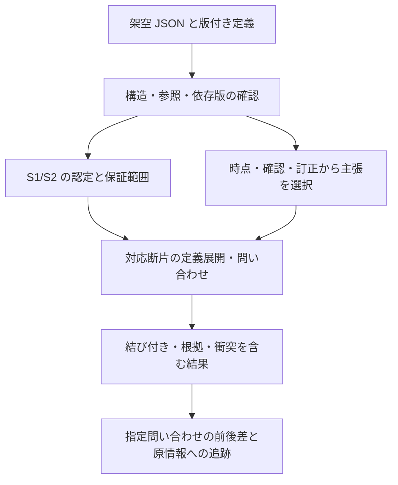

# R6：最初の試作 P0 の仕様と着手判断

作成日：2026-10-18。状態：D07 を研究用に決定した試作仕様。後続で P0-a の初期実装と開発テストを実施しました。[実行結果と未対応範囲](07-p0-a-results.md) を参照してください。P0 全体の受入評価は未完了です。

## 一枚の試作仕様

| 項目 | P0 で固定する内容 |
| --- | --- |
| 最終目標との関係 | 変化に耐える体系の最初の実証。旧意味を保つ定義追加、関係の結合、訂正前の解釈を実装で確かめる。移行ツールの完成を最終目標にしない |
| 作業者・利用場面 | 体系の設計・保守担当者が、定義追加の認定、架空記録への問い合わせ、主張の訂正、射影前後の差をローカルで確認する |
| 検証する原理 | R5 の S1/S2（限定した十分条件）、G1（役割の結合）、R1（履歴と採用の分離）。I1〜I7 の一部を扱い、I8 の臨床操作・実装間互換は後続 |
| 入力 | 版付きの架空定義パッケージ、文脈、主張・確認・訂正の台帳、参照時点、明示的な問い合わせ。すべてローカル JSON |
| 出力 | 認定とその保証範囲、記録上の支持・否定・未決・衝突・未評価、結合結果と根拠、問い合わせ単位の喪失・追加・比較不能。原入力への参照を保持 |
| 計算の範囲 | 有限の事実、単項述語の包含・正の連言による定義、同一文脈内の結合問い合わせ。新しい存在証人、任意の量化・否定推論・確率演算は対象外 |
| 最初の資料 | コミット可能な架空例のみ。実 CPC/FHIR は仕様の動機と後続材料で、P0 の外部依存・正解にはしない |
| 方向・用途 | P0 の比較は同じ架空プロファイル内の定義追加・記録更新・射影の before→after。実体系の初期移行用途 D04 は CPC 2026-09-08→2026-10-05 のまま別実験 |
| 技術構成 | Python 3.11 以降の標準ライブラリ、JSON、インメモリの純粋な処理関数と薄い CLI。最初の実行確認は現環境の Python 3.14.4 を対象とする |
| 配置 | `src/med_dsl/` に単一ライブラリ、`tests/` に意味契約の検証、`examples/p0/` に架空入力と期待結果。別パッケージ群へ最初から分割しない |
| 最初の到達点 | [P01〜P22](06-p0-contract.md) の研究用受入条件を満たす。R4 の全 K14・M40 件の合格や、臨床精度・普遍性の証明とは別 |

詳細な意味・入出力・状態・資源上限は [P0 契約](06-p0-contract.md) に固定します。最初の三つの具体例は [例の一覧](../../examples/p0/README.md) に置きました。期待結果は作成者草案で、評価器を実行した出力ではありません。

## 最初に動かす縦の流れ

医療者向け UI、DSL の文字列構文、LLM、実マスターの変換器、データベース、外部サービスはこの試作に含めません。臨床ライブラリや AI から使う将来の境界は、CLI を経由せず同じ処理関数を呼べる構成で残します。

## 既存方式との比較

意味表現の優位性を、実装していない比較方式との机上の点数で主張しません。P0 では次の二段階を分けます。

| 段階 | 同条件で比べるもの | 判定 |
| --- | --- | --- |
| P0 の工学的確認 | 役割付き関係テーブルを直接読む参照計算と、P0 に取り込み読み戻した結果。同じ肯定事実・文脈・質問を使用 | 問い合わせの集合と結合が一致すること。P0 の情報損失を見つけるためで、有用性の優位を示す比較ではない |
| 中間用途の後続評価 | R4 の B00・B01・B02・提案体系。同じ資料・条件付き対応根拠・補助情報・候補範囲 | 24+16 件と実資料で、候補、差分、負担を測る。P0 で未実装の対応候補生成を測定済みにしない |

HAPI FHIR・ROBOT は P0 の最小機能に必要としないため導入を見送ります。候補から永久に外す判断ではなく、実体系への接続・OWL/FHIR の適合検証を実装するときに再評価します。RDF・SHACL・PROV 等も概念上の参照を維持し、今回独自実装する P0 がそれらに適合すると称しません。

## 実装を小さく進める順序

| 段階 | 作るもの | その段階の確認 |
| --- | --- | --- |
| P0-a | JSON 入出力、参照固定、有限の役割付き事実と問い合わせ | P06〜P08・P16・P18 の該当部分。全値が残っても結合を失う例を検出 |
| P0-b | 定義の依存閉包、S1/S2 の認定と断片内の展開 | P01〜P05・P19・P20。認定外と危険を混同しない |
| P0-c | 主張・確認台帳、参照時点、明示的な訂正、未知能力の停止 | P09〜P15・P17・P21・P22。AI・疑い・未記載を確定へ変えない |
| P0-d | 問い合わせ単位の比較、根拠追跡、二回実行の一致と総合記録 | P01〜P22 の全件。入力・期待値・実装版と結果を保存 |

全体の最低条件は 22/22、根拠のない確定・誤った保存認定 0、必要な停止の見落とし 0 です。部分実装では未対応件数を残し、対象を後から減らして合格扱いにしません。結合、定義展開、確認済み主張を返す正例も必須にし、全棄権を通しません。

処理時間と変更量は記録しますが、初回のデータを見て性能合格値を後付けしません。初期の資源上限は P0 契約で事前指定し、打切りは正常な否定や対応なしと区別します。

## 着手条件と残る確認

| 条件 | 今回の状態 |
| --- | --- |
| 最終目標、原理、仮定、対象範囲 | R5 の原理と P0 の限定を明記済み |
| 入力資料と利用条件 | 架空例で着手可。D03 の実資料の保留範囲を広げない |
| 入出力・状態・ケース・最低条件 | [P0 契約](06-p0-contract.md) を策定。三例を JSON 化、残りは受入仕様として記述 |
| 作成者草案による開発 | 着手可。草案との一致を研究用に検証する |
| 独立した正解確認と凍結 | 確認者未割当。R4 の独立確認・裁定・評価凍結は未完了 |
| 臨床利用・精度主張 | 対象外。臨床確認、実資料の意味追跡、実務評価が必要 |

**D07：P0 の研究実装へ進む条件は満たした**と判断します。レビュー待ちを理由に全研究を止めず、作成者草案による工学的な試作として進めます。草案のファイルハッシュを記録したスナップショットと、独立確認後の評価用正解の凍結は区別します。

仕様策定後に P0-a の JSON 入出力・事実照合と、必要な主張選択を実装しました。外部依存は追加していません。次は P0-b の認定・定義推論です。主張の支持と論理含意の境界、異なる意味プロファイルの引き継ぎ、原実体の長期保存は継続課題とし、P0 の成功で解決済みにしません。
