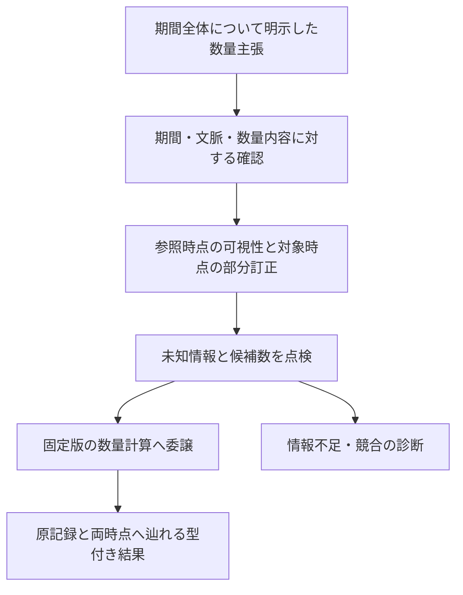

# P2-i：時間と測定の併用契約の意味設計

作成日：2026-10-20。状態：**作成者側の設計草案。runtime・native仕様・宣言・実行用fixtureは未実装**。[P2-hの結果42](42-p2-h-results.md) の次の判断です。[手指定期待44](44-p2-i-cases.md) と合わせて読みます。独立確認・評価用正解の凍結は未実施です。以下は架空の記録に対する作業定義で、医学的な持続や外部標準への適合を定めません。

## 1. 比較から分かった不足

| 契約 | 時間と訂正の意味 | そのまま併用できない点 |
| --- | --- | --- |
| [P2-e](31-p2-e-design.md) | 明示した有限半開区間、対象時点ごとの部分訂正、肯定・否定の点検 | 単一原子の台帳で、数量・測定記録全体への内容指定確認を持たない |
| [P2-g](37-p2-g-design.md) | 測定の対象は瞬間。slot内の記録版全体を訂正 | 対象時点の一点を期間へ広げられず、部分訂正の外側を残す規則がない |
| [P2-h](40-p2-h-design.md) | P2-gの固定した計画を再実行してから丸める | 任意の量を渡せる汎用表示APIではない。表示は対象時点・記録の識別を符号化しない |
| [JOINT](25-p2-c-design.md) | 基底読み取りと分割公理の併用を有限評価 | 異なる採用方針・確認の対象・時間領域の接続を自動的に保証しない |

主な反例は、Aが期間全体を覆い、Bがその一部だけを訂正する場合です。P2-gの全体訂正を先に使うと、その一部以外でもAが消えます。逆に、瞬間の測定を区間全体で使うと、原記録が述べなかった持続を追加します。原JSONを保持し、各モジュールが個別に通過しても、この差は埋まりません。

今回の研究上の問いは、**期間について明示された数量主張を、内容を指定した確認・部分訂正・数量計算へ結び、追加した前提と保つ観測を明示できるか**です。

## 2. 選定と境界

| 案 | 利点・不足 | 判断 |
| --- | --- | --- |
| P2-gで全体選択し、後から期間を絞る | 旧処理を再利用できるが、部分訂正の外側が消える | 採らない（C05/C06） |
| 時間側で残った記録をP2-gへ渡す | subsetだけでは旧確認の意味や原sourceの識別を保てず、時点を捏造するadapterになり得る | 自動翻訳は採らない（C28/C29） |
| 期間つき数量主張の専用R5で選び、P2-fへ委譲 | 新方針・確認対象・原情報を明示できる。旧台帳との自動互換はない | **P2-iの初回断片に選定** |
| 期間つき測定・比較・表示を同時に一般化 | 時間相関、比較可能性、表示の再検証まで広がる | 初回は換算のみ。比較・表示は後続契約へ分ける |

新しい意味クラスは増やしません。R5の共通4＋必須3に、TM-1〜12を加える案です。P2-e/P2-gの実行結果をJOINTの認定へ昇格させるものではありません。

### 2.1 入力する主張の意味

期間つき数量主張は、入力者が**指定した区間の各時点について、指定した文脈で数量領域が適用される**と明示した記録です。単一点の領域なら区間全体について同じ値を述べます。幅のある領域なら各時点の値をその領域に制約しますが、異なる時点の実値の同一性・相関・連続性を追加しません。実測過程や医学的真実を保証しません。

瞬間の測定、区間内で集計した値、採取に要した期間、機器の稼働期間、医学的に持続すると推定した状態は、この主張と自動的に同一視しません。P2-gのinstantは同梱して変換せず、別の原記録として残します。旧記録を利用して新しい期間主張を作るなら、その期間・解釈・根拠を含む新しい記録と確認が必要で、無損失な構文変換とは扱いません。

## 3. 初回の型と内容指定確認

以下は予約案で、現在のCLIが受理するschemaではありません。実装時にnative仕様の生バイトhashを確定し、仮のhashを有効な値として使いません。

| 項目 | 予約する型・範囲 |
| --- | --- |
| profile | `p2-temporal-measurement-draft-1` |
| request / result / source | `p2-temporal-measurement-request-draft-1` / `p2-temporal-measurement-result-draft-1` / `p2-temporal-measurement-ledger-draft-1` |
| 操作 / 回答型 | `evaluate_temporal_measurements` / `temporal_measurement_projection` |
| 方針 | `fiction:reviewed-scoped-measurement@1` |
| 要求 | `schema_version, operation, consumer, source, views, queries, budget` |
| consumer | `profile, profile_spec_sha256, operations, quantity_profile, quantity_profile_spec_sha256` |
| source | `schema_version, ref, slots, quantities, records, reviews`。参照は同梱snapshot内だけで解決 |
| slots / quantities | P2-gと同形の `{id, subject_ref}` / `{ref, profile, profile_spec_sha256, literal}`。literal.id=ref。原wrapperを変更しない |
| record | `id, kind: period_quantity, slot_ref, subject_ref, property_ref, specimen, method, validity, quantity_ref, certainty, recorded_at, origin, required_capabilities, revises`。revisesが非空ならchange_reason必須 |
| review | `id, record_ref, record_sha256, reviewer_ref, reviewer_kind: human, recorded_at, outcome: confirmed` |
| view | `id, as_of, policy_ref`。UTC秒精度。1〜64件 |
| query | `id, kind: convert, slot_ref, target_at, target_unit_ref`。UTC秒精度。1〜64件 |
| 上限 | slot/quantity/record各64、review128、1 MiB・深さ64、整数予算0〜100000。boolは整数にしない |

recordのrequired_capabilitiesには新profileを必須とし、理解集合は記録について新profile、数量についてP2-fのprofileだけとします。旧P2-g/P2-eのprofileを並べるだけでは新しい意味を理解したことにしません。

quantity_refは `{ref, sha256}`。数量のprofileは `p2-quantity-literal-draft-1`、native仕様hashは `84af2e771d1868471d0a8441021fde2a7253b1fc17f8ff9b807461e3df7f1f43` に固定します。propertyの三つの架空IDと量種の関係はP2-gと同じ表を、新native内に明示して固定します。同じ文字列だから意味を共有するとはせず、実装時の表一致を検査します。

specimen/methodはP2-gと同じknownのref/版、unknown、unspecifiedの型です。確定性はconfirmed/suspected、originは既存の四種のkindとref。欠落・null・既知の型の誤りはinvalid_input、未知の非空property・量種・単位は選択後の意味停止です。property/量種や次元の既知の矛盾は全体の入力不正とします。

validityはP2-eと同じbounded/unknown/unspecifiedを区別し、boundedはUTC秒精度でstart<endの `[start,end)`。open_end、instant、集計期間、not_applicableはunsupported_profileです。effective_atとsupersedesを新記録の別名として受理しません。

revisesは同じslot・主体の、厳密に前の記録を直接指します。両者の期間はboundedで、訂正元の区間が各訂正対象の区間に包含されることを要求します。対象の確認は必須ではありません。異なるslot・自己・未来・循環・期間を広げる訂正はinvalid_input、不明期間を含む訂正はunsupported_profile。未知期間の精密化・解消は初回に設けず、阻害が恒久的になり得る限界を明示します。

同じslotでproperty・検体・方法・数量を訂正できますが、期間の外側の文脈は変更しません。区間境界を拡張する訂正やslotの統合・主体の変更・撤回・否定は別契約です。

```text
Hq(q) = H(quantity wrapper全体)
Hr_i(a) = H({binding_profile: 新profile,
             binding_spec_sha256: 新native仕様hash,
             source_ref, record: a})
Hs_i(S) = H(sourceのslots/records/reviewsをid順、quantitiesをref順にしたもの)
```

Hは既存canonical_bytesとSHA-256。内部配列や未約分表記は正規化しません。Hr_iはvalidity・revises・originとHqを通じた数量内容を含みます。確認は新しいHr_iへの一致を要求し、P2-eのIDだけの確認やP2-gのHrを流用しません。旧確認を変換器が作り直すことも認めません。hashは本人認証・署名・真実性・永続IDの不変性の保証ではありません。

## 4. 二時点の選択と停止

全sourceの型・参照・hash・確認時刻・訂正包含・依存版を予算前に検査します。妥当な未来の追加に対する非干渉と、未来の不正入力を拒否することは別です。

slot s、参照時点k、対象時点tについて次を定義します。

```text
V(s,k) = {a | a.slot_ref=s かつ a.recorded_at<=k}
E(s,k) = {a∈V | certainty=confirmed かつ
                 kまでに見える内容一致のhuman/confirmed確認がある}
C(s,k,t) = {a∈E | validity=bounded かつ start(a)<=t<end(a)}
D(s,k,t) = {b.id | a∈C かつ b.id∈a.revises}
A(s,k,t) = {a∈C | a.id∉D}
```

Dは最終的なAでなく、**Cの全適格な訂正辺**から計算します。後で除かれた訂正元の辺も有効です。未確認の中間記録を通じて祖先を推移的に除きません。対象時点が異なれば、同じsnapshot・as_ofでも別の版が選ばれます。

| 順位 | 条件 | 完了した行の結果 |
| --- | --- | --- |
| 1 | Vの記録またはその参照数量に未知能力 | unassessed / unknown_capability。保留・訂正済み・期間外も対象。未参照slotと未来は対象外 |
| 2 | Eにunknown / unspecifiedの期間 | unassessed / validity_unknown、validity_unspecified。該当する両理由を整列 |
| 3 | Aが0または2以上 | unassessed / no_adopted_measurement、unresolved_measurement_conflict。同値でも一つにしない |
| 4 | 唯一の記録に未知property、検体/方法のunknown/unspecified、量種・単位の未知 | unassessed。P2-g/P2-fと同じ理由名を該当するだけ整列 |
| 5 | 上記なし | P2-fのconvertへ委譲し、computed / converted_domain |

unknown期間の保留・suspectedは順位2を阻害しませんが、未知能力は順位1を阻害します。既知の期間外の記録の未知method等は順位4を阻害しません。同じ不明値を一致としません。候補なしは数量零・明示否定・治癒を意味しません。

幅のある数量領域はP2-fが扱う厳密な領域のまま換算できます。期間の長さを数値の幅や測定の不確かさへ変換しません。初回はcompareを受け付けず、異なるtで同じrecordを参照したときの数値変数の同一性や時間相関も定義しません。

## 5. 計算、根拠、表示への境界

選んだ記録版に局所数量IDを割り当て、コピーにそのIDを与えたP2-fの一数量・一convert要求を作ります。元ID・wrapper・recordは保持し、対応表、子の入力hash、子の数学的根拠を返します。P2-gのrecordやhuman確認を合成して呼び出す経路は設けません。

完成したcomputed行にだけ `converted_domain, binding_evidence, calculation_evidence` を公開します。binding_evidenceはprofile/仕様hash、Hs_i、view/as_of、query/target_at、policy、slot、選択record/Hr_i、quantity/Hq、可視の確認ID、効いた全訂正辺と各確認ID、局所ID対応を含みます。前提は `explicit_period_quantity_domain` と `scoped_revision` とし、実際に使わなかった確認・未来の確認を根拠にしません。

意味上停止した完成行は、値・両完成根拠をnullとし、診断だけに可視の阻害記録・候補・訂正辺を残せます。予算未完了行ではdiagnosticsもnull、assessment_complete=false。意味上停止して全手続きを終えた行はtrueです。元sourceは原順序で一度保持します。これはアクセス制御の保証ではありません。

rootのcertificateは常にnot_certified、clinical_confirmation=not_evaluated、review_verification=structural_only、uncertainty_propagated=false、converted_to_base=false、clinical_assertions_added=[]。数量計算・選択・人の確認を医学的な認定へ上げません。



### 表示を後続契約に分ける理由

P2-hはP2-gの計画・native依存・選択根拠を検証するため、新sourceをそのまま受け付けません。privateな丸め関数だけを呼び、旧表示profileの認定票を付けることもしません。後続で表示を接続するなら、新しい要求・依存・共有予算・根拠の検証を設計します。

各tで1.21と1.24が選ばれ、同じ「1.2」になる場合、1.22以上かは表示だけでは決まりません。また、t1とt2で同じ表示でも、どの期間・記録についてかは表示artifactだけでは戻りません。表示に因子化する問いへの認定と、上流の時間・測定の解釈への認定は別です。原sourceを別添えすれば答えられることは、その区別が表示に保存されたことを意味しません（C30〜C32）。

## 6. 共有予算と再現

初回の課金案はP2-gと形が同じですが、新しい選択の実費として別に固定します。view/queryはID順。行の料金を全て先払いし、数量の子へ8だけ渡します。意味上停止した行でも同じ予約料金を払い、返却・キャッシュ割引は設けません。

```text
I = 1 + N_slots + N_quantities
    + Σview [N_records + N_reviews
             + Σquery (2 + |V(s,k)| + Σa∈E(s,k)|a.revises| + 8)]
```

辺の料金はtを覆うCだけでなくEの全辺を数えます。対象時点で結果が出やすい順に予算を変えません。子の実費8を予約に含め、親へ二重計上しません。行の予約不足なら子を呼ばず値と根拠はnull。子が別の資源で停止した場合はrootもresource_limitで、その部分結果を拾いません。先に完成した行を保持します。rootのokは手続き完了で、全行computedを意味しません。

標準一slot・一数量・一記録・一確認・一view・一queryは16。queryが二つなら27。AとBが別数量を使いBがAを訂正する場合、一view一queryは21、二queryは34です。これらは手計算の設計値で、runtimeの実測ではありません。

snapshot、両時点、方針、依存版、処理系が再現の入力です。四表の外側だけの並べ替えはHs_iを変えず、要求hashは変わり得ます。Hr_i・Hq・Hs_iをまとめて比較から除きません。未来の妥当な記録追加は過去の完成した意味結果を保てても、Hs_i・原source・料金は変え得ます。有限予算で両方が完成することも前提です。

## 7. 条件つきの導出と個別義務

以下は作成者の手作業の導出で、機械証明・独立確認ではありません。

| 導出 | 前提と結論 | 含まないこと |
| --- | --- | --- |
| TM-L1 | 新profile・全record・HqをHr_iが拘束し、確認を照合するなら、期間・値・訂正辺の変更に旧確認を流用できない | 記録と確認を一緒に偽造する攻撃や本人認証 |
| TM-L2 | tが訂正元の区間外ならその元はCに入らず、その辺で元記録は除かれない | 未知能力・不明期間等の停止を無視した非干渉 |
| TM-L3 | DはCの全辺から計算するため、後で訂正元が除かれてもその対象は自動復活しない | 未確認の中間辺を介した推移的除去 |
| TM-L4 | k以下の記録と確認だけでEを作れば、妥当な未来追加は同じk,tの完成した選択・数値を変えない | source hash・予算・保持一覧の不変 |
| TM-L5 | 固定snapshot・kでは、既知の期間境界間でC/D/Aは一定。各境界と間の代表点でこの有限集合を被覆できる | 全ての期間、臨床的な持続、時間論理一般の証明 |
| TM-L6 | 量の固定版・原literal・単位と明示した局所ID対応を保持すれば、選択後の数値換算の根拠を追跡できる | 選択自体の医学的正しさや時間相関 |

| 義務 | 内容 | 防護条件 |
| --- | --- | --- |
| TM-1 | 瞬間・集計・期間主張の非同一視 | C01、C28、N08 |
| TM-2 | 両時点・確認の可視性と未来非干渉 | C02〜C04、C09、C23 |
| TM-3 | 半開境界・包含・部分訂正の外側 | C05〜C07、N04/N05 |
| TM-4 | 全適格辺・非復活・非推移・競合保持 | C08〜C12 |
| TM-5 | unknown/unspecified・能力・slot範囲の停止順 | C13〜C19、N06/N07 |
| TM-6 | 期間・文脈・数量と依存版を含む内容指定確認 | C20/C21、C29、N03/N09 |
| TM-7 | 量種・文脈・数学的領域を分離し厳密換算 | C22/C24/C25、N10 |
| TM-8 | 原source・出自・両時点・訂正根拠の再現 | C21/C23/C26/C27、N12 |
| TM-9 | 共有予算・行全体の予約・子の一回呼出 | B01/B02、N11 |
| TM-10 | 完成値・根拠・diagnosticsの原子性 | B01〜B04 |
| TM-11 | 型付き結果と表示・臨床・基底認定の分離 | C25、C28〜C32、N08 |
| TM-12 | 旧要求の非干渉・決定性・変更波及の識別 | C26/C27、N01/N02/N12 |

R5-1は方針差と新しい期間前提、R5-2はnot_certified、R5-3は臨床主張を追加しない条件へ対応します。共通K-ID/K-STOP/K-INV/K-RESも必須です。19義務の登録・防護例参照は未作成で、既存の182義務へ加算しません。PO17の汎用的な解決や、既存の防護例なし3義務の解消とも扱いません。

今回得た原理の候補は、**併用時には型の共存だけでなく、前提・選択の順序・確認が拘束する内容・問いの範囲・資源・観測の対応を接続ごとに定める必要がある**というものです。一つのR5を足せば任意の能力が合成できる、という原理にはしません。

## 8. 次の実装への受入条件

1. [C32/N12/B4の期待44](44-p2-i-cases.md) をruntimeより先に保持する。設計式の有限点検とruntime評価を別の分母で記録する。
2. 専用native・handler・R5宣言・fixtureを追加し、時間・測定・量・表示・旧核を変更しない。必要になった変更は旧版と理由を残して再設計する。
3. 選択を区間差引きの別計算と照合し、小さい包含可能DAG、確認遅延、suspected、半開境界、複数slotの阻害範囲を検査する。量計算の呼出と原値の保持は別に照合する。
4. 全体訂正への誤置換、最終採用元だけの辺、未確認辺の推移利用、latest-wins、同値統合、未来の確認、能力の期間外除去、旧確認流用、予算リセット、根拠の早期漏出の変異を検出する。
5. 行料金・子のbudget=8・一回呼出・未完了nullを予算掃引で照合する。子のサイズ/深さ・算術停止は部分結果を再利用しない。
6. Python 3.11/3.14で新経路と旧231/52/8/P2 251件、旧22,052出力、P2-hまでの追加前挙動、生成器、版比較つき統合評価を回帰する。
7. 追加前の基準は `d13c98a`、818ファイル、manifest `33b1bcf9ad540d0ce60e956831e9b33b8a81c844698cda6e17c99bcec80350b7`、束 `7bf00222d5a6d39394c4922e85bfa2f8e1873c20e77ff9d87b7808619b70808f`。本設計時点で固定対象・登録件数・評価分母を変更しない。
8. 実装結果は別文書に件数・hash・環境・残る穴とともに残し、その後に表示への接続を選定する。独立確認をこのリポジトリの進行条件にはしない。

今回は内部契約31/37/40とnative実体を比較しました。新しい外部仕様の適合・医学的な期間・実単位を主張せず、外部データは取得していません。既存の一次資料調査は [測定の資料37](37-sources.md)・[表示の資料40](40-sources.md) と区別します。

未解決なのは、未知期間の精密化、瞬間/集計記録からの明示的な意味引き継ぎ、縦断比較・相関、表示の接続、認証・永続台帳、実体系への接続・標準化です。最終目標は変化に耐える医療コード体系そのものの確立であり、この有限の併用設計はその一つの検査です。
