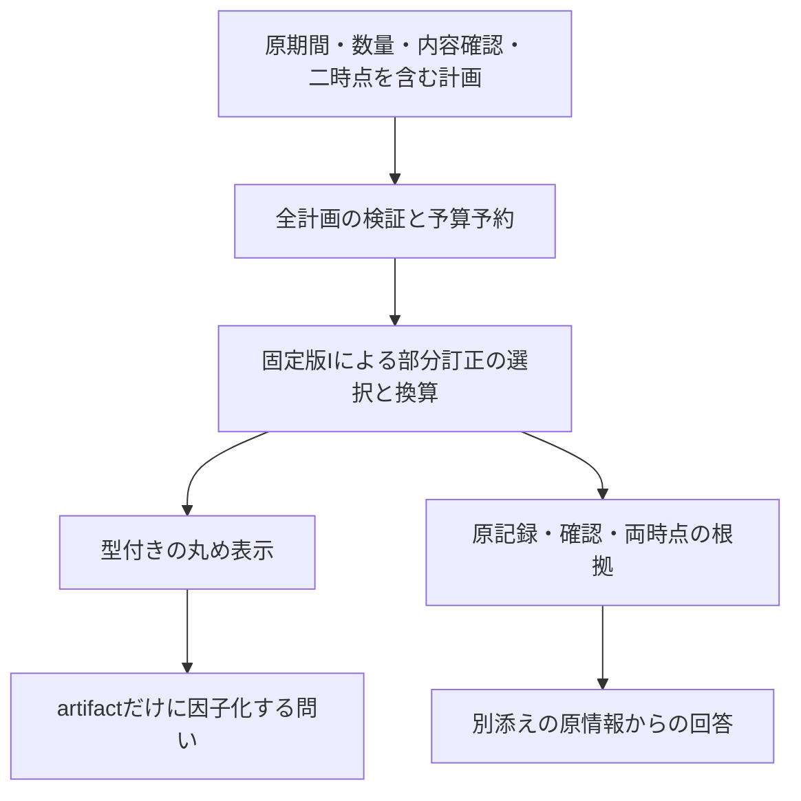

# P2-j：期間つき数量と表示を結ぶ契約の意味設計

作成日：2026-10-20。状態：**作成者側の設計草案。runtime・native仕様・宣言・実行用fixtureは未実装**。[P2-iの結果45](45-p2-i-results.md) の次の判断です。[手指定期待47](47-p2-j-cases.md) と合わせて読みます。独立確認・評価用正解の凍結は未実施です。以下は内部契約の比較から定める作業定義で、医学的な期間・閾値・外部標準への適合を主張しません。

## 1. 比較と選定

問いは、**期間つき数量の選択根拠を保持したまま、丸めた表示だけで保存する問いを限定できるか**です。[P2-i](43-p2-i-design.md) は内容一致の確認と二時点の部分訂正を点検するR5で、常にnot_certifiedです。[P2-h](40-p2-h-design.md) はGの計画を再実行するR4で、任意の上流結果を受け取る表示関数ではありません。

| 案 | 評価 | 判断 |
| --- | --- | --- |
| P2-iの結果JSONをそのまま表示へ渡す | 内容hash・自己申告だけでは選択と計算の実行を検証できない | 初回の入口にしない |
| Iの記録からGのinstantとhuman確認を合成しHへ渡す | 期間・確認対象・訂正の解釈を変え、存在しなかった確認を作り得る | 採らない |
| Hのprivateな丸め関数を呼び、Hのprofileを付ける | 数式が同じでもG固定の依存・根拠・認定の契約を満たさない | 採らない |
| **Iの計画を固定版で再検証・再実行する専用R4** | 二時点・原記録・確認を保持し、表示の問いを別に評価できる | **P2-jとして選定** |

新しい意味クラスは追加しません。共通4＋R4の3＋TD-1〜12の19義務を設計します。IのR5の認定を変更せず、Jの認定はartifactだけに因子化する問いに限ります。JOINT一般や、時間の選択自体の保存を認定するものではありません。

## 2. 専用の入口と固定する依存

以下は予約名です。現在のCLIが受理するschemaではなく、自己native仕様hashは実装時に確定します。

| 項目 | 予約する型・範囲 |
| --- | --- |
| profile / operation | `p2-temporal-display-draft-1` / `project_temporal_measurement_displays` |
| request / result / artifact | `p2-temporal-display-request-draft-1` / `p2-temporal-display-result-draft-1` / `p2-temporal-display-artifact-draft-1` |
| 回答型 | `temporal_measurement_display_projection` |
| 要求 | `schema_version, operation, consumer, temporal_measurement_plan, displays, retention, budget` |
| consumer | `profile, profile_spec_sha256, operations, temporal_measurement_profile, temporal_measurement_profile_spec_sha256, quantity_profile, quantity_profile_spec_sha256`。operationsは当該一操作のみ |
| temporal_measurement_plan | Iの要求からbudgetだけを除いた計画。schema/operation/consumer/source/views/queriesをそのまま保持。別の子予算欄は持たない |
| displays | 1〜64件。`id, view_ref, query_ref, decimal_places, rounding_policy, required_capabilities, questions` |
| 表示指定 | Iに存在するview/queryを明示参照。pは整数0〜6、方針は `fiction:decimal-half-even@1` |
| questions | 各表示1〜16件、IDは表示内で一意。§4の七種類 |
| retention | `none` / `source_bundle`。noneでも出所・二時点の根拠は残す |
| 共通上限 | 1 MiB・深さ64、整数予算0〜100000。閾値の分子/分母63bit以下、分母正。bool・生小数・NaN等を自動変換しない |

- Iのprofile：`p2-temporal-measurement-draft-1`
- Iのnative仕様hash：`80785e67b978fe9801d36c653a003d8954cba517b4a16500a2bc648931d80705`
- 数量profile：`p2-quantity-literal-draft-1`
- 数量native仕様hash：`84af2e771d1868471d0a8441021fde2a7253b1fc17f8ff9b807461e3df7f1f43`

自己・I・量のconsumerとnative実体を固定して照合します。Iの全計画をbudget=0の検証用要求として構築し、構造・全参照・内容hash・確認時刻・区間包含・依存版・入力数値の検査だけを先に行います。意味計算はまだ呼びません。未来・未参照の不正を無視せず、利用者が送ったresult/certificate/artifactを根拠にしません。

登録の依存案はp0-positive draft-2、p2-quantity-literal draft-1、p2-temporal-measurement draft-1です。H/Gへの依存や読み取りは宣言せず、数学的な丸め規則を新nativeにも明示して検査します。

Iの初回は全queryがconvertです。別操作・方針・profile・意味型はunsupported_profile、欄・型・参照・hash不正はinvalid_input、静的上限はresource_limit。pの負数・boolはinvalid_input、6超の整数はunsupported_profileです。表示の必須能力には新profileを含め、追加の未知能力は当該表示行をunassessedにします。I側の可視slot内の能力検査を省く根拠にはしません。

## 3. artifactの意味と数学的な射影

Iの当該行がcomputedで、換算領域が閉じた単一点なら、その厳密有理数xを表示します。閉じた一点区間は可能、幅のある区間はunassessed / unsupported_display_domainです。期間内の代表時刻や数値の中点は作りません。

丸めはHと同じ数式を新しい契約にも明示します。s=10^p、a=floor(sx)、f=sx−aとして、f<1/2ならa、f>1/2ならa+1、等距離なら偶数の方を係数kとします。整数商・剰余から直接決め、floatや有限精度の事前丸めを経由しません。k=0の符号は統合し、ASCII・小数p桁・末尾零を保持します。中間256bit・text64文字を防護上限とする案です。

```text
artifact = π_J(完成した上流行; 型と表示方針)
  schema_version, profile, profile_spec_sha256,
  quantity_profile, quantity_profile_spec_sha256, quantity_kind_ref, unit_ref,
  rounding_policy, decimal_places, coefficient, text

L = (2k−1)/(2*10^p), U = (2k+1)/(2*10^p)
F(k,p) = [L,U] if k is even; (L,U) if k is odd
```

artifactには新しいJのschema/profile/仕様hashを使います。自己の仕様がIの依存を固定するため、同じ数式・textでもHのartifactへ偽装しません。H/J間でhashやprofileを削除してartifact同一と判定する互換規則は設けません。数式・coefficient・textの手指定期待の比較は、完全なartifactの同一性と別です。

record ID、source hash、原値、両origin、validity、as_of、target_at、view/query/display ID、原値との差はartifactへ入れません。型・単位・方針・pは表示の意味で、sourceの出自とは分けます。artifact hashは全欄のcanonical JSONのdigestです。符号化・復号一致もartifactだけを対象とします。

Fは丸め関数の実数上の逆像で、期間・測定誤差・真値・確率区間ではありません。固定した入力上限で到達できる値はFの部分集合です。セル全体を用いた判定は保存の十分条件で、全受理入力に対する完全な喪失判定とはしません。

## 4. 表示の問いと原情報からの回答

thresholdは参照convertのtarget_unit_refで指定した単位の数値です。入力は `{id, kind: threshold, operator: lt/le/eq/ge/gt, threshold: {numerator, denominator}}`。それ以外の六種類は `{id, kind}` だけとします。

| kind | projection_answer / status | source_bundleでのsource_answer.answer |
| --- | --- | --- |
| display_text | artifact.text / preserved | null。追加情報を読まない |
| threshold | F全体で一定ならbool / preserved、他はnull / out_of_scope | 換算後の厳密値xとの比較bool |
| exact_value | null / out_of_scope | 換算後の約分した有理数 |
| selected_record | null / out_of_scope | `{record_ref, record_sha256}`。出所は別添えと根拠に結ぶ |
| target_at | null / out_of_scope | 当該I queryのtarget_at |
| as_of | null / out_of_scope | 当該I viewのas_of |
| validity | null / out_of_scope | 選択した記録の元のbounded validity |

後五種類を常にout_of_scopeにするのは初回テンプレートの範囲指定です。固定されたk/tだけを扱う狭い入力族では、時点の問いが定数として因子化する場合もあります。それも判定する完全な解析器を作ったとはしません。

形式的には、Iが選択・換算を完了する入力と行の組をXとし、π_Jはその数値と型・方針からartifactを作ります。記録や時点を読むqはX上の関数です。k/tも変わるX上で同じartifactに異なるqが対応する反例は、「全ての行についてartifactだけでそのqを復元する関数がある」という主張を否定します。**k/tを固定した別の入力族にもその反例がそのまま適用できる、とは言いません。** 記録の識別の反例は同じk/tでも別に作ります（J27〜J29）。

閾値の判定はHと同じです。セル両端が閉じているかをcとし、閾値をzとします。

| operator | 全てtrue | 全てfalse |
| --- | --- | --- |
| lt | U<z、またはU=zで開端 | L≧z |
| le | U≦z | L>z、またはL=zで開端 |
| eq | なし（セルは正の幅） | zがセルの外。開端上も外 |
| ge | L≧z | U<z、またはU=zで開端 |
| gt | L>z、またはL=zで開端 | U≦z |

どちらでもなければprojection_answer=nullです。falseは完成した回答で、nullとは区別します。原値でたまたま正しく答えられても、projectionへ流用しません。

source_answerは完成した表示行でだけ `{mode: source_replay, answer: ...}` として別に返します。retention=noneまたはdisplay_textではnullです。再検証済みIの値・選択と保存した計画を追加情報として使い、Iを二度呼ぶことはしません。source_answerが一つでも実際に出るとadditional_source_used=true、bundleを持つだけならfalseです。別添えはout_of_scopeをpreservedへ変えません。

上流が停止した行では、target_at自体が入力にあってもmetadataの回答だけを別経路で完成させません。この初回は表示が完成する行に限る契約で、全てのメタデータを照会するAPIではありません。

noneでもprojection_evidenceには時点・記録への参照があるため、「応答全体からその情報を読めない」という主張ではありません。問いの認定が対象にするのはartifactだけです。呼出側が要求のtを知っていること、根拠からtを読むこと、π_J自体がtを符号化することを混同しません。

## 5. 二時点・確認・部分訂正の根拠

完成した表示行のprojection_evidenceは、自己/I/量の仕様hash、実際のI子要求hash、予約料金Cと子の実費、Hs_i、view/query、as_of/target_at、選択record/Hr_i/validity、quantity_ref/Hq、可視確認、効いた全訂正辺と各確認、Iの前提・両origin・子のnot_certifiedを保持します。artifactのcanonical bytesのbase64・hash・実際の復号一致もここへ置きます。原値・原値との差・I結果全体をこの欄へ混ぜません。

retention=source_bundleでは、J要求からbudgetだけを除いた原要求を `source_bundle.request_plan` に保持します。Iのsource、両時点、内部の配列順、未約分の原literal、元の確認を変更しません。原予算を含む入力hashの完全再現には、呼出側で元の要求も保持する必要があります。source_evidenceには**支払い済みの当該表示行に対応するIの一行だけ**と、子要求hash・子の認定を置きます。他の未払い表示が読むIの行を複製して漏らしません。

未知期間、未確認、競合、未知能力、未知文脈、単位不適合等はIの当該行のstatus/reason_codesを保持します。表示側の未知能力を先に扱う場合もIの評価を省きません。意味上停止した表示のartifact/hash/cell/両根拠はnull、question_resultsは各質問がunassessed・両回答nullです。未完了行ではquestion_resultsもnullです。



Iが持つ「明示した期間の各時点への数量領域の適用」という前提を維持し、期間中に測定が連続実施された、医学的に値が一定、異時点で同じ数値変数、という意味は追加しません。rootのclinical_confirmation=not_evaluated、review_verification=structural_only、uncertainty_propagated=false、converted_to_base=false、clinical_assertions_added=[]も維持します。

## 6. 認定と資源

全表示がcomputed、全質問がpreserved、最後の確定料金まで完了した場合だけ、rootをcertified / checked_native_templateにする案です。scope.kindは `temporal_display_questions_only`、対象は表示ID・質問ID・artifact hash。原値一般、記録・文脈・履歴、as_of/target_at/validity、時間の選択自体、臨床の真実、不確かさを除外します。どれかの問いが範囲外・停止・未完了ならnot_certified、scope=nullです。

子Iのnot_certifiedを上書きせず根拠へ残します。Jの認定は、明示したIの意味と入力の下で数値を表示した際の問いの因子化です。人の確認の認証や、期間・選択・医学的妥当性の認定ではありません。表示が参照しないIの行はJのscope外で、意味上停止していても他の完成行の表示を妨げません。全計画の構造不正とrootの資源停止は別です。

子Iの完了料金Cは [43の§6](43-p2-i-design.md) から全計画について算定します。

```text
C = 1 + N_slots + N_quantities
    + Σview [N_records + N_reviews
             + Σquery (2 + |V(s,k)| + Σa∈E(s,k)|a.revises| + 8)]
J = 1 + C + Σdisplay (8 + 2*N_questions) + 1
```

開始1、子全体Cを先払いしてbudget=CでIを一度だけ実行、各表示行を全額先払い、最後の1で確定します。Cには全view/query、未参照のconvert、全適格なrevises辺を含めます。tを覆う辺だけに縮約せず、表示ごとにIを再実行・予算リセットしません。子の実費とCを照合し、二重計上・返却・キャッシュ割引をしません。

子rootが資源停止なら、途中で完成したIの値があっても全表示を未完了として親もresource_limitにします。親の途中まで支払ったCを子の別予算へ振り替えません。表示行の途中の資源停止では先に完成した表示は保持します。最終1だけ不足する場合もrootはresource_limit、認定なし、incompleteにcompletionを載せます。未完成の六値欄は空object・空配列・falseでもなくnullです。

標準C=16・一表示一質問ならJ=28、同じ子から二表示なら38、標準で七質問なら40。A/Bの部分訂正一queryはC=21・J=33、二query二表示はC=34・J=56です。確認前のC=20と確認後のC=21を二viewで問う全計画はC=37・J=59。これらは設計値で、runtimeの実測ではありません。

## 7. 導出・義務・再検証

| 導出 | 前提と結論 | 限界 |
| --- | --- | --- |
| TD-L1 | 固定Iの検証・再実行にだけ依存し、同じsnapshot/k/t/方針/処理系を保持すれば選択の根拠へ辿れる | 認証・永続保存・医学的な期間の真実性は保証しない |
| TD-L2 | F全体でthresholdが一定なら、artifactからその数値回答を定められる | 有限入力上限を使った完全判定ではない |
| TD-L3 | 同じπ_Jに異なるqが対応する受理可能な二入力があれば、当該入力族全体でqはπ_Jに因子化しない | 入力族を固定時点等へ狭めた場合まで自動的に一般化しない |
| TD-L4 | 応答の根拠・別添え・その可逆符号化でqが読めても、artifact自体の区別は増えない | 拡大パケットを別の射影対象として評価する研究は可能 |
| TD-L5 | I/量/H/旧核を変更せず専用schemaを追加する構成なら、旧経路を保持する検査を分離できる | 実装と前後回帰が必要。設計だけの非干渉証明ではない |

| 個別義務 | 内容 | 防護条件 |
| --- | --- | --- |
| TD-1 | 自己/I/量の版・実体と新artifact型を固定 | J01/J12/J36、N07/N08 |
| TD-2 | 計画を再実行し、結果・確認の捏造やG/Hへの偽装をしない | J18/J19/J36、N09 |
| TD-3 | 二時点・半開境界・部分訂正・非復活を保持 | J13〜J17、N04 |
| TD-4 | 全可視slotの未知能力と未知期間・文脈を保持 | J20〜J23 |
| TD-5 | 単一点だけを厳密に丸め、区間を潰さない | J01〜J12、N05/N06 |
| TD-6 | セルで一定の問いと原値での偶然の回答を分離 | J24〜J26 |
| TD-7 | 記録・時点・期間を読む問いの入力族と認定範囲を明示 | J27〜J29、J35 |
| TD-8 | 元の確認・両origin・訂正根拠・原入力を保持 | J18/J19/J30〜J32 |
| TD-9 | 別添え・符号化・artifactの区別を認定へ反映 | J25〜J32 |
| TD-10 | 全計画C・実費・一度の呼出・共有予算を照合 | J33/J34、B01〜B04 |
| TD-11 | 原子性・最後の確定・部分結果を拾わない停止 | B01〜B04、N11 |
| TD-12 | 旧観測・順序・snapshot・不変条件と変更波及を検査 | J30/J31/J36、N01/N02/N12 |

共通K-ID/K-STOP/K-INV/K-RES、R4-1（保存範囲）、R4-2（喪失の反例）、R4-3（符号化と意味を分離）を§2〜6に対応させます。19義務の登録・防護例参照は未作成で、現在の201義務へ加算しません。独立な振り分け組や個別の通過から、意味上の合成保証を自動導出しません。

## 8. 次の実装への受入条件

1. [J36/N12/B4の期待47](47-p2-j-cases.md) を先に保持し、runtime出力を正解生成へ使わない。式点検と実装評価を別の分母で記録する。
2. 新native・handler・R4宣言・fixtureを追加し、I/量/H/G/時間/旧核は変更しない。旧Hのprivate関数・旧profileの流用や、合成したinstant/reviewを入口にしない。
3. I全計画のC・子のbudget=C・実費・一回呼出・最後の確定を検査する。原子性と空コンテナの漏出を予算掃引で照合する。
4. 直接丸めと距離による別計算、セルの問いと証人点、Iの選択と区間差引きを照合する。確認境界・期間外・非復活・未知能力・非単一点を含める。
5. 同じartifactの二原値・二記録・二時点/期間の衝突を実際の新要求と内容一致の確認で作る。式上の証人と、受理可能なruntime入力の証人を区別する。
6. 元の数値をprojectionへ流用する、時点をartifactへ混ぜる、metadata/bundleで認定を拡大する、旧確認を合成する、全計画を縮約する、子予算をリセットする、最終料金を省く、という変異を検出する。
7. Python 3.11/3.14でAPI/CLI・生成器・新系列と旧231/52/8/P2 266件、旧22,052出力、Iまでの追加前挙動、版比較つき統合評価を回帰する。
8. 追加前は `adc4e38`、979ファイル、manifest `4c68018054499ebf6ba3a34a8efa59fcb61e7438c47f890f644aa73dc58d1968`、束 `9d28e76aeeddfd4eeb72768589365c6d650f8c736d128be690e50706e2331835`。今回は文書だけで、固定対象・登録・評価分母を変更しない。実装後の結果・制限は別文書へ残す。

今回新たに参照した外部仕様・マスター・臨床データはありません。数式の選定材料と外部の精度に関する既存調査は [資料40](40-sources.md) で、今回の入力族・新schema・原情報からの回答・課金は内部の作業定義です。

その後は接続ごとの前提・確認対象・選択・問い・資源・観測を原理の草案へ整理します。未知期間の精密化、時間相関、拡大パケットの保存判定、実単位・臨床閾値・FHIR/会計接続、ライブラリ・標準化は残ります。有限の接続設計を、最終目標である変化に耐える医療コード体系の確立と同一視しません。
