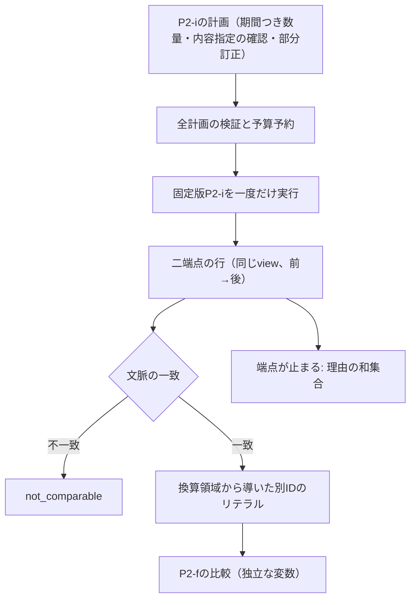

# P2-m：縦断比較（同じ slot の二時点の測定を比べる）の意味設計

作成日：2026-10-21。状態：**作成者側の設計草案。runtime・native 仕様・宣言・実行用 fixture は未実装**。[原理の草案49](49-extension-principles.md) の§9 で次の候補に挙げた C2 を、P2-m として設計します。手指定の期待は [57](57-p2-m-cases.md)。独立確認・評価用正解の凍結は未実施で、[運用方針29](29-review-repository-policy.md) に従います。単位・量種・property・数値はすべて架空で、外部資料・患者情報・実データは使いません。以下は内部契約の比較から定める作業定義で、医学的な変化の解釈（悪化・改善・臨床的有意性）や外部標準への適合を主張しません。

## 1. 問いと選定

[P2-i](43-p2-i-design.md) は、期間について明示された数量主張を、参照時点 k と対象時点 t で選び、換算します。同じ slot の二つの t を問うことはできますが、**二つの値を比べる問い**は、設計43の C25 で意図的に範囲外にしました。[P2-g](37-p2-g-design.md) の比較は瞬間の記録を別 slot どうしで比べるもので、期間の記録は扱いません。

研究上の問いは三つです。

1. 二時点の選択（P2-i）と数量の比較（P2-f）という**既存の二つの断片**から、縦断比較を、既存の契約（七欄・主題 A〜H・クラス R5）を変えずに作れるか（K2、H1、H5）。
2. 個々の断片が通っていても、組み合わせると**新しく決めなければならないこと**は何か。数え、種類を記録する（H2、H4）。
3. 既存の拡張の意味を引き継ぐ部分（P2-i の選択、P2-g の比較可能性）を、継承の差分として事前に宣言し、検査できるか（H8）。

| 案 | 評価 | 判断 |
| --- | --- | --- |
| P2-i に `compare` 問い合わせを足す（P2-i の版を上げる） | 旧い契約（C25：compare は拒否）を変える。P2-l の測定では、依存される仕様を変えると依存先 P2-j を含む再固定が数百ファイルに及んだ（実際の再固定697件）。P2-i の意味も広がる | 採らない。ただし、版を上げる案との爆発半径の差を結果で記録する |
| P2-g の比較へ期間の記録を合成して渡す | 瞬間と期間の意味が違い、存在しなかった確認や時点を作るおそれ（[43 の C28／C29](44-p2-i-cases.md)） | 採らない |
| P2-j の artifact（丸めた表示）を比べる | 丸めで失う区別を比較に持ち込む。表示は時点・記録を符号化しない | 採らない |
| 元のリテラルを直接 P2-f の比較へ渡す | 数学的には同値になり得るが、P2-i が選んだ換算結果と目標単位を使わず、選択と計算の連鎖を飛ばす | 本流にしない。**別計算の第二の経路**として使い、同値性を検査する（§7） |
| **P2-i の計画を固定版で再実行し、二端点の換算領域を P2-f の比較へ渡す専用 R5** | 選択の根拠を保ち、比較は P2-f に委譲できる | **P2-m として選定** |

新しい意味クラスは追加しません。共通4＋R5 の3＋LC-1〜12 の19義務を設計します。

## 2. 設計判断

| 判断 | 初回に採る設計 | 理由・見直す条件 |
| --- | --- | --- |
| CD1 | 専用 R5。P2-i と P2-f の公開関数を固定版で呼ぶ。P2-j・P2-g・P2-h・P2-k に依存しない | 依存を減らす。P2-j の料金式は**複製**し、実際の呼び出しの実費で照合する（暗黙の共有を避ける） |
| CD2 | 入力は P2-i の計画（予算を除く）と `comparisons`。端点は計画の query を参照する | P2-j と同じ形（全計画の先払い、子の一回の呼び出し） |
| CD3 | 一つの比較は**同じ view**（同じ参照時点 k）の二つの query。両者は同じ slot で、`from` の target_at が `to` より**厳密に前** | 異なる view の比較は「知識の変化」の比較で、縦断比較ではない。同じ時点の比較は、同じ変数の自己比較と区別が付かない（§3） |
| CD4 | 異なる時点の値は**独立な変数**として比べる。入力は方針 `fiction:independent-time-variables@1` を明示する | P2-i は時間相関・同一性・連続性を追加しない。関係は「可能な関係の集合」で、点どうしなら定まり、幅があると定まらない |
| CD5 | 比較可能性は、**選択された二つの記録**の property・specimen・method が一致することを要求する。不一致は `not_comparable` | 部分訂正で文脈が変わると、同じ slot でも比較できない。P2-g の `matched_context` と同じ観点を、期間の記録について再び述べる |
| CD6 | 子の P2-f 比較には、**二端点の換算領域から導いた新しいリテラル**を渡す（二つの別の ID、目標単位、元の量種・出自） | 選択と換算の連鎖を保つ。ただし P2-i の出力が P2-f の入力の制約を満たす保証はない（§4.3） |
| CD7 | 端点が止まるとき、比較は `unassessed` で、**二端点の理由の和集合**を保持する | 一方だけで答えを作らない。比較不能と未評価を混ぜない |
| CD8 | 課金は全計画 C の先払い＋比較ごとに固定料金18（自前6＋子の比較12）＋最後の確定1 | P2-j と同じ原則（払い戻しなし、子の部分結果を拾わない） |
| CD9 | 認定票は常に `not_certified`。臨床的有意性・傾向・差の大きさは扱わない | P2-i と同じ。比較は算術の関係に限る |
| CD10 | 継承の差分（端点の行が P2-i の直接実行の行と一致する、文脈の判定が P2-g の `matched_context` と共通部分で一致する）を、事前に義務と検査として書く | 契約に継承の欄がない（H8）。三つ目のデータ点を取る |

## 3. 入口と型

以下は予約名で、現在のCLIが受理するschemaではありません。自己 native 仕様 hash は実装時に確定します。

| 項目 | 予約する型・範囲 |
| --- | --- |
| profile / operation | `p2-longitudinal-comparison-draft-1` / `compare_longitudinal_measurements` |
| request / result | `p2-longitudinal-request-draft-1` / `p2-longitudinal-result-draft-1` |
| 回答型 / 方針 | `longitudinal_measurement_comparison` / `fiction:independent-time-variables@1` |
| 要求 | `schema_version, operation, consumer, temporal_measurement_plan, comparisons, budget` |
| consumer | `profile, profile_spec_sha256, operations, temporal_measurement_profile, temporal_measurement_profile_spec_sha256, quantity_profile, quantity_profile_spec_sha256`。operations は当該一操作のみ |
| temporal_measurement_plan | P2-i の要求から budget だけを除いた計画（schema／operation／consumer／source／views／queries をそのまま保持）。別の子予算欄は持たない |
| comparisons | 1〜64件。`id, view_ref, from_query_ref, to_query_ref, comparison_policy, required_capabilities` |
| 共通上限 | 1 MiB・深さ64、整数予算0〜100000。bool・生小数・NaN は自動変換しない |

静的検査（予算の前）は、P2-i の全計画をbudget=0の検証用要求として構築し、構造・全参照・内容hash・確認時刻・包含・依存版を検査します（P2-j と同じ）。その後に各比較を、次の順に検査します。

1. 欄の過不足と型、`view_ref`・`from_query_ref`・`to_query_ref` の解決（`unresolved_view_ref` など。invalid_input）
2. `comparison_policy`（未対応の値は `unsupported_comparison_policy`。unsupported_profile）、`required_capabilities` に自己の profile を含む（なければ `missing_comparison_capability`。invalid_input）
3. 両 query の slot が同じ（異なれば `unsupported_cross_slot_comparison`。unsupported_profile）
4. `from` の target_at < `to` の target_at（同じか逆なら `invalid_comparison_order`。invalid_input）

比較の必須能力に未知のものがあれば、当該の行が `unassessed / unknown_capability` で止まります（P2-j の表示の能力と同じ扱い）。

## 4. 意味

### 4.1 二端点と関係

比較 c = (view v、from query f、to query g) について、P2-i の全計画を一度だけ再実行して得た二つの行 R(v,f)、R(v,g) を端点とします。端点の行は、P2-i を直接実行した行と**一致**します（比較のために選択を変えません。最新の値を採る、等もしません）。

端点がともに `computed` で、文脈が一致するとき、二つの換算領域 D_f、D_g（閉・開の端を含む有理数の区間または点）の間の関係を、P2-f の比較へ委譲します。

```text
relation_set ⊆ {less, equal, greater}      （D_f の値が D_g の値に対して）
  less    ⇔ ∃x∈D_f, y∈D_g: x < y
  equal   ⇔ ∃x∈D_f, y∈D_g: x = y
  greater ⇔ ∃x∈D_f, y∈D_g: x > y
certain_relation = relation_set の要素が一つならその値、他は null
```

「独立な変数」とは、x と y を別々に動かせるという意味です。したがって **同じ記録が二つの時点で選ばれても**、点の領域なら `equal`（値が一つだけ）、幅のある領域なら三つ全て（二時点の値が同じ未知値だとは追加しない）になります。P2-f の共有参照による自己比較（常に `equal`）は使いません。二つの端点の導出リテラルには別の ID を与えます。

関係の語は P2-f のままで、**増減・悪化・改善の意味を持ちません**。`less` は「前の時点の値が後の時点の値より小さい可能性がある」という算術の関係に限ります。

### 4.2 比較可能性

選ばれた二つの記録 a_f、a_g について、次を比べます。

| 欄 | 判定 |
| --- | --- |
| property_ref | 文字列が一致 |
| specimen | `{kind, ref, version}` が一致 |
| method | `{kind, ref, version}` が一致 |

不一致の欄があれば、行は `not_comparable`、理由は `different_property`・`different_specimen`・`different_method` の該当を整列したものです。比較の値は計算せず、不一致の欄とその両側の値を `context_differences` に、端点の行を `endpoints` に残します。subject は slot が同じなので比べません。unknown／unspecified は端点側で既に止まります（P2-i の `method_unknown` など）。値や origin（観測・判断・AI 候補）の違いは比較可能性に影響しません。

### 4.3 接続面の閉包（P2-i の出力と P2-f の入力）

P2-i が返す換算領域は、約分した有理数で、中間の上限は256bitです。P2-f が入力として受理するリテラルは分子・分母が63bit以下です。つまり **P2-i の出力は P2-f の入力として常に有効とは限りません**。分子 2^62 の `u_ten` を `u_base` に換算すると、分子が 10·2^62 になり63bitを超えます。このとき P2-m は、子の P2-f が `rational_integer_limit`（resource_limit）で止まるのをそのまま root の resource_limit として返し、**元のリテラルでの比較への切り替え、浮動小数への変換、丸めは行いません**。目標単位が元の単位なら同じ値でも通るので、止まるかどうかは入力の単位の選び方に依存します。これは意味の誤りではなく、接続面の制約です（予測 W6）。

### 4.4 停止の順序

比較ごとに、次の順で最初に当てはまるものが行の結果になります。

| 順位 | 条件 | 行の結果 |
| --- | --- | --- |
| 1 | 比較の必須能力に未知のもの | unassessed / `unknown_capability`。端点・根拠は公開しない |
| 2 | 端点の一方または両方が `computed` でない | unassessed。理由は二端点の `reason_codes` の和集合を整列。端点の行（診断を含む）を `endpoints` に保持 |
| 3 | 文脈の不一致 | not_comparable。理由は §4.2 |
| 4 | 上記なし | P2-f の比較を実行。computed |

順位2では、端点の状態が `not_comparable`（例：目標単位の次元が不一致）でも、比較の状態は `unassessed` です（端点の換算が成立していないため）。理由はそのまま保持します。

## 5. 結果と根拠

各行は `id, view_ref, from_query_ref, to_query_ref, status, assessment_complete, reason_codes, relation_set, certain_relation, context_differences, endpoints, comparison_evidence` を持ちます。**値を持つ五欄**は `relation_set, certain_relation, context_differences, endpoints, comparison_evidence` で、未完了の行では全て null です（空 object・空配列・false にしません）。

| 状態 | relation_set／certain_relation | context_differences | endpoints | comparison_evidence |
| --- | --- | --- | --- | --- |
| computed | 値あり | 空配列 | `{from, to}`（P2-i の行の全体） | あり |
| not_comparable | null | 不一致の欄の一覧 | あり | null |
| unassessed（端点が止まった） | null | null | あり（診断つき） | null |
| unassessed（比較の未知能力） | null | null | null | null |
| 未完了 | null | null | null | null |

comparison_evidence は、自己・P2-i・P2-f の仕様 hash、P2-i の子要求の hash・予約料金・実費、source hash、view／as_of、両端点の target_at と方向（`from_relative_to_to`）、前提 `independent_time_variables`・`explicit_period_quantity_domain`・`scoped_revision`、P2-f の子要求の hash・予約12・実費・数学的根拠を保持します。原リテラルと選択の根拠は `endpoints` の行（`binding_evidence`）にあります。

root は `clinical_confirmation=not_evaluated`、`review_verification=structural_only`、`uncertainty_propagated=false`、`converted_to_base=false`、`clinical_assertions_added=[]`、さらに `time_correlation_assumed=false`、`clinical_significance=not_evaluated` を保ちます。認定票は常に `not_certified`（evidence_level `known_policy_change`）で、理由に `independent_time_variables`・`no_clinical_significance_claim` を載せます。



## 6. 資源

```text
M = 1 + C + Σcomparison (6 + 12) + 1
C = P2-i の全計画の料金（設計43の§6、設計46の§6と同じ。全view・全query・全適格な訂正辺を数える）
```

開始1、C を先払いして budget=C で P2-i を**一度だけ**実行（実費が C と一致しなければ停止）、各比較を18ずつ先払い（意味上止まる行でも払う。払い戻し・キャッシュ割引なし）、最後の確定1。自前の6は二つの端点の読み取り・文脈の判定・二つのリテラルの導出・行の確定の定額で、測定した値ではなく**定めた単価**です。子の P2-f の比較には12（1＋2数量＋9）を予約し、computed の行では実費がちょうど12でなければ停止します。

C が親の上限を超えれば P2-i を呼ばず、全行を未完了にします。子が資源停止なら、途中の値があっても全比較を未完了にします。比較の途中の資源停止では、先に完成した比較を保持します。最後の1だけ不足する場合も root は resource_limit、認定なし、`incomplete` に `completion` を載せます。

設計値（手計算）：標準の一 slot・一数量・一記録・一確認・一view・二query は C=27、一比較で M=47。AとBが別数量を使い B が A を部分訂正する二 query は C=34、M=54。これらは runtime の実測ではありません。

## 7. 七欄と義務の主題（H1・H2 の実験）

七欄を**実装の前に**埋めます。

| 欄 | P2-m の決定 |
| --- | --- |
| 前提 | P2-i の明示した期間の数量主張を使う。二時点の値は独立な変数（相関・同一性・連続性なし）。関係は算術のみで臨床の意味なし。二点・同じ slot・前→後 |
| 版 | 自己の profile と native 仕様 hash を固定し、P2-i と P2-f の profile・仕様 hash を consumer が固定する。P2-j 等に依存しない |
| 確認対象 | 新しい確認を作らない。端点の選択に効いた P2-i の内容指定の確認だけが拘束する。比較自体は人の確認の対象でない |
| 情報の選択 | 同じ view。端点の行は P2-i の再実行結果そのまま |
| 問い | 二時点の値の関係の集合と、一つに定まる場合の関係。文脈の不一致は比較不能。差の大きさ・変化率・傾向・基準範囲は範囲外 |
| 保持・喪失・追加 | 保持：両端点の P2-i の行（選択記録・確認・訂正根拠・両 origin・診断）。喪失：なし。追加：独立変数の前提、文脈の一致判定、換算領域から導いたリテラル |
| 資源・停止 | §6。停止の順は §4.4 |

### 7.1 義務（19：共通4＋R5の3＋LC-1〜12）と主題の割当

| 義務 | 内容 | 主題 |
| --- | --- | --- |
| LC-1 | 自己・P2-i・P2-f の版と実体を固定する。P2-i／P2-j／P2-g／P2-h の結果や profile を代用しない | A |
| LC-2 | P2-i の計画を再実行する。利用者の送った結果・端点の行・関係を根拠にせず、確認を作らない | B |
| LC-3 | 二端点は同じ view。参照時点以下の記録・確認だけで選び、妥当な未来の追加が完成した比較を変えない | C |
| LC-4 | 訂正・競合・非復活が端点へそのまま伝わる。片方の端点の競合を残りで埋めない | D |
| LC-5 | 未知能力・未知期間・未知文脈の端点の理由を和集合で保ち、停止の順序を §4.4 に固定する | E |
| LC-6 | 全計画 C・比較ごとの18・子の実費12・一度の呼び出し・原子性・最後の確定を照合する | F |
| LC-7 | 端点の行は P2-i の直接実行と一致する（継承の差分）。旧経路を変えない | G |
| LC-8 | 関係は算術のみ。AI 由来を保ち、臨床的な傾向・有意性・基底への変換を作らない | H |
| LC-9 | 二時点の値を独立な変数として扱う。同じ記録でも alias（常に等しい）にしない | I（意味固有） |
| LC-10 | 選択された記録の文脈の一致を要求する。訂正で変わった文脈を slot 全体や最新の記録で代用しない | I（意味固有） |
| LC-11 | 前→後・同じ slot・同じ view。同じ時点・逆順・別 slot を黙って受理しない | I（意味固有） |
| LC-12 | 導出リテラルを P2-f の入力の制約で検査し、満たさなければ代替の経路へ切り替えず止める | **A〜H に収まらない**と予測 |

H2 の予測：**12の個別義務のうち8が A〜H、3が意味固有の主題 I、1（LC-12）は A〜H にも既存の I にも収まらず、「接続面の閉包（前段の出力が後段の入力の制約を満たすか）」という新しい主題が要る**。P2-k では新しい主題は要らなかったので、断片の組み合わせ（合成）が主題の追加を要求するかどうかが、この予測の試験です。

## 8. 実装前に固定する予測と反例

### 8.1 予測

| ID | 予測 | 外れた場合に分かること |
| --- | --- | --- |
| W1 | 既存のモジュール・native 仕様・宣言・旧実行例を一つも変更せずに実装できる（変更は登録点：host の振り分け、評価・検査の一覧、固定対象）。新しいクラスも宣言の書式の変更も要らない | K2・H5：契約の不足が、変更の要求として現れる |
| W2 | 組み合わせの結果は、個々の断片の通過から決まらない。同じ二つの端点の行から、alias（共有参照）と独立な変数で別の関係が出る。P2-i と P2-f の既存の義務は、この差を区別しない。親にない義務は LC-9〜12 の4件 | H4：併用は個別の通過から導ける |
| W3 | 七欄は実装の前に埋まり、実装の最中に七欄へ収まらない決定は出ない（n=3） | H1：七欄が不足する |
| W4 | 文脈の判定は、P2-g の `matched_context` と、property・specimen・method の共通の断片（全組合せ324対）で一致する | 再び述べた比較可能性が、引き継ぐつもりの意味とずれる |
| W5 | 料金 M = 2 + C + 18N が全要求で成り立つ。P2-i の実費は C、P2-f の実費は12。途中の資源停止は先に完成した比較を変えない | F：合成の課金が崩れる |
| W6 | P2-i が計算できても、P2-f の入力の63bit上限により比較は止まる入力がある（`rational_integer_limit`）。目標単位の選び方だけで止まる・止まらないが変わる | 接続面の閉包が自明で、LC-12 が不要 |
| W7 | 関係の集合は、目標単位の選び方（上限に当たらない範囲）に依らない。元のリテラルを直接比べる第二の経路と一致する | 換算を挟むと比較の意味が変わる |
| W8 | 継承の差分は、既存の書式の義務（`finite_check`）として宣言でき、検査は書ける。ただし registry はそれが P2-i を指すと理解しない（P2-l の VR-1 と同じ）。P2-g の `matched_context` との継承は、宣言の書式では表せず、宣言の外の差分の検査だけになる | H8 の根拠が増えない、または宣言の書式に継承が既にある |

### 8.2 反例の候補（[手指定の期待57](57-p2-m-cases.md) に具体値を固定）

| ID | 内容 | 試すこと |
| --- | --- | --- |
| X1 | 同じ記録（点 2 u_ten）を二時点で比べる／幅のある同じ記録（[1,2] u_ten）を二時点で比べる | 点は certain `equal`、幅は三つ全てで certain なし（alias にしない） |
| X2 | AをBが [4,6) で部分訂正し、Bの method の版が違う。t=3 と t=5 を比べる／t=3 と t=7 を比べる | 前者は `not_comparable`（`different_method`）、後者は同じ記録 A なので比較可能。slot 全体や最新の記録で文脈を代用する変異を検出できるか |
| X3 | 一方の端点が期間外、他方が競合 | 理由の和集合。片方の値で答えを作らない |
| X4 | 二つの query の target_at が同じ／逆 | 静的に拒否（`invalid_comparison_order`）。alias の自己比較に落とさない |
| X5 | 異なる slot の二 query | 静的に拒否（`unsupported_cross_slot_comparison`） |
| X6 | 分子 2^62 の `u_ten` を、両端点とも `u_base` に換算する／`u_ten` に換算する | 前者は P2-i が計算するが比較は resource_limit、後者は通る（W6） |
| X7 | 同じ値を、端点ごとに異なる目標単位で問う | 目標単位に依らない関係（W7）。単位の次元が違えば端点が止まり、理由が和集合で出る |
| X8 | 参照時点 k より後の記録・確認を追加 | 完成した比較の関係と選択は不変。source hash と料金は変わり得る |
| X9 | P2-i が表す「点を期間全体に適用」と「期間の中央値」との区別 | 比較は端点の領域の関係だけ。期間内の代表値・平均を作らない |

## 9. 受入条件

1. [57](57-p2-m-cases.md) の期待と §8 の予測を、runtime より先に保持し、実行結果から期待を更新しない。式点検と実装評価を別の分母で記録する。
2. 専用 native・module・R5 宣言・fixture・独立な別計算を追加する。P2-i・P2-f・P2-g・P2-j・P2-k・旧核は変更しない（W1）。
3. 別計算は P2-i の別計算（区間差引き）と P2-f の別計算（整数対と証人点）を再利用し、文脈・方向・順序・理由の和集合・料金・63bit 境界を自前の独立実装で持つ。元のリテラルを直接比べる第二の経路を持つ。
4. 小さい全数の列挙、乱数、P2-g との文脈の差分（W4）、目標単位の不変性（W7）、予算の掃引、入力の不変性を検査する。
5. alias、文脈の代用、順序の無視、理由の取りこぼし、端点の選択の変更、先払いの省略、実費の未照合、代替の経路への切り替えという変異を検出する。
6. Python 3.11／3.14 で、全テスト系列と版比較つき統合評価、旧い22,052件の挙動 digest を回帰する。分母の変更は旧い値を履歴として残して明示的に更新する。
7. 追加前は `99de2ba`、固定対象1,242ファイル、manifest `d3b414bd754324a074fa50d3f6bc07ff92c69fe6ec1cc0089fe12d3568938528`、束 `1091c67703a2fd865cd7bdc55d74d01f3dfb9c5d032f30a4e63e429c6e4c5e7`。今回は文書だけで、固定対象・登録・評価分母を変更しない。
8. 件数・hash・予測の結果・残る穴を結果の文書に残す。`independent_review` / `evaluation_frozen` は false のまま。

## 10. 範囲外

三点以上の傾向、差の大きさ・変化率、基準範囲、臨床的有意性の判定、異なる slot（異なる部位・個体）の比較、異なる view（知識の変化）の比較、同じ記録の二時点の値が同じ未知値だと仮定する方針、測定の不確かさ、丸めた表示の比較、P2-g の瞬間の記録との混在、撤回、未知期間の精密化記録（P2-k）の取り込み。関係の集合の推移（`a<b` と `b<c` から `a<c`）を導くことも行いません。

今回新たに参照した外部仕様・マスター・臨床データはありません。この断片は、二つの既存の断片の接続の一つの実演で、任意の将来の能力が合成できる保証ではありません。最終目標は変化に耐える医療コード体系そのものの確立であり、この有限の設計はその一つの検査です。
