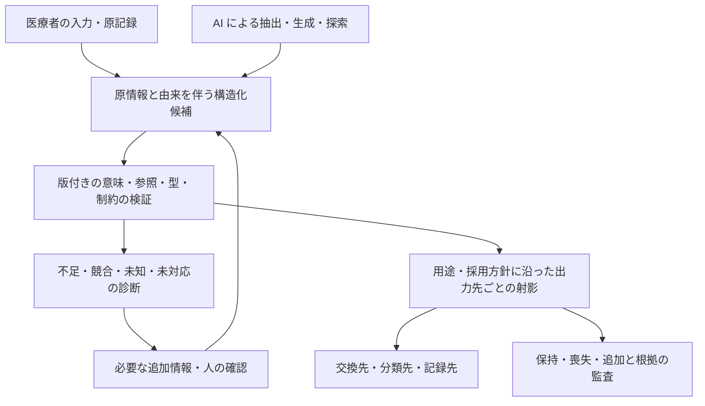

# ニューロ・シンボリック／EDA から説明する MedDSL の役割

記録日：2026-10-21。状態：**利用者の着想を、既存の研究方針に沿って整理した説明用メモ**。外部技術の概要と、本研究への対応付けという設計上の解釈を分けます。アーキテクチャの必然性・数学的な完全同型・臨床的安全性を証明する文書ではありません。[Vision](../vision.md) の AI 利用と入力・出力先の分離を補足し、最終目標・研究の進行順序・現在の実装契約・認定範囲は変更しません。

## 1. 記録する動機と位置付け

**医療者がコード改定や出力形式への追従、機械で検出できる形式上の誤りの修正に振り回されず、観察と臨床判断へ集中できるようにしたい。** この動機から、候補を作る役割と、明示された意味・型・制約を検査する役割、接続先へ射影する役割を分ける構成を考えます。確認負担の削減量と、どの判断を自動化できるかは、今後の運用評価の対象です。

ニューロ・シンボリックという語は、ニューラルな学習・処理と、記号的な知識・推論を組み合わせる方向を指す説明に使います。[IBM Research の概要](https://research.ibm.com/topics/neuro-symbolic-ai) はこの組合せを説明しています。本研究の候補生成と検証の分業をその観点から捉えるのは、**本メモでの対応付け**です。MedDSL 単体がニューラルモデルである、臨床 LLM との接続を実証済みである、という意味ではありません。

「決定論的ガードレール」は、固定した入力・仕様・依存版・方針・資源条件の下で、検査結果と根拠を再現できる境界という意味で使います。未知・不足・競合・資源停止を正規の結果として返すことも含みます。任意の医学的命題を決定できる、誤った入力を必ず見抜く、という意味ではありません。

## 2. EDA との構造的な対応

EDA は電子設計の自動化です。KLayout の公式文書では、DRC は幅・間隔等のルールを検査して違反を報告し、LVS はレイアウトから抽出したネットリストと参照回路を比較します。以下の右列は、これらの責務を本研究へ対応付けたアナロジーです。[DRC](https://www.klayout.de/doc/manual/drc_basic.html)、[LVS](https://www.klayout.de/doc/manual/lvs_overview.html)

| 比較軸 | EDA における役割 | 本研究への対応付けと範囲 |
| --- | --- | --- |
| 候補の作成・探索 | 人や設計ツールが回路・配置・配線の候補を作る | 医療者の入力、臨床 LLM による抽出・生成候補。人の入力をニューラルモデルと同一視せず、AI 候補と確認済みの記録を分ける |
| 明示した規則の検査 | DRC が指定されたルールへの適合と違反箇所を調べる | MedDSL が、対応する意味プロファイルの構造・参照・依存版・制約を検査する。医学・解剖の制約を扱う場合には、知識の根拠・適用条件・版の設計と検証が別に必要 |
| 参照との比較 | LVS が抽出したネットリストと参照回路を比較する | 元の意味と射影後の意味を、指定した問い・比較範囲で照合する。意図的に情報を落とす射影もあるため、全体の完全一致を一律の成功条件にしない |
| 出力の表現 | GDSII／OASIS 等のレイアウトデータ形式 | 交換先には FHIR、分類先には ICD-11／ICD-10 等を候補として考える。交換規格と分類体系は別の責務で、同一種類のファイル形式ではない |
| 追跡と再検査 | ルール、参照回路、違反報告を結び付けて検査する | 元の入力・出自・確認状態・規則の版と、保持・喪失・追加・判定不能の理由を結ぶ。監査情報があることだけで、網羅性や医学的真実を認定しない |

GDSII／OASIS はここではレイアウトデータ形式の例に限ります。KLayout がこれらを読み取ることは [公式の読み込み仕様](https://www.klayout.de/doc/manual/loading.html) で確認できます。製造工程全体と医療の業務全体を同一視するものではありません。

FHIR は医療情報を電子的に交換するための標準で、ICD は罹患・死亡等の分類・集計に使う体系です。この役割の違いは、出力先の比較でも維持します。[FHIR R5 Overview](https://hl7.org/fhir/R5/overview.html)、[WHO：ICD の概要](https://www.who.int/standards/classifications/classification-of-diseases)。このメモでは外部コード・定義・対応表を取得・取り込みせず、[D03](03-data-access.md) の利用条件と保留を維持します。

## 3. AI との接続を説明する構成

以下は役割分担の構想で、接続済みの臨床システムの図ではありません。

LLM は表現の抽出・候補の探索を担い、検証層は明示した契約を満たすか、どの情報が足りないかを調べます。単体の生成モデルに誤りゼロの保証を依存させない構成を研究するのであって、「確率モデルではハルシネーションの根絶が原理的に不可能」という一般的な不可能性定理を本研究で示したとはしません。

AST は構文上の構造を持つ表現、IR は中間表現を指す説明に使います。**AST を用意すること自体と、意味・医学的妥当性を検証できることは別**です。本研究の構造化 JSON と版付き意味プロファイルをこの観点から説明できますが、文字列 DSL、AST だけに閉じた表現、グラフとの分担は未確定です（[設計メモ](../architecture.md)）。同じ検証責務を別の表現で実現する可能性を排除しません。

DRC と SMT ソルバーも同義ではありません。本メモは SMT の導入を決定せず、検査器・推論器の選択、扱う断片と停止条件は既存の研究手順に従います。

## 4. 現在の実証との接点

| 接点 | 内部で確かめた断片 | このアナロジーから追加しない保証 |
| --- | --- | --- |
| 厳密な数値境界 | [P2-f](36-p2-f-results.md) の有理数・単位計算、[P2-j](48-p2-j-results.md) の丸めセル、[P2-p](69-p2-p-results.md) の有限小数・区間端の表現可否 | 数値の一致から、測定の真実性や医学的同等性を導かない |
| 確認・採用・出自 | 内容を指定した確認、時点・訂正、AI 候補の状態と由来の保持 | 確認の構造的整合から、本人認証・診断の正しさへ昇格しない |
| 医療者の操作と出力先 | [P2-o](65-p2-o-results.md) の限定した臨床ライブラリと、出力先の要求・不足の診断 | 実際の診療業務で操作や確認の負担が減ったという評価は未実施 |
| 外部構造への接地 | [監査66](66-p2-p-grounding-audit.md)・[P2-p](69-p2-p-results.md) の FHIR R5 Observation の構造に基づく表現可否の診断 | FHIR 全体への適合や、ICD への実接続、一般の臨床データの意味保存を保証しない |

`lost` / `retained` / `added` は、宣言した射影・運ぶ欄・比較対象における情報の流れとして解釈します。記録していない属性や検査器が理解できない意味まで完全追跡したと扱わず、範囲外・判定不能・追加情報の使用を明示します。原情報を別添えで残すことと、出力自体がその情報を表すことも分けます（[原理の草案49](49-extension-principles.md)）。

## 5. Thesis 等での主張と限界

このメモから採用できる主張の草案は、次のとおりです。

> 本研究は、医療者や AI による入力候補の生成と、版付きの意味表現に対する検証・用途別の射影を分離する。これは EDA における設計・ルール検査・参照比較の分業を手掛かりに説明できる。宣言した意味と問いの範囲で、不足・矛盾・表現不能・情報の保持・喪失・追加を根拠とともに追跡し、規格変更への追従や反復的な修正に伴う医療者の負担を減らす構成を研究する。

次の断定は、現在の研究からは導きません。

- **「EDA と完全に同型」「この構成が唯一の道・論理的必然」**：対応する責務のアナロジーであり、代替構成を排除する証明ではない。
- **「医学的・解剖学的な整合性を静的型検査で全面的に保証」**：根拠付きの規則として表せて検査できる範囲と、臨床上の真実は別。左右を取り違えた記載でも、左右両方が許される型・制約には適合し得る。実際の観察との一致は、それだけでは確認できない。
- **「違反を自動クランプ・正規化すれば正しい内容になる」**：表記の正規化と臨床内容の変更を分ける。元の値を丸める、区間端を閉じる、不足を補う等の操作は、その根拠・規約・情報差分を伴わせ、黙って修復しない。
- **「医師の確認修正が不要になる」「システム全体の安全性が保証される」**：自動化できる検査を増やすことと、必要な観察・臨床判断・確認をなくすことは別。必要情報を満たせない場合は依頼として返す。負担軽減と安全性は別途評価する。
- **「LVS と監査メタデータが意味の完全一致・完全追跡を証明」**：参照・比較範囲・意味定義・検査の網羅性に依存する。情報を落とす出力では、失われる問いを特定すること自体が結果になり得る。

最終目標は引き続き、将来の変化に耐えうる医療コード体系の原理と仕様の確立です。このアナロジーを理由に、AI・パーサー・SMT・実コード変換の実装を新たな優先事項にしたり、現在の実装を保証範囲以上に説明したりはしません。

## 6. 出典の扱い

外部事実は上記の一次資料を2026-10-21に閲覧し、日本語で要約しました。EDA やニューロ・シンボリックの説明は外部事実、MedDSL との対応表・構成図・Thesis 用文案は本研究の解釈・構想です。本文・コード・ルールデッキ・外部マスターの取得や転用は行わず、現行の資料台帳・native 仕様・実行用の固定対象へ新しい資料を追加していません。
