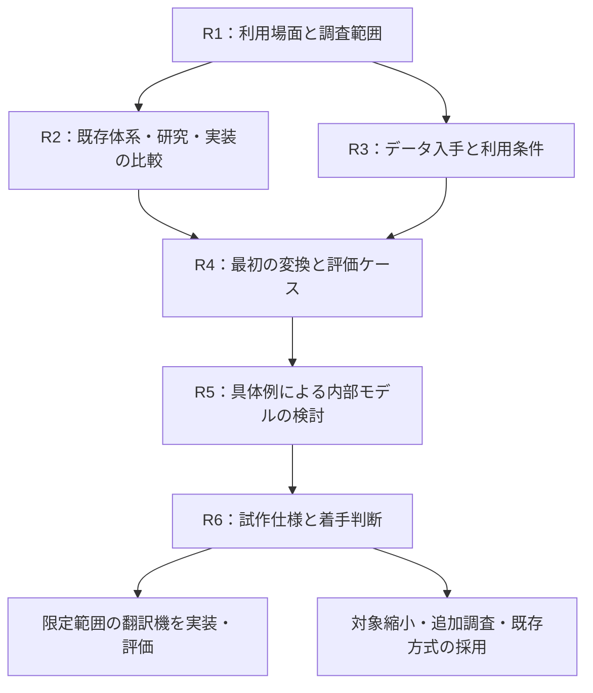

# 調査フェーズのロードマップ

更新日：2026-10-18。状態：R1 の用途定義を完了、R2 以降は未完了。実現性と優位性の検証はこれからです。

## 調査の到達点

調査フェーズの終わりに、**誰のどの作業を、どのコード体系・版・方向・用途で改善し、その成否をどう測るか**を説明できる状態にします。R1 で主用途を「コード移行における意味の保持・喪失・追加の監査」と定めました。同時に、独自の中間表現が必要な範囲と、既存仕様・実装を再利用する範囲を決めます。

翻訳機を最初の入口にする方針は維持します。ICD-10 と ICD-11 は最初の接続候補です。対象領域、方向、実装言語、DSL の構文、内部オントロジーは調査で決めます。既存方式で要件を満たせる場合は、その活用を成果として扱います。

長期目標には、臨床ライブラリを通じた医療者の操作と接続先の分離、および AI と共有できる意味・文脈・根拠の整理を含めます。拡張性・普遍性は初期の設計要件とし、移行監査を最初の検証用途にします。素のコードや DSL の直接操作を医療者に要求する運用は前提にしません。

成果物は、このリポジトリの文書として残します。R1 の成果物は作成済みです。それ以外のファイル名は今後の配置案です。

## 進める順序

R2 と R3 は同じ期間に進められます。データを使える条件と評価可能な範囲が分かってから R4 を確定します。R5 で不足が見つかれば R2〜R4 に戻り、何を再調査するかを記録します。

| 段階 | 中心となる問い | 主な決定 | 成果物の配置案 |
| --- | --- | --- | --- |
| R1（完了） | 誰の何を助けるのか | 主利用者と最初の用途 | [用途定義](research/01-use-case.md) |
| R2 | 既存の仕組みで何ができるか | 再利用候補と検証したい差 | `docs/research/02-landscape.md` |
| R3 | 必要な資料とデータを使えるか | 利用可能な体系・版・範囲 | `docs/research/03-data-access.md` |
| R4 | どの変換で何をもって成功とするか | 対象、評価ケース、評価手順 | `docs/research/04-evaluation.md` |
| R5 | どの情報をどう保持する必要があるか | 最小の表現モデルと変換結果 | `docs/research/05-model-study.md` |
| R6 | 次に何を作るか | 試作範囲、構成、着手条件 | `docs/research/06-prototype-brief.md` |

## R1：利用場面と調査範囲を定める

**2026-10-18 完了。** 利用者の構想を踏まえ、主利用者をコード移行の設計・検証担当者、主用途を変換前後の意味の監査としました。追加情報の根拠と比較不能を区別し、将来の体系へ接続する負担を検証する方針です。[結果・具体例・D01 の決定](research/01-use-case.md) を参照してください。外部利用者への聞き取りと性能評価は未実施です。

### 調べること

- 利用場面を、マスター整備、研究データの正規化、統計分類の移行、請求支援に分ける。それぞれ誰が入力し、誰が結果を確認し、何を成果物として受け取るかを整理する。
- 現行作業の入力、参照資料、手作業、出力、困る例を一つの作業単位で書く。実務上の非公開資料を持ち込まず、公開資料と架空例で記述する。
- 「翻訳」を、同義概念の検索、候補提示、条件付き対応、複合表現の変換、情報損失を伴う分類への射影に分け、必要なものを特定する。
- 傷病名、所見、検査、処置、薬剤など、長期的に扱いたい範囲を一覧にし、最初の対象との関係を整理する。

### 決めること

主利用者を一種類、主用途を一つ選びます。最初の出力を「人が確認する対応候補」とするかなど、結果の利用方法を決め、現時点で扱わない用途も記録します。

### 完了条件

「誰が、何を入力し、何を受け取り、どう役立てるか」を一段落と具体例で説明でき、改善したい手作業が特定されていること。外部の利用者に確認できていない要望は仮説として明示します。

## R2：既存体系・研究・実装を比較する

### 調べること

| 調査群 | 候補 | 比較する点 |
| --- | --- | --- |
| 分類・用語体系 | ICD-10/11、SNOMED CT、MEDIS、LOINC、薬剤・処置体系 | 目的、概念の粒度、合成、文脈、国別拡張、版管理 |
| 対応・交換仕様 | FHIR ConceptMap、`$translate`、CodeSystem、CodeableConcept | 方向、条件、意味関係、複数候補、対応なし、出典の表現 |
| 統合語彙・対応データ | OHDSI/Athena、UMLS、公式の対応リソース | 対応範囲、目的、粒度、更新、入手条件、組み合わせ変換の限界 |
| 実行可能な基盤 | HAPI FHIR、Snowstorm、WHO ICD API | 必要機能、採用版、データ依存、導入負担、ライセンス、実例 |
| 概念・情報モデル | SNOMED CT 合成文法・概念モデル、openEHR、OWL、GALEN/GRAIL、FMA/TA2 | 合成と制約、意味と記録文脈の分離、推論、保守上の課題 |

これらは同じ役割の製品ではありません。標準仕様、用語データ、対応表、実行エンジン、研究モデルを分けて比較します。資料への入口は [調査メモ](research.md) にあります。

各国の体系は、基盤、国別修正版、拡張、単なる対応関係を区別します。「別体系に対応表がある」ことを「同じ体系から派生した」根拠にせず、共通の母体ごとの集計と、実装上区別が必要な版・地域の一覧を別に作ります。主要国の調査対象も R1 の用途に沿って明記します。

先行研究は、合成的な臨床用語、用語間マッピング、文脈・時間・否定、情報損失、実運用での評価を優先します。原著と後続研究を探し、検索式、検索日、採否の理由、著者・年・識別子、実験条件、限界を記録します。ラテン語・形態素解析は、入力や表記への効果が必要になった時点で掘り下げます。

R1 を踏まえた優先比較軸は、項目・関係ごとの喪失と追加、論理的に導ける内容の扱い、補助情報の由来、比較不能の報告、未知の体系・版を接続する際の変更量です。変換候補の生成と、既存の変換結果の監査をそれぞれ調べます。

長期構想から、臨床情報モデルと業務操作の分離、再利用可能な臨床ライブラリ・テンプレート、拡張と互換性、適合性の検証も比較します。AI 向けの観点は、意味定義の参照、否定・疑い・時間・対象者の区別、情報源と導出過程への追跡、生成候補と確認済み記録の区別です。既存方式がこれらをどこまで表現・検証できるかを調べます。

### 決めること

再利用を調べる基盤を最大二つ、比較基準とする方式を一つ選びます。独自部分の候補は「既存方式で困る具体例」と組にし、資料未確認と機能不足を区別します。

### 完了条件

最初の用途に関係する主要な候補を共通の比較表で評価し、再利用できる部分、足りない可能性がある部分、未確認の部分を一次資料付きで説明できること。独自 DSL や中間表現の必要性は、この段階では検証対象として扱います。

## R3：データ入手と利用条件を確認する

### 調べること

- 入力・出力体系の正式名称、発行主体、国・地域、版、言語、公開日、取得方法、形式、更新周期。
- 公式対応表の有無、対象版、方向、用途、例外規則、臨床文脈の要否。API の存在だけで対応表や変換機能があると判断しない。
- API 認証、ローカル利用、必要な登録、料金、実行環境の制約。取得や契約が必要なものは条件と担当を記録する。
- コード、ラベル、定義、階層、公式対応表、独自に作る対応表について、ローカル利用、非公開共有、生成物、将来の公開・配布の条件をそれぞれ確認する。

利用条件の判断には公式の規約・許諾文書と確認日を添えます。非公開リポジトリであること、コード識別子だけを扱うこと、外部から取り込むことだけを利用可能の根拠にしません。

### 決めること

最初の試作で使うデータの入手元と版、コミットする範囲、ローカルだけに置く範囲、未解決で対象から外す範囲を決めます。データ本体を保存できない場合も、出典・版・取得手順・検証方法を残せるか確認します。

### 完了条件

少なくとも一組の入力・出力候補について、必要資料の実在、入手可能性、予定する使い方の条件が確認できていること。未解決の条件には解消方法を付け、依存する作業を保留するか別候補へ切り替えます。

## R4：最初の変換と評価方法を決める

### 調べること

対象候補は、利用価値、資料・対応根拠の入手性、確認できる人の有無、合成・文脈・損失を評価できること、範囲を絞れること、保守負担で比較します。例えば脳血管疾患、骨折、感染症を候補として挙げられますが、領域は未決定です。

候補ごとに数例を手作業で追い、コードだけで決まる場合、追加情報が必要な場合、出力側で表現できない場合を確かめます。長期的な共通モデルの検討用には、主領域以外の検査・処置・薬剤などの例も少数残します。これらは最初の変換の対応範囲には数えません。

### 決めること

入力体系と版、出力体系と版、国・地域、方向、用途、主領域、許容する入力文脈を一組に固定します。コードのみを受け取るのか、左右・診断確度などの補助情報も受け取るのかを決めます。

初期案として架空ケースを 40 件用意し、設計用 24 件と、規則を固めた後に使う評価用 16 件に分けます。件数は作業量の目安で、網羅性や統計的な性能保証を意味しません。類似例が両方に漏れて評価を楽にしない分け方と、期待結果の確認者を決めます。

| 含めるケース | 確認すること |
| --- | --- |
| 単純な対応 | 基本動作と版の指定 |
| 出力の方が広い／狭い対応 | 情報損失と根拠のない詳細化 |
| 左右・部位・病因・複数概念 | 属性と関係を保てる範囲 |
| 疑い・否定・既往・家族歴・時間 | 病名が同じでも意味が違う入力 |
| 候補複数・不足情報 | 人に何を確認すべきか |
| 対応なし・未収載・入力不正・旧版 | 処理状態を混同しないこと |

期待結果は、コード候補だけでなく、意味関係、許される情報損失、意味の追加と情報源、矛盾、比較不能、必要な追加情報、根拠、確認状態も記録します。既存情報の明示化と新しい臨床情報を区別し、人の確認が一致しないケースは要検討として残します。

### 評価指標と完了条件

| 指標 | 数え方の案 |
| --- | --- |
| 根拠のない確定 | 評価ケース全件のうち、必要な条件を欠いたまま一つに確定した件数 |
| 候補の適合 | 返した候補全体のうち、期待結果で妥当と確認された候補の割合 |
| 期待候補の網羅 | 期待候補がある全件を対象に、期待候補を含む割合を集計。候補を返せなかった件も含める |
| 情報損失の検出 | 人が損失ありとした件のうち、必要な警告を返せた件数 |
| 追加・矛盾の検出 | 人が確認した追加・矛盾と照合し、見落としと誤検出を別々に集計 |
| 比較可能な範囲 | 全件・全評価観点のうち、根拠付きで判定できた範囲。比較不能の内訳も報告 |
| 不足情報・未対応の判別 | 状態ごとの正答件数と取り違えの内訳 |
| 確認負担 | 一件あたりの確認・修正時間、追加質問数 |
| 再現性と保守負担 | 同じ版・規則での結果一致、規則追加・版更新で直す箇所 |

比較方式と MedDSL 案に同じ入力・資料・補助情報を与え、指標は件数と分母を併記します。合格条件は実装前に数値化し、少なくとも評価セット上の根拠のない確定は 0 件を目標とします。全件を未対応にする方式が合格しないよう、候補提示の有効性と確認負担も条件に入れます。

将来の体系への拡張性は、設計時に使わなかった体系・版を後で接続し、定義追加・内部モデル変更・規則変更・再検証の量を測る案で評価します。対象と実施時期は R3〜R4 で決め、有限の実験で未知の全体系への対応を証明したとは扱いません。

評価仕様、ケースの分け方、期待結果の確認手順、指標と合格条件を固定したら完了です。期待結果を確認できる体制がない場合は、表現可能性の探索までとし、変換精度を実証した扱いにしません。

## R5：具体例から最小の内部モデルを検討する

### 調べること

R4 の設計用ケースを、①直接の対応表、②既存仕様・基盤、③共通中間表現を介する案で手作業で表します。この段階では表と小さな JSON 例で比較し、実装言語や文法を先に固定しません。

| 論点 | 決める内容 |
| --- | --- |
| 概念と外部コード | 独自 ID を発行する条件、外部体系・版との区別、同義語の扱い |
| 合成と関係 | 属性、因果、併存、参照共有を表す方法。木とグラフの必要性 |
| 臨床文脈 | 否定、疑い、既往、家族歴、対象者、時間の保持場所 |
| 情報不足 | 未記載、不明、未確定、該当なしを区別する方法 |
| 対応結果 | 意味関係、処理状態、候補、条件、喪失、追加と情報源、矛盾、比較不能、根拠の契約 |
| 妥当性 | 構文、用語の制約、臨床判断の責務と、検証不能時の扱い |
| 変更と追跡 | 定義の改訂、非推奨化、対応規則の版、原情報への追跡 |
| 臨床ライブラリとの境界 | 普段の操作を内部表現へ結ぶ方法、専門領域の拡張、版・互換性・適合性 |
| AI との境界 | 機械可読な定義と文脈、生成候補の情報源・検証・確認状態、モデル固有の形式との分離 |

外部コードを原情報として保存できること、意味を分解して表現できること、妥当な別コードへ変換できることを別々に判定します。解釈できないコードは未解釈の参照として保持できても、意味を網羅したとは数えません。

### 決めること・完了条件

各方式の保持情報、失われる情報、例外規則、規則数、確認・保守負担を比較します。採用する最小モデル、既存仕様に従う部分、独自に追加する部分、後回しにする機能を決め、根拠となるケースを添えます。

中間表現の利点が見えない場合は、直接変換の基盤に範囲を縮めます。独自構文は、既存の表現で不足する具体例を説明できたときに検討します。[設計メモ](architecture.md) はこの決定に合わせて更新します。

## R6：試作仕様をまとめ、着手を判断する

一枚の試作仕様に、利用場面、対象、入出力例、必要データ、利用条件、評価方法、既存方式との差、未解決事項をまとめます。実装構成はこの仕様に必要な分だけ選びます。

- [ ] 対象と対応方向、体系・版・用途が固定されている。
- [ ] 必要な資料・データを予定する条件で使える。
- [ ] 設計用ケースと評価手順があり、期待結果の根拠と確認状態が分かる。
- [ ] 意味関係、喪失、追加と情報源、矛盾、比較不能、不足情報、未対応を返す契約がある。
- [ ] 比較方式、指標、合格条件が実装前に決まっている。
- [ ] 既存機能を利用する部分と独自部分を説明できる。
- [ ] 次の試作を小さく区切れ、残る疑問の影響を説明できる。

満たせた範囲で試作に進みます。満たせない項目は、対象変更、追加調査、既存方式の採用のいずれで解消するかを決めます。この計画の作成は、各項目の調査・合意完了を意味しません。

## 決定事項の記録

D01 は用途定義として決定済み、D02〜D07 は未決定です。各決定に日付、根拠、比較した選択肢、採らなかった理由、見直す条件を付けます。相談が必要な選択肢は、比較結果を添えて提示します。

| ID | 決めること | 決定段階 |
| --- | --- | --- |
| D01 | 移行設計・検証担当者による意味の変化の監査。人が結果を確認する | R1：2026-10-18 決定。根拠と見直し条件は [用途定義](research/01-use-case.md) |
| D02 | 再利用する仕様・基盤と比較方式 | R2、R5 で確定 |
| D03 | データ入手元、版、保存・共有範囲 | R3 |
| D04 | 最初の領域、体系、方向、用途、補助入力 | R4 |
| D05 | 評価ケース、確認体制、指標、合格条件 | R4 |
| D06 | 最小の内部モデルと変換結果の契約 | R5 |
| D07 | 試作構成、技術スタック、実装する範囲 | R6 |

資料の確認済み、仮説、決定済み、保留を区別して記録します。一つの疑問に調査範囲を広げ続けず、次の判断を変える情報かどうかで優先順位を付けます。

## 直近の着手順

1. R2 で、FHIR ConceptMap、既存の共通語彙・合成モデル・用語サーバーを、R1 の意味差分の例に照らして比較する。
2. 同時に R3 で、候補データの版、入手方法、対応表、利用条件の不明点を洗い出す。
3. 機械的に差分を判定するために必要な意味定義・規則と、未解釈になる範囲を整理する。
4. 候補ごとの架空例を手作業で追い、最初の対象と評価ケースの設計につなげる。

日付や期間は、R1〜R3 で資料の入手性と確認者の作業量が分かってから見積もります。

## 調査後の見通し

限定範囲の翻訳機を実装・評価し、その結果をもとに領域や体系を追加します。独自 DSL、自然言語入力、画面、FHIR 連携は、利用価値と必要性を確認した順に進めます。網羅性は、対象ごとの評価結果と未対応の内訳で示します。

その先で臨床ライブラリ・接続実装の標準化と AI 利用を検証します。医療者の操作・確認負担が接続先の変更で増えないか、AI が文脈と根拠を保持して情報を取得・利用できるかを評価します。これらの性能や運用上の効果は未検証です。
