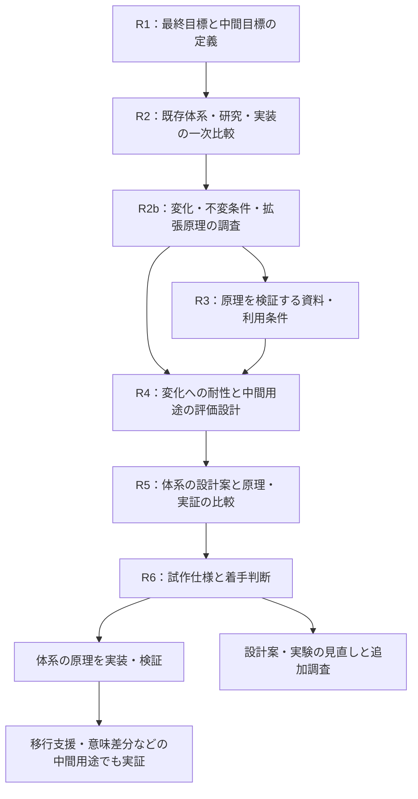

# 調査フェーズのロードマップ

更新日：2026-10-18。状態：R4 の評価設計に続き、R5 で一次比較と基礎モデルの研究用選定を実施。条件付きの保存・意味引き継ぎの導出を記録しました。次は R6 の試作仕様です。完全な形式仕様、独立確認、永続性全体の証明、評価の凍結・実行は未完了です。

## 調査の到達点

最終目標は、**未来永劫、原理的に変化に耐えうる医療コード体系の確立**です。[最終目標と設計原則](vision.md) を基準に、調査フェーズで変化の範囲、不変条件、意味の定義、拡張の原理と評価方法を明確にします。

移行支援・意味差分の監査は、体系を検証する中間目標です。そこで誰のどの作業を助けるかも具体化しますが、移行ツールの完成でプロジェクト全体を完了とはしません。ICD-10 と ICD-11 は実験候補であり、体系の表現力や成功条件をこの一組へ限定しません。

臨床ライブラリを通じた操作と接続先の分離、AI と共有できる情報整理は応用の目標です。その要求は初期設計から扱います。既存仕様・実装の再利用は、最終目標の原理を実現する方法として評価します。

成果物は、このリポジトリの文書として残します。R1〜R5 の調査成果物は作成済みです。R5 の選定は研究用で、形式化・独立確認・実証が残ります。R6 のファイル名は今後の配置案です。

## 進める順序

R2b で基礎原理に関する問いを先に定めます。資料の入手条件は並行して調べられますが、入手しやすい体系の構造をそのまま普遍的な基礎にはしません。R5 で不足が見つかれば基礎原理や評価例に戻り、何を再調査するかを記録します。

| 段階 | 中心となる問い | 主な決定 | 成果物の配置案 |
| --- | --- | --- | --- |
| R1（目的を再整理済み） | 最終目標と中間目標は何か | 最終目標と、検証のための中間用途 | [目標と原則](vision.md)、[R1](research/01-use-case.md) |
| R2（一次比較完了） | 既存の仕組みで何ができるか | 再利用候補と検証したい差 | [比較結果](research/02-landscape.md)、[出典・調査記録](research/02-sources.md) |
| R2b（基礎調査完了） | 変化に耐えるとは何を保つことか | 変化の範囲、不変条件、拡張原理の候補、形式的な評価方法 | [調査結果](research/02b-change-model.md)、[例・反例](research/02b-cases.md)、[出典](research/02b-sources.md) |
| R3（資料・条件確認、取得・初期照合完了） | 必要な資料とデータを使えるか | 利用可能な体系・版・範囲 | [資料選定](research/03-data-access.md)、[出典](research/03-sources.md)、[取得結果](research/03-acquisition.md)、[台帳](research/03-materials.json) |
| R4（評価設計完了） | 原理と中間用途をどう検証するか | 原理 14 ケース、架空 24+16 件、指標・確認・凍結手順 | [評価設計](research/04-evaluation.md)、[ケース](research/04-cases.md)、[実資料追跡](research/04-material-probes.md)、[出典](research/04-sources.md) |
| R5（一次比較・研究用選定） | 体系の原理をどの設計で実現するか | 基礎モデル、更新ごとの拡張・改訂契約、再利用範囲 | [比較とD06](research/05-model-study.md)、[原理・導出](research/05-principles.md)、[出典](research/05-sources.md) |
| R6 | 次に何を作るか | 試作範囲、構成、着手条件 | `docs/research/06-prototype-brief.md` |

## R1：最終目標と中間用途を定める

**2026-10-18 目的を再整理。** 最終目標を変化に原理的に耐える体系の確立とし、コード移行の意味の監査を中間目標としました。[結果・具体例・D01 の決定](research/01-use-case.md) を参照してください。外部利用者への聞き取りと性能評価は未実施です。

### 調べること

- 利用場面を、マスター整備、研究データの正規化、統計分類の移行、請求支援に分ける。それぞれ誰が入力し、誰が結果を確認し、何を成果物として受け取るかを整理する。
- 現行作業の入力、参照資料、手作業、出力、困る例を一つの作業単位で書く。実務上の非公開資料を持ち込まず、公開資料と架空例で記述する。
- 「翻訳」を、同義概念の検索、候補提示、条件付き対応、複合表現の変換、情報損失を伴う分類への射影に分け、必要なものを特定する。
- 傷病名、所見、検査、処置、薬剤など、長期的に扱いたい範囲を一覧にし、最初の対象との関係を整理する。

### 決めること

最終目標と、その実証に使う中間用途を区別します。中間用途の利用者と結果の利用方法を決め、その対象へ体系全体を限定しないことも記録します。

### 完了条件

最終目標と中間目標を明示し、中間用途について「誰が、何を入力し、何を受け取るか」を具体例で説明できること。外部利用者に確認していない要望や、原理の実現可能性は仮説として明示します。

## R2：既存体系・研究・実装を比較する

**2026-10-18 一次比較完了。** 意味差分には先行研究があることを確認し、比較基準を条件付きの FHIR ConceptMap による直接対応、次の検証候補を HAPI FHIR と ROBOT に選定しました。臨床情報モデルは openEHR と FHIR、由来や検証は PROV・OWL・SHACL を参照して検討します。[比較結果](research/02-landscape.md) に、確認済みの事実、机上の検討、未確認の点を区別して記録しました。実装採用と性能評価は未完了です。

### 調べること

| 調査群 | 候補 | 比較する点 |
| --- | --- | --- |
| 分類・用語体系 | ICD-10/11、SNOMED CT、MEDIS、LOINC、薬剤・処置体系 | 目的、概念の粒度、合成、文脈、国別拡張、版管理 |
| 対応・交換仕様 | FHIR ConceptMap、`$translate`、CodeSystem、CodeableConcept | 方向、条件、意味関係、複数候補、対応なし、出典の表現 |
| 統合語彙・対応データ | OHDSI/Athena、UMLS、公式の対応リソース | 対応範囲、目的、粒度、更新、入手条件、組み合わせ変換の限界 |
| 実行可能な基盤 | HAPI FHIR、Snowstorm、WHO ICD API | 必要機能、採用版、データ依存、導入負担、ライセンス、実例 |
| 概念・情報モデル | SNOMED CT 合成文法・概念モデル、openEHR、OWL、GALEN/GRAIL、FMA/TA2 | 合成と制約、意味と記録文脈の分離、推論、保守上の課題 |

これらは同じ役割の製品ではありません。標準仕様、用語データ、対応表、実行エンジン、研究モデルを分けて比較します。資料への入口は [調査メモ](research.md) にあります。

各国の体系は、基盤、国別修正版、拡張、単なる対応関係を区別します。「別体系に対応表がある」ことを「同じ体系から派生した」根拠にせず、共通の母体ごとの集計と、実装上区別が必要な版・地域の一覧を別に作ります。主要国の調査対象も R1 の用途に沿って明記します。

先行研究は、合成的な臨床用語、用語間マッピング、文脈・時間・否定、情報損失、実運用での評価を優先します。原著と後続研究を探し、検索式、検索日、採否の理由、著者・年・識別子、実験条件、限界を記録します。ラテン語・形態素解析は、入力や表記への効果が必要になった時点で掘り下げます。

R1 を踏まえた優先比較軸は、項目・関係ごとの喪失と追加、論理的に導ける内容の扱い、補助情報の由来、比較不能の報告、未知の体系・版を接続する際の変更量です。変換候補の生成と、既存の変換結果の監査をそれぞれ調べます。

長期構想から、臨床情報モデルと業務操作の分離、再利用可能な臨床ライブラリ・テンプレート、拡張と互換性、適合性の検証も比較します。AI 向けの観点は、意味定義の参照、否定・疑い・時間・対象者の区別、情報源と導出過程への追跡、生成候補と確認済み記録の区別です。既存方式がこれらをどこまで表現・検証できるかを調べます。

### 決めること

再利用を調べる基盤を最大二つ、比較基準とする方式を一つ選びます。独自部分の候補は「既存方式で困る具体例」と組にし、資料未確認と機能不足を区別します。

### 完了条件

中間用途に関係する主要な候補を共通の比較表で評価し、再利用できる部分、足りない可能性がある部分、未確認の部分を一次資料付きで説明できること。最終目標を支える理論・原理の評価は R2b に続けます。

## R2b：変化・不変条件・拡張原理を調べる

**2026-10-18 基礎調査完了。** C1〜C8 の変化、不変条件 I1〜I8、保存・改訂・言語変更を分けた比較方法、設計案 A・B・C、14 件の机上例・反例を整理しました。一次資料の確認から、通常の推論と拡張の保存判定を別に評価すること、単独の拡張と併用時を区別することを研究方針に加えました。[結果と D08 の暫定整理](research/02b-change-model.md)、[確認範囲](research/02b-sources.md) を参照してください。体系の原理の採用と証明は R5 に残しています。

### 調べること

- 新概念、新属性・関係、新領域、知識の訂正、制度や用途、コア仕様の変化を分類し、代表例と反例を用意する。
- 既存の意味を保つ拡張、定義の改訂、過去の記録の解釈、複数の異なる主張を扱う理論・既存設計を調べる。
- コアを固定する設計、拡張可能なメタモデル、コア自体の改訂を管理する設計を比較する。どの設計なら最終目標の要求を満たせるかを検討する。
- 表現の普遍性と、機械的な検証・推論・差分計算の範囲を分け、制約や両立しにくい要求を整理する。
- 理論上示す性質と、具体例で確認する性質を分け、将来の変化への耐性をどう評価するかを調べる。

### 決めること

まず対象とする変化と不変条件を定義し、意味・拡張・互換性に関する複数の設計候補と、その比較方法を決めます。有限の例で成功したことを全将来変化への保証とせず、どの仮定の下で何を示すかを記録します。

### 完了条件

対象とする変化、保つ性質、設計候補、既存研究の根拠、未解決の点、反例と評価方法を説明できること。この段階で永続性の原理を確立したとはせず、R5 で検討する設計の土台とします。

## R3：データ入手と利用条件を確認する

**2026-10-18 資料・条件確認と取得・初期照合を完了。** RxNorm CPC 2026-09-08／2026-10-05 と、FHIR Procedure R4 v4.0.1／R5 v5.0.0 の HTML を取得しました。CPC の CRC・README の版・全行の初期構造と出典、FHIR の版・時点の項目を確認しました。公表 MD5 は CPC 10 月版で一致し、他の公表ハッシュ未確認の範囲は区別しています。[D03・利用条件](research/03-data-access.md)、[取得結果](research/03-acquisition.md) を参照してください。WHO・LOINC 等の取り込みの保留は維持し、取得資料を R4 へ引き継ぎました。

R2b の原理を検証する意味定義・変更履歴・領域ごとの例と、移行実験のためのマスター・対応表を分けて確認します。特定の接続候補を入手できることを、体系の原理設計を開始する条件にはしません。

### 調べること

- 入力・出力体系の正式名称、発行主体、国・地域、版、言語、公開日、取得方法、形式、更新周期。
- 公式対応表の有無、対象版、方向、用途、例外規則、臨床文脈の要否。API の存在だけで対応表や変換機能があると判断しない。
- API 認証、ローカル利用、必要な登録、料金、実行環境の制約。取得や契約が必要なものは条件と担当を記録する。
- コード、ラベル、定義、階層、公式対応表、独自に作る対応表について、ローカル利用、非公開共有、生成物、将来の公開・配布の条件をそれぞれ確認する。

利用条件の判断には公式の規約・許諾文書と確認日を添えます。非公開リポジトリであること、コード識別子だけを扱うこと、外部から取り込むことだけを利用可能の根拠にしません。

### 決めること

最初の試作で使うデータの入手元と版、コミットする範囲、ローカルだけに置く範囲、未解決で対象から外す範囲を決めます。データ本体を保存できない場合も、出典・版・取得手順・検証方法を残せるか確認します。

### 完了条件

少なくとも一組の入力・出力候補について、必要資料の実在、入手可能性、予定する使い方の条件が確認できていること。未解決の条件には解消方法を付け、依存する作業を保留するか別候補へ切り替えます。

## R4：体系の変化への耐性と、中間用途の評価を決める

**2026-10-18 評価設計 v0.1 を策定。** D04 を CPC 9 月→10 月の薬剤概念の版更新監査に固定しました。D05 として原理の 14 ケース、架空の設計用 24 件・回帰評価用 16 件、比較方式・指標・工学的最低条件、確認・凍結手順を定めました。[本文](research/04-evaluation.md)、[期待結果の草案](research/04-cases.md)、[実資料の部分追跡](research/04-material-probes.md) を参照してください。独立確認者は未割当、正解の凍結・実行・臨床精度の評価は未完了です。

### 調べること

R2b で定めた原理を、新しい概念・関係・知識の訂正・用途・コア仕様の変更等の例でどう検証するかを設計します。旧表現の意味の追跡、拡張後の解釈、複数領域の表現、反例への対応を、移行実験とは別の評価軸にします。

対象候補は、利用価値、資料・対応根拠の入手性、確認できる人の有無、合成・文脈・損失を評価できること、範囲を絞れること、保守負担で比較します。今回は資料・条件を確認した CPC の薬剤概念を主材料、FHIR の処置を領域横断の補助材料としました。脳血管疾患、骨折、感染症は資料と確認体制を整えてからの候補です。

候補ごとに数例を手作業で追い、コードだけで決まる場合、追加情報が必要な場合、出力側で表現できない場合を確かめます。長期的な共通モデルの検討用には、主領域以外の検査・処置・薬剤などの例も少数残します。これらは最初の変換の対応範囲には数えません。

### 決めること

入力体系と版、出力体系と版、国・地域、方向、用途、主領域、許容する入力文脈を一組に固定します。コードのみを受け取るのか、左右・診断確度などの補助情報も受け取るのかを決めます。

移行という中間用途については、架空ケース 40 件を設計用 24 件と、規則を固めた後に使う回帰評価用 16 件に分けました。主たる失敗機序のファミリーを分け、ID を置換しただけの類似例を両側へ置かない方針です。期待結果はすべて閲覧可能で、未見評価とはしません。独立確認の役割・裁定手順は定めましたが、担当者は未割当です。件数は網羅性や統計的な性能保証を意味せず、体系全体の評価もこれだけにはしません。

| 含めるケース | 確認すること |
| --- | --- |
| 単純な対応 | 基本動作と版の指定 |
| 出力の方が広い／狭い対応 | 情報損失と根拠のない詳細化 |
| 左右・部位・病因・複数概念 | 属性と関係を保てる範囲 |
| 疑い・否定・既往・家族歴・時間 | 病名が同じでも意味が違う入力 |
| 候補複数・不足情報 | 人に何を確認すべきか |
| 対応なし・未収載・入力不正・旧版 | 処理状態を混同しないこと |

期待結果は、コード候補だけでなく、意味関係、許される情報損失、意味の追加と情報源、矛盾、比較不能、必要な追加情報、根拠、確認状態も記録します。既存情報の明示化と新しい臨床情報を区別し、人の確認が一致しないケースは要検討として残します。

### 評価指標と完了条件

| 指標 | 数え方の案 |
| --- | --- |
| 根拠のない確定 | 評価ケース全件のうち、必要な条件を欠いたまま一つに確定した件数 |
| 候補の適合 | 返した候補全体のうち、期待結果で妥当と確認された候補の割合 |
| 期待候補の網羅 | 期待候補がある全件を対象に、期待候補を含む割合を集計。候補を返せなかった件も含める |
| 情報損失の検出 | 人が損失ありとした件のうち、必要な警告を返せた件数 |
| 追加・矛盾の検出 | 人が確認した追加・矛盾と照合し、見落としと誤検出を別々に集計 |
| 比較可能な範囲 | 全件・全評価観点のうち、根拠付きで判定できた範囲。比較不能の内訳も報告 |
| 不足情報・未対応の判別 | 状態ごとの正答件数と取り違えの内訳 |
| 確認負担 | 一件あたりの確認・修正時間、追加質問数 |
| 再現性と保守負担 | 同じ版・規則での結果一致、規則追加・版更新で直す箇所 |

比較方式と MedDSL 案に同じ入力・資料・補助情報を与え、指標は件数と分母を併記します。合格条件は実装前に数値化し、少なくとも評価セット上の根拠のない確定は 0 件を目標とします。全件を未対応にする方式が合格しないよう、候補提示の有効性と確認負担も条件に入れます。

将来への適応性は、設計固定後に未見の月次 CPC を追加して変更量を測ります。版の選択・抽出方法を [R4](research/04-evaluation.md) に定めました。未見体系の追加は権利・専門確認を確保してから別に行い、現時点では未選定です。未見版と未見体系を混同せず、有限の実験で未知の全体系への対応を証明したとは扱いません。

原理について示す性質と仮定、反例、変化の例に対する期待結果を定め、体系の評価方法を説明できることを完了条件にします。中間用途についても評価仕様、ケースの分け方、期待結果の確認手順、指標と合格条件を固定します。確認できる体制がない場合、変換精度を実証した扱いにはしません。

## R5：体系の設計案を、原理と実証の両面から検討する

**2026-10-18 一次比較と D06 の研究用選定を実施。** 不変な定義参照、役割付き事象・文脈付き主張、用途別の採用判断を基礎とし、通常の定義追加、意味モジュールの追加、コア改訂を別の契約で扱う構成を選びました。[比較](research/05-model-study.md) に K01〜K14 と D/E のファミリーへの机上適用、既存仕様の再利用範囲を記録しました。[原理](research/05-principles.md) に保存の十分条件、有限回の合成、関係表→役割付き事象の意味対応を手作業で導出しました。実行・独立確認・永続性全体の証明は未完了です。

### 調べること

R2b の不変条件・拡張原理に照らして、体系の設計案を比較します。原理上の性質、必要な仮定、反例、表現できない範囲を整理し、R4 の変化の例で検証します。さらに中間用途では、①直接の対応表、②既存仕様・基盤、③共通中間表現を介する案を比較します。実装言語や表面上の文法は先に固定しません。

| 論点 | 決める内容 |
| --- | --- |
| 概念と外部コード | 独自 ID を発行する条件、外部体系・版との区別、同義語の扱い |
| 合成と関係 | 属性、因果、併存、参照共有を表す方法。木とグラフの必要性 |
| 臨床文脈 | 否定、疑い、既往、家族歴、対象者、時間の保持場所 |
| 情報不足 | 未記載、不明、未確定、該当なしを区別する方法 |
| 対応結果 | 意味関係、処理状態、候補、条件、喪失、追加と情報源、矛盾、比較不能、根拠の契約 |
| 妥当性 | 構文、用語の制約、臨床判断の責務と、検証不能時の扱い |
| 変更と追跡 | 定義の改訂、非推奨化、対応規則の版、原情報への追跡 |
| 臨床ライブラリとの境界 | 普段の操作を内部表現へ結ぶ方法、専門領域の拡張、版・互換性・適合性 |
| AI との境界 | 機械可読な定義と文脈、生成候補の情報源・検証・確認状態、モデル固有の形式との分離 |

外部コードを原情報として保存できること、意味を分解して表現できること、妥当な別コードへ変換できることを別々に判定します。解釈できないコードは未解釈の参照として保持できても、意味を網羅したとは数えません。

### 決めること・完了条件

設計候補ごとに、変化を受け止める原理、不変条件を保てる仮定、意味の保存と改訂、表現・計算の範囲を比較します。基礎モデルと拡張機構、既存仕様に従う部分、独自に設計する部分を決め、形式的な根拠と実証例を添えます。中間用途についても、保持・喪失する情報、規則数、確認・保守負担を比較します。

中間用途で利点が見えない場合は、実験の適切さ、意味定義、設計案と実装を見直します。プロジェクトの最終目標を直接変換の基盤へ置き換えません。既存表現の再利用と独自設計の範囲は、変化に耐える体系の要求を満たすかで判断します。[設計メモ](architecture.md) はこの決定に合わせて更新します。

## R6：試作仕様をまとめ、着手を判断する

一枚の試作仕様に、利用場面、対象、入出力例、必要データ、利用条件、評価方法、既存方式との差、未解決事項をまとめます。実装構成はこの仕様に必要な分だけ選びます。

- [ ] 試作で検証する不変条件・拡張原理と、最終目標に対する位置付けが明確である。
- [ ] 原理上の性質、仮定、反例、具体例で検証する範囲を区別している。
- [ ] 試作する性質と対象を定めている。移行実験を含む場合は、対応方向、体系・版・用途も固定している。
- [ ] 必要な資料・データを予定する条件で使える。
- [ ] 設計用ケースと評価手順があり、期待結果の根拠と確認状態が分かる。
- [ ] 試作の入出力と検証結果の契約がある。移行実験を含む場合は、意味関係・喪失・追加・根拠・矛盾・比較不能等も定義している。
- [ ] 比較方式、指標、合格条件が実装前に決まっている。
- [ ] 既存機能を利用する部分と独自部分を説明できる。
- [ ] 次の試作を小さく区切れ、残る疑問の影響を説明できる。

満たせた範囲で試作に進みます。満たせない項目は、対象変更、追加調査、既存方式の採用のいずれで解消するかを決めます。この計画の作成は、各項目の調査・合意完了を意味しません。

## 決定事項の記録

D00 は利用者の指定した最終目標、D01 は中間用途の位置付けとして記録済みです。D02 の直接対応の比較基準は維持し、実行基盤の検証候補は R6 で試作対象に応じて採否を決めます。D03 は初期材料と保存範囲を選定し、取得・初期照合も完了しました。D04・D05 は R4 の研究用条件、D06 と D08 の初期保存・改訂契約は R5 で研究用に選定しました。D07 と完全な形式仕様・実装の適合は未確定です。各決定に日付、根拠、選択肢と見直す条件を付けます。

| ID | 決めること | 決定段階 |
| --- | --- | --- |
| D00 | 最終目標：未来永劫、原理的に変化に耐えうる医療コード体系の確立 | 2026-10-18 利用者指定。[最終目標と原則](vision.md) |
| D01 | 中間目標：移行支援と意味の変化の監査。人が結果を確認する | R1：2026-10-18 位置付けを修正。[R1](research/01-use-case.md) |
| D02 | 比較基準：条件付き ConceptMap による直接対応。検証候補：HAPI FHIR・ROBOT | R2：2026-10-18 選定。[理由](research/02-landscape.md)。R5 で候補を維持し、実装採否は R6 の試作対象に合わせる |
| D03 | データ入手元、版、保存・共有範囲 | 2026-10-18 初期材料と範囲を選定し、[取得・初期照合](research/03-acquisition.md) も完了。[根拠・保留・見直し条件](research/03-data-access.md) |
| D04 | 最初の領域、体系、方向、用途、補助入力 | 2026-10-18 CPC 2026-09-08→2026-10-05 の薬剤概念の版更新監査。[条件・理由・見直し](research/04-evaluation.md) |
| D05 | 評価ケース、確認体制、指標、合格条件 | 2026-10-18 [原理14・架空24+16件](research/04-cases.md)、[確認・指標・工学的最低条件](research/04-evaluation.md)を策定。独立確認・凍結・実行は未完了 |
| D06 | 体系の基礎モデルと拡張機構、検証・中間用途の入出力契約 | 2026-10-18 [R5](research/05-model-study.md) で研究用に選定。不変な定義参照、役割付き事象・主張、更新種別ごとの契約。形式仕様・実装は未完了 |
| D07 | 試作構成、技術スタック、実装する範囲 | R6 |
| D08 | 変化の範囲、不変条件、意味・拡張・互換性の原理と形式的な評価方法 | R2b の [分類と不変条件](research/02b-change-model.md) を基に、2026-10-18 R5 で [S1/S2/S3 の保存、R1 の改訂、C1 の引き継ぎ契約](research/05-principles.md)を初期原理に選定。全将来の保証は未完了 |

資料の確認済み、仮説、決定済み、保留を区別して記録します。一つの疑問に調査範囲を広げ続けず、次の判断を変える情報かどうかで優先順位を付けます。

## 直近の着手順

1. R6 で G1 の関係保持、R1 の主張履歴と採用、S1/S2 の認定を中心に小さい試作仕様を作る。対応する意味・問い合わせ断片、入出力、対象ケース、構成、未対応を固定する。
2. 期待結果、意味の導出、実資料追跡の独立確認者を割り当て、不一致を記録する。担当者確保までは作成者草案に基づく研究とし、臨床性能を主張しない。
3. 実装前に対象ケース・規則・定義を凍結し、R4 の比較条件で検証する。限定した P0 の成功と、R4 全体への合格を分ける。未見版は設計固定後に追加する。

日付や期間は、R1〜R3 で資料の入手性と確認者の作業量が分かってから見積もります。

## 調査後の見通し

体系の設計原理を検討し、形式的な性質と具体例の両面で検証します。移行支援・意味差分の実験も用いて、表現・意味・拡張の仕組みを修正します。コード体系そのものの確立に向けて、示せた性質と未解決事項を積み上げます。

その先で臨床ライブラリ・接続実装の標準化と AI 利用を検証します。医療者の操作・確認負担が接続先の変更で増えないか、AI が文脈と根拠を保持して情報を取得・利用できるかを評価します。これらの性能や運用上の効果は未検証です。
